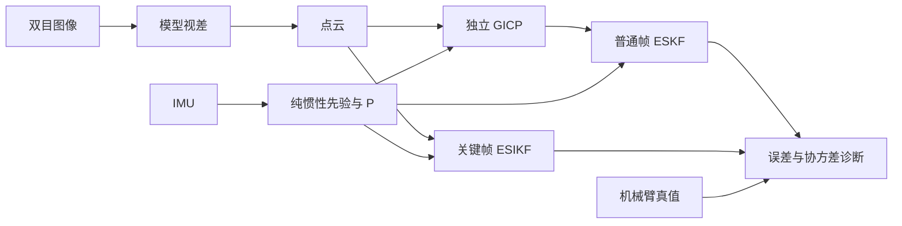

# Kalman Fusion Lab · 前端卡尔曼滤波实验

我们在调试 SIO_SLAM 前端的两条卡尔曼滤波路径：普通帧用 GICP 位姿观测做 **ESKF 松耦合**，关键帧用点云观测做 **ESIKF 紧耦合**。数据是 FR5 机械臂带 ZED X 的 6 条高速录制（平移 0.5 m/s，旋转 50 °/s），机械臂给出逐帧位姿真值。目标是弄清滤波器的先验协方差 P、视觉观测协方差 R 和卡尔曼增益 K 是否与实际误差相符，再改进融合精度。

实验过程、对照设计、全部数值和运行方法见 **[实验记录.md](实验记录.md)**。

## 实验怎么做

- **帧对**：每条录制固定 5 组帧对（开始静止、同步摆动、主运动相邻帧、主运动间隔 6 帧、结束静止），共 30 组，每组独立运行。
- **IMU 先验**：静止段初始化后纯惯性传播，冻结每帧的状态和完整 21×21 P。
- **普通帧**：独立 GICP（欧氏 GICP 与投影 Stereo-GICP，来自 robotic-front `744ac2d`）给出锚点到当前帧的位姿与 Hessian 协方差，冻结后回放 ESKF。
- **关键帧**：ESIKF 直接读点云和同一先验，逐轮点级关联与更新。
- **视差**：用户提供的 ONNX 模型经 TensorRT 推理；不运行动态滤除、RAFT 和后端。
- **评价**：以锚点估计为条件的相对位姿误差，取 30 组 RMSE；真值只在报告中使用。

## 第二轮结果（2026-10-30）

实测代码 **`1b88c05`**：115 项单测通过，6 序列、18 次运行、**1092 条记录**。本轮围绕关键帧 ESIKF 的先验协方差、观测 R、NIS 和旋转更新设计对照。完整设计、全部 16 个变体与逐帧证据见 **[第二轮审阅包](results/esikf/20261030_1b88c05/README.md)** 和 [实验记录第 7 节](实验记录.md#7-2026-10-30-第二轮-f0f5已运行)。

相同 30 组固定帧对的条件 RMSE：

| 配置 | 先验模型 | 平移 mm | 旋转 ° |
|---|---|---:|---:|
| IMU 先验基准 | 两种模型均值相同 | 25.754 | 0.059612 |
| E2 点对点基准 | 原先验 | 18.762 | 0.066037 |
| F0 相对先验 + 点到面 + F3s 冻结旋转 | 原先验 | **7.935** | **0.059612** |
| 点到面 + F3s 冻结旋转 | SDK 噪声与可观性初始 P | **8.293** | **0.059612** |
| F4 点到面，20 轮 | SDK 噪声与可观性初始 P | **5.831** | 0.060078 |
| F4 标定 R 点对点，20 轮 | SDK 噪声与可观性初始 P | 17.884 | 0.059549 |

- F0 将原先验的旋转/平移白化均值从约 168/202 降至 4.02/3.66；单独加 F0 时旋转仍退化。F3s 明确把增益旋转行置零，保持 IMU 旋转是其设计约束。
- SDK 点到面 20 轮有本轮最低平移误差，但旋转比 IMU 高约 0.78%。上述配置都来自事先定义的对照，尚未选为系统默认配置。
- P/R 一致性仍未解决：原先验 F0+F3s 后验平移白化约 31.4；SDK F0+F3s 虽然 NIS/自由度约 1.15，先验旋转白化仍约 152。不能单靠精度或 NIS 宣布协方差已校准。
- 静止标定增至 20 轮后收敛数增加，但零运动误差没有整体降低。标定仍按预设 usable 均值法，点对点 R 倍数为 111.2/83.18，点到面为 58.43/35.92，不用评估真值选倍数。
- 只有 roll_right/static_end 超过预设 50 mm 先验误差门限；完整 30 对和其余 29 对均报告，没有删除异常记录。原先验 F0+F3s 在其余 29 对上为 7.895 mm，E2 为 7.570 mm，总 RMSE 的改善并不表示每一对均改善。

F5 复算提示约 0.48° 坐标系偏转与约 1%–1.6% 尺度差异，拟合使用真值，只作诊断，没有用于本轮先验。后续需要独立数据区分 IMU 标定与真值外参误差，再处理观测相关性和偏差；[待解决问题](实验记录.md#8-待解决问题) 保留完整范围。

## 已保留的第一轮与普通帧实验

[第一轮 E0–E7](results/esikf/20261029_b9804c7/README.md) 在 `b9804c7` 上完成 111 项单测、18 次运行、1236 条记录，原包保持完整；[新增 NIS 汇总](results/esikf/20261030_1b88c05/round1_nis/summary.csv) 只是用新报告补算旧矩阵，位姿误差不变，不计作第二轮运行。

普通帧 GICP→ESKF、P/R 灵敏度和模型接入记录见 [实验记录第 1–6 节](实验记录.md)。本轮没有重跑普通帧、完整 SLAM、动态滤波、RAFT 或后端。所有结果都是固定帧对的相对误差，不能当作全序列轨迹 ATE。

## 文档与代码

| 内容 | 位置 |
|---|---|
| 实验过程、对照、全部数值、运行方法 | [实验记录.md](实验记录.md) |
| 数据、坐标系与时间 | [docs/FR5_DATASET.md](docs/FR5_DATASET.md) |
| 环境与复现 | [docs/REPRODUCING.md](docs/REPRODUCING.md)、[docs/LOCAL_SETUP.md](docs/LOCAL_SETUP.md) |
| 实验驱动与配置 | [experiments/fusion/](experiments/fusion/README.md) |
| 滤波核心 | [src/state_estimater.cpp](src/state_estimater.cpp)、[src/imu_integator.cpp](src/imu_integator.cpp)、[include/data.h](include/data.h) |
| 配准模块 | [modules/registration/](modules/registration/README.md) |
| 实验结果与来源记录 | [results/](results/README.md) |
| SIO_SLAM 完整系统介绍 | [README_SIO_SLAM.md](README_SIO_SLAM.md) |
| 第三方来源与授权 | [THIRD_PARTY_NOTICES.md](THIRD_PARTY_NOTICES.md) |
