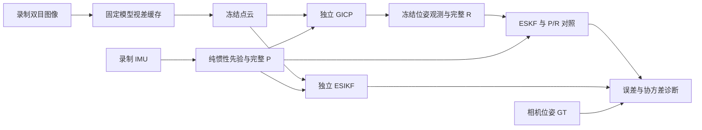
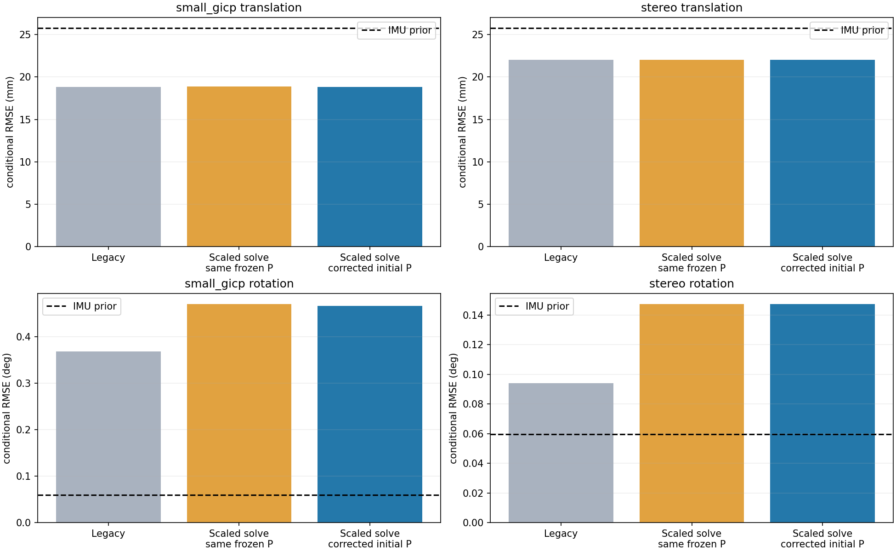

# Kalman Fusion Lab · 前端卡尔曼滤波实验

我们正在调试双目视觉与 IMU 前端的 **ESKF 普通帧融合**和 **ESIKF 关键帧紧耦合**，重点检查先验协方差 P、视觉观测协方差 R、卡尔曼增益 K 与实际误差之间的关系。

**这个仓库供外部人员理解实验、审查设计与结论，并提出代码修改建议。阅读不需要安装环境、下载原始数据或运行程序。** 实验代码和原始记录作为论述的依据保留；复跑步骤放在技术附录。

**当前结论（2026-10-29）：修复了初始 P 的状态索引与 ESKF 混合量纲阻尼两处问题；93 项单测通过，新增 960 条对照记录数值有效，但旋转精度仍有退化。滤波数值正确性已改善，噪声标定与锚点相关性仍待验证。**

## 从哪里开始

建议先读 [实验审阅说明](docs/EXPERIMENT_REVIEW_BRIEF.md)：它集中解释研究问题、数据、算法实际计算过程、对照逻辑、已有证据和待审查疑点。再按需要查看下列文档，不必先遍历全部代码和日志。

| 想了解什么 | 入口 |
|---|---|
| 完整理解本轮实验，并知道可以对哪里提建议 | **[实验审阅说明](docs/EXPERIMENT_REVIEW_BRIEF.md)** |
| 为什么做、比较什么、控制哪些变量 | [实验设计](docs/EXPERIMENT_DESIGN.md) |
| 用的什么数据、坐标系与时间如何处理 | [FR5 数据说明](docs/FR5_DATASET.md) |
| 已经做了什么、还缺什么 | [进展与待解决问题](docs/EXPERIMENT_PROGRESS.md) |
| 修复依据、实际结果与限制 | [协方差诊断](docs/FUSION_COVARIANCE_DIAGNOSIS.md) |
| 每次实验的配置、CSV、完整 P/R/K 和迭代记录 | [结果目录](results/README.md)、[实验清单](results/RUNS.csv) |
| 生产模块和实验驱动如何连接 | [Fusion Lab 使用说明](experiments/fusion/README.md) |

## 实验在做什么

录制场景中物体静止，相机随机械臂运动。普通帧先独立运行 GICP，取得位姿与 Hessian 协方差，再冻结同一观测和 IMU 先验回放 ESKF；关键帧 ESIKF 则直接读取点云和同一先验。GT 只用于结果评估。

本轮实验不启动动态点滤除、RAFT、后端优化或后验反馈。完整 SIO_SLAM 源码仍保留，供追踪模块来源；完整系统介绍见 [SIO_SLAM 项目说明](README_SIO_SLAM.md)。

## 已得到的结果

六条 FR5 + ZED X 录制：`up / forward / right / yaw_left / pitch_up / roll_right`；4186 对原图，跳过每条前 60 帧后保留 3826 对图像和 23884 个 IMU 样本。每条选定五组帧对，使用相同输入独立比较算法。

下面是 **30 组固定帧对的 ESKF R×1 条件 RMSE**，单位为 mm / °；不是完整轨迹 ATE。

| 观测来源 | 原实现 | 仅修复求解、P 冻结 | 再修复初始 P 并重传播 |
|---|---:|---:|---:|
| 欧氏 GICP → ESKF | 18.812 / 0.36887 | 18.887 / 0.47008 | 18.832 / 0.46620 |
| Stereo-GICP → ESKF | 22.016 / 0.09395 | 22.021 / 0.14733 | 22.021 / 0.14732 |

同批 IMU 先验为 **25.754 mm / 0.05961°**。修复后 GICP 观测保持一致；旧阻尼曾意外压低视觉角度增益。当前 P/R 的量级使融合接近相信视觉观测，数值检查通过并不意味着精度合格。

## 希望审阅者帮助判断什么

1. 当前观测来自锚点到当前帧的配准，滤波却使用长期绝对惯性 P；是否需要在观测模型中显式计入锚点相关性？
2. 初始 P、代码内实际使用的 IMU 噪声和 GICP 的 Hessian R，其量级与坐标约定是否合理？
3. 独立 ESIKF 的重线性化、先验约束和状态注入是否完整？

欢迎基于具体函数、公式或现有记录提出修改方案；不要求审阅者先运行实验。各疑点的已知事实与未验证部分见 [审阅问题表](docs/EXPERIMENT_REVIEW_BRIEF.md#希望外部人员审查的问题)。

## 直接查看证据

先看 [汇总误差表](results/diagnostics/20261029_105246/summary.csv)、[逐轴 P/R 与实际 K](results/diagnostics/20261029_105246/covariance_audit.csv) 和上面的对照图；需追查单个案例时，再按 [controls.json](results/controls.json) 定位逐次报告。HTML 是附加的交互视图，主要论述、表格和图均可直接在 GitHub 阅读。

## 代码与来源

- 滤波核心：[src/state_estimater.cpp](src/state_estimater.cpp)；状态与初始 P：[include/data.h](include/data.h)。
- 实验驱动：[experiments/fusion/src](experiments/fusion/src)；报告：[scripts/fusion_report.py](scripts/fusion_report.py)；P/R 对照：[scripts/fusion_audit.py](scripts/fusion_audit.py)。
- 配准采用 [Ben-cpy/robotic-front main 的固定提交 `744ac2d`](https://github.com/Ben-cpy/robotic-front/commit/744ac2d993ae629b0cc44a3b1d995e04ab4fad48)，本地滤波边界的协方差约定适配有有限差分测试；见 [模块说明](modules/registration/README.md)。
- 数据格式与采集流程：[SaxonShang/Fr5_recording 的 high-speed 分支](https://github.com/SaxonShang/Fr5_recording/tree/high-speed)。本次录制的索引、IMU、GT、标定与数据哈希在 `results/inputs/`；原始图像需另行取得。
- 用户提供的 ONNX 身份及转换验证在 `results/models/`；54 帧模型视差保存在 `results/disparity/`。ONNX 权重、设备相关 `.plan` 和编译产物由本地准备步骤生成。
- 本仓库从 SIO_SLAM 工作区导出；原始基点、代码差异、历史实现和所有归档文件的校验值见 `results/provenance/` 和 `results/SHA256SUMS`。来源与已有授权文件见 [THIRD_PARTY_NOTICES.md](THIRD_PARTY_NOTICES.md)。

## 技术附录

需要自行检查环境、重建报告或运行程序时，再参考 [复现步骤](docs/REPRODUCING.md) 和 [Fusion Lab 操作说明](experiments/fusion/README.md)。这些步骤不是理解和审阅实验的前提。
