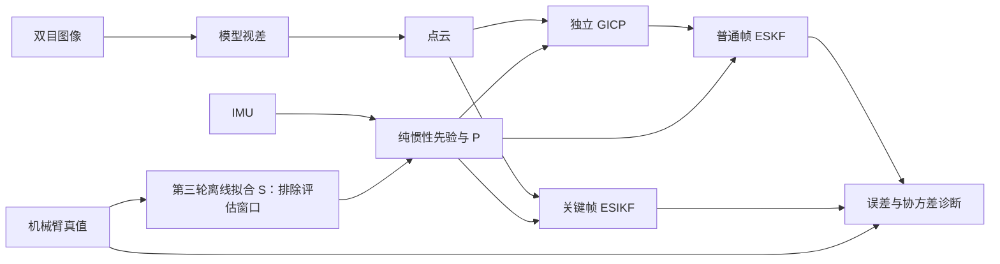

# Kalman Fusion Lab · 前端卡尔曼滤波实验

我们在调试 SIO_SLAM 前端的两条卡尔曼滤波路径：普通帧用 GICP 位姿观测做 **ESKF 松耦合**，关键帧用点云观测做 **ESIKF 紧耦合**。数据是 FR5 机械臂带 ZED X 的 6 条高速录制（平移 0.5 m/s，旋转 50 °/s），机械臂给出逐帧位姿真值。目标是弄清滤波器的先验协方差 P、视觉观测协方差 R 和卡尔曼增益 K 是否与实际误差相符，再改进融合精度。

本页介绍实验、目前最好的结果、决定算法方向的关键实验，以及相对 SIO_SLAM 原代码确定有效的改进；实验过程、对照设计、全部数值和运行方法见 **[实验记录.md](实验记录.md)**。

## 实验怎么做

- **帧对**：每条录制固定 5 组帧对（开始静止、同步摆动、主运动相邻帧、主运动间隔 6 帧、结束静止），共 30 组，每组独立运行。
- **IMU 先验**：静止段初始化后纯惯性传播，冻结每帧的状态和完整 21×21 P。
- **普通帧**：独立 GICP（欧氏 GICP 与投影 Stereo-GICP，来自 robotic-front `744ac2d`）给出锚点到当前帧的位姿与 Hessian 协方差，冻结后回放 ESKF。
- **关键帧**：ESIKF 直接读点云和同一先验，逐轮点级关联与更新。
- **视差**：用户提供的 ONNX 模型经 TensorRT 推理；不运行动态滤除、RAFT 和后端。
- **评价**：以锚点估计为条件的相对位姿误差，取 30 组 RMSE；真值用于报告。第三轮另外用避开评估窗口的真值离线拟合固定 S，运行时滤波只使用该固定矩阵。

## 目前最好的结果（2026-10-30，第二、三轮）

30 组固定帧对的条件 RMSE：

| 路径 | 配置 | 平移 (mm) | 旋转 (°) |
|---|---|---:|---:|
| IMU 先验（基准） | 纯惯性传播，SDK 噪声 | 25.75 | 0.0596 |
| IMU 先验 + G1 | 积分前校正陀螺刻度 S | 20.35 | **0.0394** |
| 关键帧 ESIKF，原实现 | SIO_SLAM 原代码 | 22.75 | 0.376 |
| 关键帧 ESIKF，平移最好 | SDK IMU 噪声与可观性初始 P + 锚点条件先验（E2）+ 点到面残差 | **6.54** | 0.0601 |
| 同上，迭代上限 20 | | **5.83** | 0.0601 |
| 关键帧 ESIKF，旋转最好 | 同上（8 轮）+ G1 | 7.35 | **0.0392** |
| 同上，观测只用于平移、旋转不更新（F3s），不加 G1 | | 8.29 | 0.0596 |
| 普通帧：欧氏 GICP → ESKF | 默认 P、R | 18.83 | 0.466 |
| 普通帧：Stereo-GICP → ESKF | 默认 P、R | 22.02 | 0.147 |
| 普通帧：欧氏 GICP → ESKF（诊断） | P×1e-4、R×100000 | 15.14 | 0.0595 |

- **没有一个配置在两项上都最好。** G1 让旋转下降 34%，几乎全部来自先验本身：ESIKF 在校正后的先验上只再降 0.4%。同时平移从 5.83 升到 7.30 mm（同为 20 轮）。
- **本实验的平移数值主要衡量从锚点速度漂移中恢复。** 帧对实验不回写后验，纯惯性从初始化递推 0.6–18 s 才到锚点，先验平移均方误差的 99.75% 来自锚点速度误差。锚点速度取真值时，先验平移只有 1.28 mm（G1 为 1.37 mm）。同一先验下的变体比较仍然有效；跨 IMU 模型的平移比较，以及连续滤波中的平移精度，需要在受控锚点速度下重新评价。
- **关键帧的平移收益集中在先验差的帧对。** 结束静止段 51.6 → 10.3 mm，主运动间隔 6 帧 25.2 → 9.5 mm；先验本来就好的短帧对略差（开始静止 0.09 → 0.35 mm）。去掉唯一的离群帧对（roll_right 结束段，先验差 120 mm）后，29 对平移为 5.86 mm（IMU 13.74 mm），中位数 1.80 mm（IMU 3.32 mm）。
- 最后一行是灵敏度诊断中事先固定的档位里最好的一档，事后挑出，不是可用的默认配置。
- 这些是固定帧对的条件误差，不是完整轨迹 ATE。

## 关键实验与决策

只列对之后算法方向给出明确结论的实验。数值为 30 组帧对的条件 RMSE（平移 mm / 旋转 °）。

### 普通帧 ESKF：问题在 P、R 的量级，不在求解器（[第 4 节](实验记录.md#4-2026-10-29-初始-p-与-eskf-求解修复)）

- **现象**：修正初始 P 的索引错位和 ESKF 的混合量纲阻尼后，K 与独立求解一致（相对差 < 2.1e-11），欧氏 GICP → ESKF 的旋转却从 0.369° 变为 0.466°。
- **原因**：旧阻尼意外压低了视觉旋转增益（例：旧 K 旋转对角约 0.18 / 0.07 / 0.008，修正后约 1）。正确求解后滤波器几乎完全相信 GICP，而 GICP 的旋转比 IMU 差。
- **依据**：事先固定 P×1e-4、扫描 R 倍数，欧氏 GICP 在 R×1000–100000 时平移 15.1–17.1 mm、旋转约 0.059°，两项同时不劣于 IMU（档位事后挑出，只作诊断）。
- **决策**：精度取决于 P、R 的量级是否与实际误差相符，而不是求解方法；此后集中在关键帧 ESIKF 上查清 P 和 R 的来源。

### 关键帧 ESIKF 旋转退化的根因（[第 5 节](实验记录.md#5-2026-10-29-关键帧-esikf-现状分析)）

- **现象**：原实现旋转 0.376°，是 IMU 的 6 倍；30 组中旋转只改善 3 组。
- **数据**：先验 P 的旋转 σ 中位数 5.93°，虚拟观测 R 只有 0.0118°，方差比约 2.5×10⁵，K 的旋转对角 0.996–1.000。实际误差恰好相反：IMU 相对旋转误差中位数 0.011°，观测 0.126°。
- **判断**：P 是从初始化累积的绝对不确定度，而观测是相对锚点的，两帧共同的误差相减后抵消，P 被严重高估；R 把上万个相关的点当作独立观测相加，被严重低估。迭代缺少先验项只是次要原因。
- **决策**：设计 E0–E7，把相对锚点的先验协方差（E2）、R 标定（E3）、迭代保留先验（E1）等做成开关，在同一输入上并排比较。

### 第一轮 E0–E7 的取舍（[第 6 节](实验记录.md#6-2026-10-29-关键帧-esikf-改进-e0e7已运行)）

| 改动 | 关键数据 | 决策 |
|---|---|---|
| E2 锚点条件先验 | 旋转 0.376 → 0.066（新先验模型 0.365 → 0.060）；5 类案例的旋转都降到 IMU 同一量级 | 根因确认，采用 |
| E1 迭代保留先验 | 单独使用 0.376 → 0.393，无改善 | 保留为必要的数学修正，不作为提高精度的手段 |
| E4 陀螺刻度 1.5% | 总体旋转 0.066 → 0.147，主运动 0.039 → 0.089 | 放弃“放大 P”：陀螺积分对真值显示约 1–1.6% 的确定刻度偏差和约 0.48° 的坐标系旋转，应当标定而不是当噪声 |
| E6 光度项 | 降低几何权重的效果与等比例放大 R 完全相同；光度的标定倍数恰为点对点的一半，结果 4 位有效数字相同 | 当前“5 cm 点云颜色梯度”的形式几乎没有信息，不再在这一形式上调参 |
| E7 ray 残差 | R 的旋转 σ 3.28°（点对点 0.012°）；静止段纯观测 66/66 次发散 | 沿视线的残差在结构上看不到旋转，不单独使用 |
| E7 点到面 | 新先验模型下平移 22.69 → 6.75 mm，但旋转 0.137° | 稠密几何适合提供平移；旋转变差是否来自 E4，交给第二轮分开 |

### 第二轮：去掉 E4 后的取舍（[第 7 节](实验记录.md#7-2026-10-30-第二轮-f0f5已运行)）

| 改动或发现 | 关键数据 | 决策 |
|---|---|---|
| 去掉 E4 | SDK 先验点到面 6.75 / 0.137 → 6.54 / 0.0601；5 类案例平移都好于 E2 点对点，旋转相差不到 1% | 当前最好组合：SDK 先验 + E2 + 点到面 |
| 平移收益的分布 | 先验差的帧对大幅改善，先验好的短帧对略差；静止标定的全局 R 倍数会把两类帧对的收益一起放弃（标定后长帧对只降到 21.2 mm） | 下一步让 R 随帧变化（分格刀切法） |
| 以估计锚点为参照的先验（F0） | 原先验下先验白化从 168 / 202 降到 4.0 / 3.7；SDK 下旋转白化仍为 152 | 定义上正确；G1 后 F0 旋转白化仍约 75.8，S 只解释部分不一致，来源仍需区分 |
| 观测只用于平移（F3、F3s） | F3 与 F3s 平移几乎相同（8.36 vs 8.29 mm），旋转经先验相关的耦合很弱 | F3s 作为“旋转完全来自 IMU”的稳妥选项保留 |
| 迭代上限 20 与静止重新标定 | 收敛 21 → 52 / 66，但零运动误差 7.3 mm / 0.18° → 8.6 mm / 0.25°；新收敛的帧对仍有 6.9 mm / 0.12° | 收敛不等于准确，稠密观测零运动时就有约 0.12° 的旋转误差（静止 IMU 0.006°）：旋转不再在稠密观测上调参，改走陀螺校正和稀疏特征 |
### 第三轮：陀螺刻度校正与平移变差的来源（[第 8 节](实验记录.md#8-2026-10-30-第三轮-g1-陀螺刻度校正与末轮-nis已运行)）

| 改动或发现 | 关键数据 | 决策 |
|---|---|---|
| G1 陀螺刻度校正 | 相对真值，陀螺积分有 0.3–1.5% 的刻度误差。校正后先验旋转 0.0596 → 0.0394（−34%），main_motion_long 0.126 → 0.082；评估帧对附近的留出窗口 200 ms 误差 0.0489 → 0.0371。ESIKF 各变体最多只比校正后的先验低 1.5%（ray），点到面低 0.4% | 旋转精度由 IMU 模型决定，而不是视觉更新。S 保留为候选，暂不作默认：它由同一批录制拟合，对平移的影响待 H1 判定 |
| 平移变差的来源 | Python 逐对复现两轮先验（30 对差 < 0.0001 mm）：先验平移均方误差的 99.75% 来自锚点速度误差，初始化后 8 s、18 s 的锚点速度误差中位数为 113、479 mm/s。锚点速度取真值后，原陀螺 / G1 / 真值姿态分别为 1.28 / 1.37 / 1.21 mm | G1 的平移退化是累积速度漂移的变化，不能据此否定 G1。帧对实验的平移主要衡量从速度漂移中恢复，下一步先建立受控锚点速度的评价情形（H1） |
| 末轮 NIS | 点到面首轮 10.83、末轮 10.73；E2 点对点 12.88 → 10.45；只有标定点对点（0.255 → 0.596）和 F3 点对点（6.05 → 28.9）增大。第二轮“首轮 NIS 偏小约一个数量级”的推断不成立 | 两种 NIS 都表明点到面的 P+R 比实际误差小约一个数量级。首末轮都保留，只作诊断；R 的估计转向分格刀切法 |

## 与 SIO_SLAM 原代码相比确定有效的改进

只列在同一输入上相对原实现确定改善的改动。对照的 `legacy_*` 变体与原实现逐矩阵一致（最大差 1.18e-14）。

| 改进 | 原代码 | 效果（30 组帧对） |
|---|---|---|
| **以锚点位姿为条件的先验协方差**（E2）：`P = Φ(P_a − P_a[:,0:6] P_aa⁻¹ P_a[0:6,:])Φᵀ + Q` | 先验 P 是从初始化起累积的绝对不确定度 | 原先验：22.75 / 0.376 → **18.76 / 0.066**；新先验模型：22.69 / 0.365 → **17.80 / 0.0600**。两种先验下平移、旋转都改善；5 类案例的旋转全部改善，平移除新先验模型下 main_motion_long（12.80 → 12.89 mm）外全部改善 |
| **当前最好组合**：SDK IMU 噪声与可观性初始 P + E2 + 点到面残差（不加陀螺刻度项） | IMU 噪声写死、初始 P 各向同性、绝对先验 P、三维点对点残差 | 22.75 / 0.376 → **6.54 / 0.0601**；5 类案例的平移、旋转全部改善（例：结束静止段 47.8 → 10.3 mm、0.652° → 0.0040°） |

第二行按组合列出，因为各组成部分单独看并非处处更好：点到面在原先验下开始与结束静止段的平移略差，SDK 先验与 F0 合用时平移变差。改动只在本实验仓库，SIO_SLAM 仓库本身未改。对比都在同一纯惯性先验上进行，改善成立；但平移数值大部分是从锚点速度漂移中恢复（见第三轮），在逐帧连续滤波或完整 SLAM 中的幅度尚未验证。G1 不在此列，因为它的平移影响尚未判定。其余改动（正确性修正、尚不稳定或有副作用的改进）的对照见实验记录第 6、7 节。

## 下一步

候选 **H1 受控锚点速度**（待审核）：锚点速度取真值加固定种子的噪声 σ_v（0 / 10 / 30 mm/s），代表连续滤波中速度已被约束的情形。用它判定 G1 对平移的作用，并检验先验好时稠密观测在现有 R 下是改善还是拉坏平移。真值进入先验生成，只作诊断。之后依次是特征匹配预实验、在 H1 情形下评价的分格刀切法 R、视预实验结果再做图块对应 E8a，见 [实验记录第 9 节](实验记录.md#9-待解决问题)。

## 文档与代码

| 内容 | 位置 |
|---|---|
| 实验过程、对照、全部数值、运行方法 | [实验记录.md](实验记录.md) |
| 第一至三轮审阅包（全部变体、逐帧指标、P/R/K、日志） | [results/esikf/20261029_b9804c7/](results/esikf/20261029_b9804c7/README.md)、[results/esikf/20261030_1b88c05/](results/esikf/20261030_1b88c05/README.md)、[results/esikf/20261030_8f23550/](results/esikf/20261030_8f23550/README.md) |
| 数据、坐标系与时间 | [docs/FR5_DATASET.md](docs/FR5_DATASET.md) |
| 环境与复现 | [docs/REPRODUCING.md](docs/REPRODUCING.md)、[docs/LOCAL_SETUP.md](docs/LOCAL_SETUP.md) |
| 实验驱动与配置 | [experiments/fusion/](experiments/fusion/README.md) |
| 滤波核心 | [src/state_estimater.cpp](src/state_estimater.cpp)、[src/imu_integator.cpp](src/imu_integator.cpp)、[include/data.h](include/data.h) |
| 配准模块 | [modules/registration/](modules/registration/README.md) |
| 实验结果与来源记录 | [results/](results/README.md) |
| SIO_SLAM 完整系统介绍 | [README_SIO_SLAM.md](README_SIO_SLAM.md) |
| 第三方来源与授权 | [THIRD_PARTY_NOTICES.md](THIRD_PARTY_NOTICES.md) |
