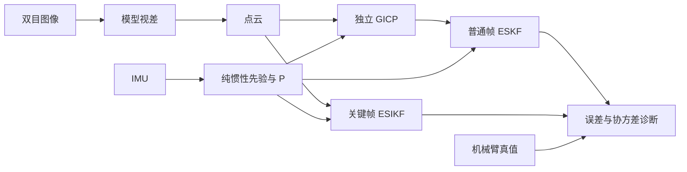

# Kalman Fusion Lab · 前端卡尔曼滤波实验

我们在调试 SIO_SLAM 前端的两条卡尔曼滤波路径：普通帧用 GICP 位姿观测做 **ESKF 松耦合**，关键帧用点云观测做 **ESIKF 紧耦合**。数据是 FR5 机械臂带 ZED X 的 6 条高速录制（平移 0.5 m/s，旋转 50 °/s），机械臂给出逐帧位姿真值。目标是弄清滤波器的先验协方差 P、视觉观测协方差 R 和卡尔曼增益 K 是否与实际误差相符，再改进融合精度。

实验过程、对照设计、全部数值和运行方法见 **[实验记录.md](实验记录.md)**。

## 实验怎么做

- **帧对**：每条录制固定 5 组帧对（开始静止、同步摆动、主运动相邻帧、主运动间隔 6 帧、结束静止），共 30 组，每组独立运行。
- **IMU 先验**：静止段初始化后纯惯性传播，冻结每帧的状态和完整 21×21 P。
- **普通帧**：独立 GICP（欧氏 GICP 与投影 Stereo-GICP，来自 robotic-front `744ac2d`）给出锚点到当前帧的位姿与 Hessian 协方差，冻结后回放 ESKF。
- **关键帧**：ESIKF 直接读点云和同一先验，逐轮点级关联与更新。
- **视差**：用户提供的 ONNX 模型经 TensorRT 推理；不运行动态滤除、RAFT 和后端。
- **评价**：以锚点估计为条件的相对位姿误差，取 30 组 RMSE；真值只在报告中使用。

## 目前最好的结果（2026-10-29）

30 组固定帧对的条件 RMSE：

| 路径 | 配置 | 平移 (mm) | 旋转 (°) |
|---|---|---:|---:|
| IMU 先验（基准） | 纯惯性传播 | 25.75 | 0.0596 |
| 普通帧：欧氏 GICP → ESKF | 默认 P、R | 18.83 | 0.466 |
| 普通帧：Stereo-GICP → ESKF | 默认 P、R | 22.02 | 0.147 |
| 关键帧：ESIKF | 默认，几何权重 0.5 | 22.73 | 0.375 |
| 普通帧：欧氏 GICP → ESKF（诊断） | P×1e-4、R×100000 | **15.14** | **0.0595** |

- 默认配置下，视觉融合降低了平移误差，但旋转比 IMU 先验差 2.5–8 倍。原因是滤波器用的绝对先验 P（旋转约 6°）远大于视觉 R（约 0.005–0.08°），几乎完全相信视觉，而视觉的实际旋转误差比 IMU 大。
- 最后一行是灵敏度诊断中事先固定的 6 个 R 档位之一，为其中最好的一档：说明 P、R 量级合理后平移和旋转能同时不劣于 IMU 先验，但它是事后挑出的，不是可用的默认配置。
- roll_right 结束静止段一组（纯惯性积分约 20 s，先验差 120 mm）占先验平移 RMSE 平方和的约 72%；去掉这一组，先验为 13.74 mm。
- 这些是固定帧对的条件误差，不是完整轨迹 ATE。

## 下一步

关键帧 ESIKF 的 E0–E7 改进已写好，待 Linux 端运行：迭代保留先验、以锚点位姿为条件的先验协方差、用静止帧对标定观测协方差、陀螺刻度误差、初始化修正、光度一致性、一维几何残差。改动内容与 6 条运行命令见 [实验记录.md 第 6 节](实验记录.md#6-2026-10-29-关键帧-esikf-改进-e0e7待运行)。

## 文档与代码

| 内容 | 位置 |
|---|---|
| 实验过程、对照、全部数值、运行方法 | [实验记录.md](实验记录.md) |
| 数据、坐标系与时间 | [docs/FR5_DATASET.md](docs/FR5_DATASET.md) |
| 环境与复现 | [docs/REPRODUCING.md](docs/REPRODUCING.md)、[docs/LOCAL_SETUP.md](docs/LOCAL_SETUP.md) |
| 实验驱动与配置 | [experiments/fusion/](experiments/fusion/README.md) |
| 滤波核心 | [src/state_estimater.cpp](src/state_estimater.cpp)、[src/imu_integator.cpp](src/imu_integator.cpp)、[include/data.h](include/data.h) |
| 配准模块 | [modules/registration/](modules/registration/README.md) |
| 实验结果与来源记录 | [results/](results/README.md) |
| SIO_SLAM 完整系统介绍 | [README_SIO_SLAM.md](README_SIO_SLAM.md) |
| 第三方来源与授权 | [THIRD_PARTY_NOTICES.md](THIRD_PARTY_NOTICES.md) |
