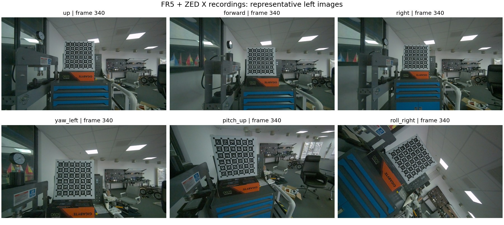

# 实验审阅说明：我们怎样调试前端卡尔曼滤波

本文供外部审阅者完整理解当前实验，并对数学模型、实验设计或具体代码提出修改建议。只阅读本文、链接的源码和结果即可参与讨论，无需配置环境或重跑实验。内容截至 **2026-10-29**。

## 研究目标与当前结论

普通帧通过 GICP 位姿观测与 IMU 先验进行 ESKF 松耦合；关键帧直接以点云几何/光度观测进行 ESIKF 紧耦合。我们希望先弄清滤波实际怎样使用不确定性，再判断视觉更新有没有改善位姿。

本阶段的核心问题是：**为什么加入视觉观测后，平移误差减少，但旋转误差反而增大？是配准观测本身、P/R 建模、数值求解，还是迭代更新的问题？**

已经确认并修复两处实现问题：初始 P 的状态索引错位，以及 ESKF 在旋转与平移混合量纲下使用统一阻尼。修复后增益与独立求解一致，但旋转误差仍然退化。当前结论止于此，尚未证明噪声标定、观测独立性或 ESIKF 迭代理论正确。

## 用的是什么数据

相机固定在 **FR5 机械臂法兰**上，录制 **ZED X 双目图像与机身 IMU**。数据说明给出的条件为：1920×1080 校正彩色图像、30 fps、约 200 Hz IMU；静态室内实验室中含固定 Aprilgrid 标定板。相机随机械臂运动，场景静态不等于相机静止。

六条高速录制包含三轴平移与三轴旋转：平移指令速度 0.5 m/s，旋转指令速度 50°/s。每条都有起始静止、同步摆动、主运动和结束静止段，整条约 23–25 s；实际运动量与标称单轴运动有小偏差，采用提供的逐帧真值，不假设其余轴严格为零。

| 录制 | 运动 | 原始图像对 | 处理后图像对 | 保留 IMU |
|---|---|---:|---:|---:|
| 20261015_112553_up | 上移 | 697 | 637 | 3980 |
| 20261015_112659_forward | 前移 | 683 | 623 | 3884 |
| 20261015_112757_right | 右移 | 697 | 637 | 3983 |
| 20261015_112845_yaw_left | 偏航 | 680 | 620 | 3884 |
| 20261015_112940_pitch_up | 俯仰 | 687 | 627 | 3900 |
| 20261015_113028_roll_right | 滚转 | 742 | 682 | 4253 |
| 合计 | | 4186 | 3826 | 23884 |



图中各取原始帧号 340 的左目图像，只做展示缩放。背景与相机视角可直接观察；静态场景按录制实验设定处理，本轮没有运行动态点滤除。

数据接入有四项影响解释结果的约定：

1. 每条跳过前 60 帧曝光/白平衡过渡段。图像原始帧号保留，因此本文的 340 始终指录制帧号，不是删帧后的编号。
2. 图像内容相对 IMU 原时间轴晚约 4.2–4.9 ms。保持图像与 GT 标签不变，将 IMU 时间按各条 `lag_ms` 平移一次；不再叠加另一份补偿。
3. 图像从 1920×1080 缩放到 1280×720，中心裁为 1280×640，再到模型输入 896×448。内参相应变换，双目基线 0.120094 m；`T_imu_cam` 表示相机到 IMU 的变换。
4. GT 是左目在 FR5 基座系的逐帧位姿，由法兰位姿与手眼外参生成，并包含录制流程已有的时间、行程/转角和端点修正。它不是 SDK 自带姿态；本阶段没有另行量化其剩余误差。

详细时间、单位、外参方向和采集警告见 [FR5_DATASET.md](FR5_DATASET.md)，原录制使用说明归档在 `results/recording/`，每条的转换元数据在 `results/inputs/`。

已有采集限制包括 `forward` 时钟拟合残差超过 1 ms、`pitch_up` 前后互相关时间差约 3.7 ms，以及待评估的 IMU 轴不正交、陀螺仪尺度与残余视差偏置。接入程序保留这些警告，没有用经验系数把它们消除。

## 实验实际怎样运行

首先用静止段至少 200 个 IMU 样本初始化，再连续纯惯性传播，保存选定帧的状态和完整 P。图像通过同一套预处理与模型视差生成点云。默认深度范围 0.5–15 m、像素采样步长 2。

视差来自用户提供的 `disp.onnx`，输入 RGB、FP32、896×448、0..255，模型图内完成归一化；输出是像素视差。本轮采用原始模型输出，未加完整前端的局部邻域视差后处理。54 帧视差已冻结；旧阶段的 SGBM 结果单独保存，不与模型结果混合。

每条固定五组帧对，六条合计 **30 组**：

| 案例 | 原始帧号 | 观察什么 |
|---|---|---|
| static_start | 110 → 111 | 开始静止段的观测与更新 |
| sync_motion | 185 → 186 | 同步摆动段 |
| main_motion | 340 → 341 | 主运动相邻帧 |
| main_motion_long | 340 → 346 | 同一锚点下的较长间隔 |
| static_end | 640 → 641 | 结束静止段及长期惯性 P |

同一案例分别进行 GICP、ESKF 和 ESIKF 实验。ESKF 从独立 GICP 的观测开始；ESIKF 从点云和原 IMU 先验开始，不读取 GICP 位姿、GICP R 或 ESKF 后验。各组后验不传入下一案例，也不用于重建后续 IMU 先验。

因此，普通帧/关键帧在这里代表被测试的两条算法路径。帧对由配置固定，本轮没有验证完整前端的自动关键帧调度、连续视觉反馈或后端，也不使用 RAFT。

## 代码实际计算什么

### IMU 先验与 P

状态误差顺序为 `[δθ, δp, δv, δbg, δba, δg, exposure, reserved]`，维度为 `3+3+3+3+3+3+1+2=21`。姿态误差在当前机体系，位置误差为世界系加法误差。本轮关注前 18 维的运动状态。

当前初始姿态和位置对角方差均为 0.01，v、bg、ba、g 的各轴为 1e-5；这只是现有初始化取值，并非本次实测标定结果。积分器实际使用的噪声常数为 `sigma_g=1e-4, sigma_a=1e-3, sigma_bg=1e-5, sigma_ba=1e-4`，由其平方构造连续 Q。参数 YAML 中填入的 SDK 噪声尚未接入这段传播代码。

P 来自从初始化开始的长期绝对惯性传播，没有逐帧视觉校正；不能把它直接当作短帧间相对运动的不确定性。源码见 [ImuPreintegrationCov](../src/imu_integator.cpp) 与 [状态构造函数](../include/data.h)。

### GICP 如何成为 ESKF 观测

独立运行欧氏 GICP 与投影 Stereo-GICP，版本固定为 `robotic-front main/744ac2d`。相对配准以 IMU 预测作为初值，锚点状态记为 `X_a`，配准结果为 `T_a_current`，输入 ESKF 的世界位姿为 `X_a T_a_current`。

观测 R 来自求解器 Hessian 协方差，并按实际左右扰动约定转换到 `[δθ_body, δp_world]`。变换保留旋转—平移交叉项；具体雅可比和上游适配见 [配准模块说明](../modules/registration/README.md)。Hessian R 尚未通过真实误差统计标定，不能仅凭正定认定可靠。

默认要求至少 20 个对应点、有限位姿、正定 R，且协方差确实来自 Hessian。`require_convergence=false`，收敛状态另行记录。30 组 Stereo 均达到 20 轮上限；上游同时返回 `converged=true`，我们保留两者，因此需要结合 `solver_status=max_iter` 解读。

报告中的 `valid` 表示输入/更新数值有效，不代表配准或融合精度达标。欧氏 GICP 未提供独立点距 RMSE，记录中的 NaN 表示未提供；默认 Stereo 路径未计算的归一化 Hessian 谱记为 -1。解读这些字段时不要把缺测标记当作测得的数值。

### ESKF 单次更新

令 `H` 选择状态前六维，实际创新为：

```text
z = [So3LogApprox(R_pred^T R_gicp), p_gicp - p_pred]
S = H P^- H^T + R
K = P^- H^T S^-1
δx = K z
R_post = R_pred Exp(δθ)       p_post = p_pred + δp
P_post = (I-KH) P^- (I-KH)^T + K R K^T
```

其余速度、偏置和重力通过完整交叉协方差参与更新。公式写出逆矩阵便于阅读，当前实现用对角白化后的 LDLT 线性求解计算 K；正常正定时不加阻尼，仅在浮点退化时加入无量纲相对 jitter。

同一观测下比较 `0.1R / R / 10R`，以及固定对角 R（旋转标准差 0.5°、位置标准差 0.02 m）。另做固定 `P×1e-4`、R 倍数扩展到 1000 和 100000 的敏感性诊断。这些值事先指定，不按 GT 自动选择最优参数。

### 独立 ESIKF 更新

每轮按当前状态重新关联点，累积几何/光度的六维信息矩阵 `H_obs` 和梯度 `b_obs`。这里的 `H_obs` 是信息矩阵，区别于上面的状态选择矩阵 H。现有代码由正则化信息矩阵求得虚拟观测 `R_obs` 和残差 `r_v`，用固定输入先验 P 计算 K，再以 `δx=K r_v` 注入当前迭代状态；最多 8 轮，最后用一次 Joseph 形式更新 P。

比较几何权重 1.0 与 0.5 两组。现有实现是否完整表达了迭代滤波的先验回拉、重线性化和状态注入，需要继续审查；上述是代码行为描述，不代表已经完成理论正确性证明。本轮白化求解修复只针对 ESKF，ESIKF 保留自身的信息矩阵阻尼与求解流程。

## 对照为何这样设计

最初观察到旋转误差退化后，发现两处实现问题。初始 P 的旧索引使部分速度轴与 bgx 继承较大方差；ESKF 旧统一阻尼 `1e-6×max(1,trace(S)/6)` 混合了 rad² 与 m²，位置方差大时会意外压低角度增益。

为分清数值求解和先验变化的影响，保留原模型、数据、帧对与配准参数：

| 组别 | 改了什么 | 控制了什么 | 记录数 |
|---|---|---|---:|
| reference | 修复前模型实验记录 | 原样保存的历史基线 | 360 |
| solver_only | 仅 ESKF 求解 | 同一观测、均值、完整旧 P | 240 |
| repropagated | 再修正初始 P 并重新传播 | 同一输入，已核对配准结果保持一致 | 360 |
| sensitivity | 指定 P/R 缩放 | 同一新观测与均值 | 360 |

新增三组共 960 条记录。每个案例有两种配准或多个权重变体，因此记录数不等于独立样本数；30 组帧对中还包含共用锚点的案例。93 项测试证明了所覆盖的实现性质，不代表完成所有滤波模型的正确性验证。

## 结果说明什么

下表取模型视差、修正初始 P 后的 30 组案例；ESKF 为 `R_x1`。数值来自 [汇总 CSV](../results/diagnostics/20261029_105246/summary.csv)，同组先验只计一次：

| 路径 | 条件平移 RMSE / mm | 条件旋转 RMSE / ° |
|---|---:|---:|
| IMU 先验 | 25.754 | 0.05961 |
| 独立欧氏 GICP | 18.895 | 0.47570 |
| 欧氏 GICP → ESKF | 18.832 | 0.46620 |
| 独立 Stereo-GICP | 22.021 | 0.14733 |
| Stereo-GICP → ESKF | 22.021 | 0.14732 |
| ESIKF，几何权重 1.0 | 22.751 | 0.37600 |
| ESIKF，几何权重 0.5 | 22.731 | 0.37502 |

修复前后比较见 [协方差诊断](FUSION_COVARIANCE_DIAGNOSIS.md)。GICP 位姿在重传播对照中的最大变化为 0；新 K 与独立 NumPy 解的最大相对差低于 `2.1e-11`。这些支持数值修复的有效性，同时显示旋转精度问题仍在。

例如 `up/static_end/small_gicp`，冻结旧 P 和 R 时，旧旋转增益对角线约 `[0.1791,0.0694,0.0081]`，修复后约 `[0.99999,0.99999,0.99984]`。旧阻尼曾意外减少视觉角度更新；正确求解后，过大的 P 相对很小的 R 使输出更接近视觉观测。这个量级关系由实际矩阵支持，但 **P 与 R 各自应该取多少、锚点相关性应如何进入模型，尚未得到验证结论**。

误差评价需要注意：GT 是相机位姿，先计算 GT 相对运动，再以相机—IMU 外参转换，使用共同的估计锚点与先验/结果比较。若 `G_a,G_b` 为两帧相机 GT，`B=T_imu_cam`，报告中的条件参考为 `X_a B G_a^-1 G_b B^-1`。

因此这是锚点条件下的固定帧对误差，不是完整轨迹 ATE。它没有把锚点不确定性和相关性全部纳入误差统计；长期绝对 P 与这一评价也不是同一个随机量。小 NIS、正定 R、数值有效或单一误差改善均不足以证明整个滤波器已校准。

## 希望外部人员审查的问题

| 疑点 | 已知事实 | 希望得到的判断与修改建议 |
|---|---|---|
| P 与相对配准观测的关系 | 世界观测由估计锚点构成，使用长期绝对 P；未建模锚点相关性 | 创新及其协方差该怎样推导，是否需要相对状态或联合协方差？ |
| IMU 初始化与过程噪声 | P 索引已修复；实际 Q 为代码常数，未读取 YAML 噪声 | 先验传播中哪些假设或接口应修改，怎样区分实现问题与参数问题？ |
| GICP 的 R | 采用 Hessian 协方差，保留扰动约定转换与交叉项；Stereo 全部达到迭代上限 | 信息矩阵、量纲、退化处理及相关误差是否合理，哪些部分需要修正？ |
| ESIKF 迭代 | 固定先验 P，重建点级观测并反复注入 K r_v | 先验回拉、误差坐标、注入及后验更新是否完整？ |
| 实验指标的解释 | 30 组固定帧对且存在相关性，GT 已经包含录制流程修正 | 现有证据能否支持当前结论，是否存在评价偏差或遗漏对照？ |

这里列的是待审查问题，不把尚未验证的假设写成已确认 bug。提出方案时，说明相关函数、认为应成立的公式或假设、现有证据以及预期影响即可；不要求提交代码或运行结果。

## 怎样从论述定位到代码与证据

| 内容 | 代码入口 | 对应证据 |
|---|---|---|
| 帧对、先验与冻结输入 | [lab_prepare.cpp](../experiments/fusion/src/lab_prepare.cpp) 的 Prepare；[配置](../experiments/fusion/configs/baseline.yaml) | 每次 resolved.yaml、输入/源码哈希 |
| 初始化和 P/Q 传播 | [imu_integator.cpp](../src/imu_integator.cpp) 的 ImuInit / ImuPreintegrationCov；[data.h](../include/data.h) | covariance_audit.csv 中 P 的逐轴标准差 |
| 独立配准与世界位姿构造 | [lab_run.cpp](../experiments/fusion/src/lab_run.cpp) 的 RunGicp；[registration](../modules/registration/README.md) | observations.yml.gz、gicp_iterations.csv |
| R 的坐标变换 | [utils.h](../include/utils.h) 的 AlignGicpCovarianceToEskfPose / AlignStereoGicpCovarianceToEskfPose | 原始协方差、对齐后的完整 R、有限差分单测 |
| ESKF 实际更新 | [state_estimater.cpp](../src/state_estimater.cpp) 的 ESKF；RunEskf | eskf.yml.gz 中创新、S、K、修正与完整 P |
| ESIKF 点级迭代 | [state_estimater.cpp](../src/state_estimater.cpp) 的 ESIKF / ColorPointObserver；RunEsikf | esikf_iterations.csv 中逐轮信息矩阵、R、K、残差 |
| GT 与 RMSE | [fusion_report.py](../scripts/fusion_report.py) 的 collect / summarize | metrics.csv、summary.csv、GT 元数据 |
| 固定变量对照 | [fusion_audit.py](../scripts/fusion_audit.py) | controls.json、对照清单与归一化 K 核对 |

主要静态证据可在 GitHub 直接阅读：[误差汇总](../results/diagnostics/20261029_105246/summary.csv)、[P/R/K 对照](../results/diagnostics/20261029_105246/covariance_audit.csv)、[进展与限制](EXPERIMENT_PROGRESS.md)。完整矩阵和历史源码仅在需要核实细节时查看；环境与运行命令收在 [技术附录](REPRODUCING.md)。
