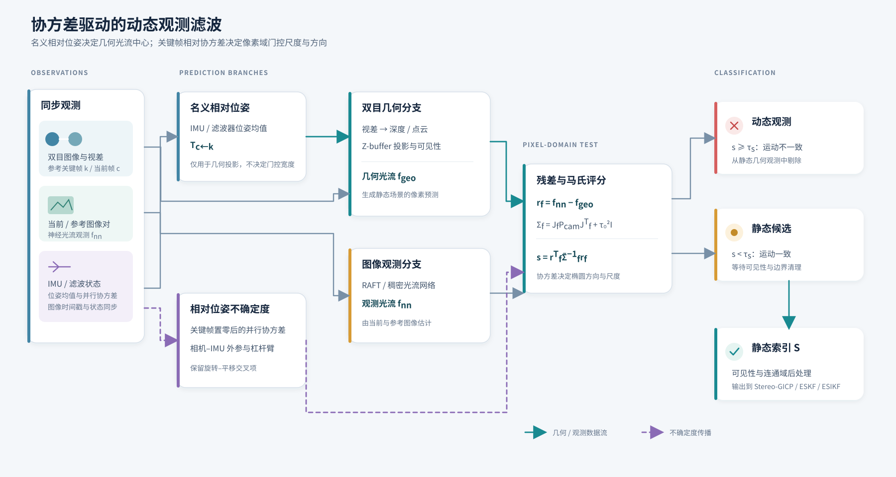
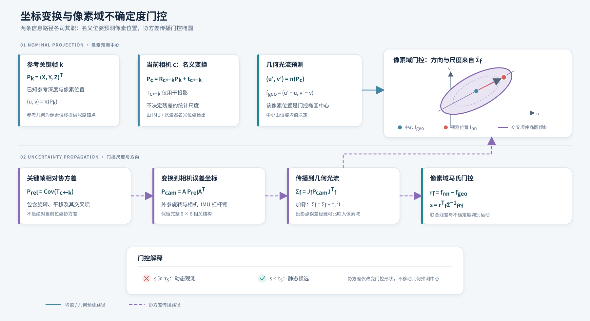

# 基于位姿不确定度的几何–神经光流动态观测滤波

> 五篇 SCI 之 **Paper 1** · [索引](SCI_五篇论文索引.md) · 工程：`src/dynamic_cloud_processor.cpp`，`include/internal/geo_flow_error.h`

## 建议题目

Stereo-Inertial Dynamic Observation Filtering with Optical-Flow Uncertainty for Motion-Aware Static Reconstruction

## 摘要

动态场景中的双目惯性观测同时受到独立物体运动、相机位姿误差和深度误差影响。本文提出一种协方差驱动的动态观测滤波方法：在关键帧建立时初始化并行相对协方差，随主滤波器同步传播和视觉更新，再通过相机外参与杠杆臂变换到相机坐标系；随后用一阶光流雅可比将其映射为深度相关、可倾斜的像素残差协方差。对于参考关键帧点云，方法比较双目几何光流与神经光流，并以马氏分数筛除与静态场景模型不一致的观测，同时将无效视差和当前视图遮挡点单独标记为不可见。输出的静态索引供 Stereo-GICP、ESKF 与 ESIKF 使用。本文给出完整推导、工程接口和基于 FR5–ZED X 眼在手上平台的可复现实验协议；实验测量值、统计结果和性能结论留待作者补入。

**关键词：** 双目惯性；动态观测滤波；位姿不确定度；光流；马氏门控；静态点云

## Abstract

Dynamic scenes contaminate stereo-inertial estimation through a mixture of independent object motion, camera-pose error, and depth uncertainty. This paper presents a covariance-aware dynamic observation filter. A keyframe-relative covariance is initialized with the reference keyframe and propagated with the same prediction and visual updates as the front-end estimator. After transformation through the camera extrinsics and lever arm, a first-order flow Jacobian maps the pose uncertainty to a depth-dependent pixel-residual covariance. The filter compares stereo-geometry-induced flow with neural optical flow and uses a Mahalanobis score to reject observations inconsistent with the static-scene model. Invalid stereo points and points occluded in the current view are kept as an explicit unobservable state. The resulting static indices are passed to Stereo-GICP, ESKF, and ESIKF. The manuscript provides the derivation, implementation contract, and a reproducible FR5–ZED X eye-in-hand test protocol; measured experimental data and quantitative claims are intentionally left for completion.

**Index Terms—** stereo-inertial sensing, dynamic observation filtering, pose uncertainty, optical flow, Mahalanobis gating, static reconstruction.


## 1. Introduction

### 1.1 研究背景

在双目-惯性 SLAM 中，动态目标首先污染的往往不是后端地图，而是**前端观测本身**。行人、车辆、摆动物体等独立运动会同时破坏三处假设：（i）双目视差对应静物；（ii）帧间光流可由相机刚体解释；（iii）点云配准的 target 点云为静态场景。一旦动态点进入 GICP / ESIKF，错误对应会把位姿拧偏，再经滤波协方差收缩被“自信地”传播下去。鲁棒核与后端边缘化只能减轻已发生的污染；若能在观测层提前识别动态区域并只保留静态点，则更可能从源头切断误差链。

双目系统额外提供稠密深度，IMU 提供短时相对运动，二者结合起来可以回答：“若场景全是静态的，像素应该怎么走？”把这个预测与神经网络估计的实际光流对比，就得到不依赖语义类别的运动一致性检验——这正是本文动态观测滤波的物理出发点。

### 1.2 现有方法问题

现有动态处理大致有三类不足。

第一，纯语义分割依赖训练集类别，对未知运动物体、局部形变或分割边界噪声敏感，且通常不利用 IMU 几何。

第二，大量工程实现使用固定像素阈值 $\tau$（或随深度线性放大的启发式 $\tau(Z)$）。旋转误差引起的流偏差与深度无关，平移误差则按 $1/Z$ 放大；固定阈值无法同时适配远近与旋转/平移主导情形，近处易误杀、远处易漏检。

第三，不少工作止于报告掩码 IoU，很少说明净化后的静态点集如何改变后续配准内点率、滤波创新一致性与轨迹 ATE。对 SLAM 而言，掩码精度只是中间量，**定位链路收益**才是最终判据。

### 1.3 本文思路

针对上述问题，本文提出基于双目几何与 IMU 位姿不确定度的动态观测滤波。几何流与门控椭圆分两路构造，不以 $\mathrm{Cov}(T_{c\leftarrow k})$ 充当 $P_{\mathrm{cam}}$。流程概览如下：

1. 用双目视差恢复参考关键帧稠密点云；  
2. 用 IMU 预测名义位姿复合出参考→当前的相对变换 $T_{c\leftarrow k}$（只用于投影）；同时用关键帧处置零、再与主滤波同步预测和 GICP 更新的并行协方差取出相机系 $6\times 6$ 位姿协方差 $P_{\mathrm{cam}}$（含交叉项，只用于门控）；  
3. 将参考点投影到当前帧，经 Z-buffer 生成几何光流 $\mathbf{f}_{\mathrm{geo}}$；  
4. 用 RAFT 等网络估计观测光流 $\mathbf{f}_{\mathrm{raft}}$，残差 $\mathbf{r}_f=\mathbf{f}_{\mathrm{raft}}-\mathbf{f}_{\mathrm{geo}}$；  
5. 经光流雅可比把 $P_{\mathrm{cam}}$ 映射为像素协方差 $\Sigma_f=\mathbf{J}_f P_{\mathrm{cam}}\mathbf{J}_f^\top$，加脊后做马氏门控 $s=\mathbf{r}_f^\top\tilde\Sigma_f^{-1}\mathbf{r}_f\ge 1$；  
6. 形态学与边界连通域清理后，输出参考帧静态索引 $\mathcal{S}$，供 Stereo-GICP / ESKF / ESIKF 使用。

方法刻意**不修改当前帧点云**，只净化作为配准 target 的参考关键帧点，以减小对前端数据结构的侵入。详细公式见第 3 节；从关键帧相对位姿协方差到门控的五步链见 §3.5。

### 1.4 主要贡献

1. 提出由双目几何与 IMU 运动先验共同驱动的 Z-buffer 几何光流预测，避免远点覆盖近点。  
2. 提出将关键帧相对位姿协方差（关键帧处置零后与主滤波同步预测、GICP 更新，含交叉项）映射到可倾斜的光流椭圆，并以马氏门控替代固定像素阈值的动态判别；明确旋转 / 平移不确定度映到像素半轴的量级（$\sim f\sigma_\omega$ 与 $\sim f\sigma_t/Z$）及随之松紧的门控策略。  
3. 给出双流同时过小才跳过检验、边界连通域清理等工程规则，降低静止漏检与出入视野伪影。  
4. 以静态点保留率、配准/滤波链路指标与轨迹误差，验证动态滤波对前端鲁棒性的提升。

## 2. 方法说明

### 2.1 系统总体流程与在前端中的位置

输入为同步双目图像与 IMU。本模块插在“双目重建之后、点云配准 / ESIKF 之前”：上一关键帧点云先经动态滤波得到静态子集，再作为 GICP 的 target 或 ESIKF 的锚点几何。当前帧仍完整参与重建，以免误删当前观测中尚可用的结构。整体数据流为：

```text
双目 → 视差/点云(参考KF) → 几何光流(f_geo)
IMU  → T_c←k（名义相对位姿，只投影） ↗        ↓
     → P_rel（关键帧置零后的并行协方差）→ P_cam → Σ_f → 马氏门控
图像对 → RAFT(f_raft) → 残差 r_f ↗                         → 静态索引 S → 配准/滤波
```



**图 1.** 观测层的数据流。名义相对位姿只确定几何光流中心；关键帧相对协方差经过相机坐标变换后确定像素门控椭圆，二者在残差评分处汇合。

### 2.2 双目重建与参考几何建立

左右目估计视差后，按针孔模型反投影得到参考帧左目系点云，并在三角化时把参考像素写成 `StereoPoint` 的字段 `u`、`v`（`has_pixel` 为 1）。几何光流、RAFT 与参考图像都读这个字段，不再把 XYZ 投回参考内参恢复 $(u,v)$。点云同时承担两类角色：一是后续静态场景结构；二是几何光流的深度锚点——没有可靠深度就无法由刚体位姿预测像素位移。无有效视差（$d\le 0$，或被邻域一致性滤波清零）是左右目不重叠和立体失败区域：这些像素不建点，不进入静态云，也不标为动态。过近过远的点同样不建点，以免用噪声深度制造假几何流。

### 2.3 IMU 先验：名义相对位姿与关键帧相对协方差

IMU 误差状态传播同时给出两类量，用途分开：

1. **名义相对位姿** $T_{c\leftarrow k}$：由世界系相机位姿复合得到，只用于把参考点投到当前帧、生成 $\mathbf{f}_{\mathrm{geo}}$。  
2. **关键帧相对位姿协方差** $P_{\mathrm{cam}}\in\mathbb{R}^{6\times 6}$：另有一份与主滤波同维的并行协方差。参考关键帧成立时该矩阵置零，之后主滤波的每一次 IMU 预测（$\Phi P\Phi^{\top}+Q$）和 GICP / ESIKF 位姿更新都作用到这份矩阵上。门控取它的位姿 $6\times 6$（含 $P_{\theta\theta}$、$P_{pp}$ 与交叉 $P_{\theta p}$），经外参旋转与杠杆臂转到左目相机系。它是 $\mathrm{Cov}(T_{c\leftarrow k})$，不是当前绝对协方差；主滤波自己的绝对协方差保持不变。不从绝对协方差里减 $P_k$，也不使用两帧交叉 $P_{k,c}$。

平移对角设下界 $\sigma_{t,\min}^2$，覆盖未建模的短时平移不确定度，避免并行协方差被 GICP 压到很小时 $\Sigma_f$ 过小、几乎所有残差都被判动态（过杀）；交叉项保留，不把椭圆强制轴对齐。并行协方差从关键帧处的零开始，随之后的预测增长，并在 GICP 更新时被同一增益压回去，因此不是跳过视觉更新的开环预积分。从这一相对协方差走到马氏门控的五步见 §3.5。

### 2.4 几何光流与神经光流

几何光流回答“静态刚体世界下像素应如何移动”；神经光流回答“图像里实际测到怎样移动”。二者在静态区域应大致一致；独立运动物体上神经光流往往显著偏离几何预测。当前图像的 Z-buffer 在每个整数像素 $(u',v')$ 上只保留当前深度 $Z'$ 最近的点做检验，视点变化后被遮挡的点不进入动态或静态候选。

### 2.5 光流不确定度建模与动态判别

两路分开：$T_{ck}$ 只定几何流（椭圆中心），$P_{cam}$ 只定椭圆形状。由 $\Sigma_f = J_f P_{cam} J_f^{T}$ 得到像素协方差，加脊后得 $\tilde{\Sigma}_f$。马氏分数 $s = r_f^{T}\tilde{\Sigma}_f^{-1} r_f$：$s\ge 1$ 落在 $1\sigma$ 椭圆外，判为动态。从关键帧相对协方差到 $s$ 的五步（投影点协方差是 $\mathbf{J}_f$ 内部的中间映射）见 §3.5。

交叉项不改中心，只让椭圆相对像素轴倾斜。同号斜残差沿长轴，$s$ 更小（位姿误差更能解释）；反号沿短轴，$s$ 更大（更像独立运动）。对角 $P$ 在光心附近轴对齐，不区分这两种方向。位姿协方差映到像素后：旋转项 $\sigma_f\sim f\sigma_\omega$（与深度无关），平移项 $\sigma_f\sim f\sigma_t/Z$（近处放大）——量级与门控松紧见 §3.4、§3.6。仅当几何流与神经流**同时**很小时才跳过检验——避免相机近似静止时因 $f_{geo}\approx 0$ 而放过仍在动的物体。交叉项如何进入 $\Sigma_{uv}$ 见 §3.5。

### 2.6 后处理与前端接口

动态掩码经腐蚀膨胀去噪；触及顶/左/右边界的连通域做条带清理，抑制物体进出视野造成的假动态条带（底边常接地面，策略上保留）。参考点投影落入动态像素则移出 $\mathcal{S}$。超出当前图像、位于相机后方，或在当前视图中被更近表面遮挡的点标为不可见，单独输出为不可见点云，既不是静态也不是动态；每个当前像素只检验 $Z'$ 最近的可见点。没有视差图像素索引的点同样不可见（左右目不重叠），并入该不可见点云，既不进入 $\mathcal{S}$ 也不标为动态。输出 $\mathcal{S}$ 作为姊妹篇 Stereo-GICP / ESKF·ESIKF 的静态 target 契约。

## 3. 理论推导

每个显示公式后给出符号含义；光流雅可比与位姿误差→光流量级见 §3.4，从关键帧相对位姿协方差到门控的五步链见 §3.5，马氏门控与由协方差驱动的策略见 §3.6。姊妹篇：[投影 Stereo-GICP](SCI_投影StereoGICP.md)、[ESKF 与 ESIKF](SCI_ESKF与ESIKF.md)。解析灵敏度对照：[flow_pose_error_sensitivity.md](flow_pose_error_sensitivity.md)。

### 3.1 问题与假设

#### 问题表述

设参考关键帧左目图像为 $I_k$，当前帧左目图像为 $I_c$。参考帧经双目重建得到左目系点云 $\{\mathbf{P}_i\}_{i=1}^{N}$。动态滤波在**不修改当前帧点云**的前提下，从参考点云中剔除独立运动点，输出静态索引集合 $\mathcal{S}$，供后续 GICP / ESIKF 的 target 使用。

其中：

- $I_k,I_c$：参考 / 当前左目强度图；
- $\mathbf{P}_i\in\mathbb{R}^3$：参考左目系三维点；
- $\mathcal{S}\subseteq\{1,\ldots,N\}$：静态点索引。

#### 建模假设

1. **静态场景刚性**：静态点的像素位移仅由相机相对刚体运动引起。
2. **IMU 先验可用**：短时名义相对位姿 $T_{c\leftarrow k}$ 由 IMU 预测复合得到；光流椭圆取自当前预测协方差 $P^-$ 转到相机系后的 $6\times 6$ 位姿块 $P_{\mathrm{cam}}$（含轴间相关与 $P_{\theta p}$）。$P_{\mathrm{cam}}$ 是相机系位姿微扰的协方差代理，不是 $\mathrm{Cov}(T_{c\leftarrow k})$。
3. **神经光流为观测**：RAFT 等网络给出稠密光流 $\mathbf{f}_{\mathrm{raft}}$，含估计噪声，但不引入独立物体运动模型。
4. **位姿误差一阶小**：用光流对相机系位姿微扰的雅可比 $\mathbf{J}_f$ 做线性映射 $P_{\mathrm{cam}}\mapsto\Sigma_f=\mathbf{J}_f P_{\mathrm{cam}}\mathbf{J}_f^\top$。

---

### 3.2 相对位姿与几何光流

#### 相对位姿构造

世界系名义位姿经外参变到左目相机系后，

$$
T_{c\leftarrow k}
=
\bigl(T_{w\leftarrow c}^{\mathrm{cam}}\bigr)^{-1}
T_{w\leftarrow k}^{\mathrm{cam}}
=
\begin{bmatrix}
R & t \\
\mathbf{0}^\top & 1
\end{bmatrix}.
$$

其中：

- $T_{c\leftarrow k}\in\mathrm{SE}(3)$：参考左目系 → 当前左目系；
- $T_{w\leftarrow k}^{\mathrm{cam}},T_{w\leftarrow c}^{\mathrm{cam}}$：参考 / 当前左目相对世界的位姿；
- $R\in\mathrm{SO}(3)$：相对旋转；
- $t\in\mathbb{R}^3$：相对平移（m）；
- $\mathbf{0}$：三维零向量。

对参考点 $\mathbf{P}=(X,Y,Z)^\top$，

$$
\mathbf{P}' = R\mathbf{P}+t = (X',Y',Z')^\top.
$$

其中 $\mathbf{P}'$ 为同一点在当前左目系的坐标。

#### 针孔投影

$$
\pi(\mathbf{P})
=
\begin{pmatrix}
f_x\dfrac{X}{Z}+c_x \\[4pt]
f_y\dfrac{Y}{Z}+c_y
\end{pmatrix},
\qquad
\mathbf{u}'=\pi(\mathbf{P}').
$$

其中：

- $\pi$：针孔投影；当前像素取 $\pi(\mathbf{P}')$，参考像素不由 $\pi(\mathbf{P})$ 恢复；
- $f_x,f_y$：焦距（px）；
- $c_x,c_y$：主点（px）；
- $\mathbf{u}=(u,v)^\top$：参考像素，取自视差图索引，不由 $\mathbf{P}$ 再投影得到；
- $\mathbf{u}'=(u',v')^\top$：当前像素。

#### 几何光流定义

$$
\mathbf{f}_{\mathrm{geo}}(\mathbf{u})
=
\mathbf{u}'-\mathbf{u}
=
\begin{pmatrix}
f_x X'/Z'+c_x-u \\[2pt]
f_y Y'/Z'+c_y-v
\end{pmatrix}.
$$

其中 $\mathbf{f}_{\mathrm{geo}}$ 为 IMU 先验诱导的几何光流（px）；$(u,v)$ 是视差图索引，不是把 $\mathbf{P}$ 再投影到参考图像的结果。

#### Z-buffer

超出当前图像或位于相机后方的点标为不可见，不进入动态或静态候选，且不占用当前像素 Z-buffer。落在当前图像内的点按整数像素 $(u',v')$ 竞争，只保留当前深度 $Z'$ 最小者作为候选：马氏检验可标为动态，否则保留为静态。同一像素上 $Z'$ 更大的点视为被当前视图遮挡，同样标为不可见，不进入候选。没有有效视差索引的点标为不可见（左右目不重叠或立体失败），不默认保留为静态。

---

### 3.3 神经光流与残差

裁剪缩放后的 $(I_k,I_c)$ 输入 RAFT，得

$$
\mathbf{f}_{\mathrm{raft}}(\mathbf{u})\in\mathbb{R}^2.
$$

光流残差：

$$
\mathbf{r}_f
=
\mathbf{f}_{\mathrm{raft}}-\mathbf{f}_{\mathrm{geo}}
=
\begin{pmatrix} r_u \\ r_v \end{pmatrix}.
$$

其中：

- $\mathbf{f}_{\mathrm{raft}}$：观测光流（px）；
- $\mathbf{r}_f$：残差；$r_u,r_v$ 为其水平 / 垂直分量。

静态理想模型：$\mathbf{r}_f\approx\mathbf{0}$（在位姿与深度噪声范围内）。独立运动使 $\|\mathbf{r}_f\|$ 显著超出该范围。

---

### 3.4 位姿扰动到光流的一阶映射（逐步）

#### 归一化坐标

$$
x_n=\frac{u-c_x}{f_x},\qquad
y_n=\frac{v-c_y}{f_y},\qquad
\rho=\frac{1}{Z}.
$$

其中 $x_n,y_n$ 为归一化像平面坐标；$\rho$ 为逆深度（1/m）。

#### 小扰动下的光流敏感度

相机系位姿受到小扰动 $(\delta\boldsymbol{\omega},\delta\mathbf{t})$ 时，像点位移的一阶项由经典视觉里程计公式给出。该微扰作用在把参考点变到当前相机系的刚体变换上；其协方差取自 $T_{c\leftarrow k}$ 的相对位姿协方差映到相机系的 $P_{\mathrm{cam}}$（§3.5）。将 $\mathbf{J}_f\in\mathbb{R}^{2\times 6}$ 按列写出：

**旋转列（与深度无关）：**

$$
\begin{aligned}
\mathbf{J}_{\omega_x}
&=
\begin{pmatrix}
-f_x x_n y_n \\
-f_y(1+y_n^2)
\end{pmatrix},
&
\mathbf{J}_{\omega_y}
&=
\begin{pmatrix}
f_x(1+x_n^2) \\
f_y x_n y_n
\end{pmatrix},
\\
\mathbf{J}_{\omega_z}
&=
\begin{pmatrix}
-f_x y_n \\
f_y x_n
\end{pmatrix}.
\end{aligned}
$$

**平移列（与 $1/Z$ 成正比）：**

$$
\begin{aligned}
\mathbf{J}_{t_x}
&=
\begin{pmatrix}
f_x\rho \\ 0
\end{pmatrix},
&
\mathbf{J}_{t_y}
&=
\begin{pmatrix}
0 \\ f_y\rho
\end{pmatrix},
&
\mathbf{J}_{t_z}
&=
\begin{pmatrix}
-f_x x_n\rho \\
-f_y y_n\rho
\end{pmatrix}.
\end{aligned}
$$

其中：

- $\mathbf{J}_{\omega_\ast},\mathbf{J}_{t_\ast}$：光流对对应自由度的雅可比列（px/rad 或 px/m）；
- 推导要点：旋转改变视线方向，故敏感度不含 $\rho$；平移改变点在相机系中的位置，经投影链式法则出现 $\rho$。

组装为完整 $2\times 6$ 光流雅可比：

$$
\mathbf{J}_f
=
\bigl[
\mathbf{J}_{\omega_x}\ \mathbf{J}_{\omega_y}\ \mathbf{J}_{\omega_z}\
\mathbf{J}_{t_x}\ \mathbf{J}_{t_y}\ \mathbf{J}_{t_z}
\bigr]
=
\begin{bmatrix}
-f_x x_n y_n & f_x(1+x_n^2) & -f_x y_n & f_x\rho & 0 & -f_x x_n\rho \\
-f_y(1+y_n^2) & f_y x_n y_n & f_y x_n & 0 & f_y\rho & -f_y y_n\rho
\end{bmatrix}.
$$

其中行对应 $(\mathrm{d}u,\mathrm{d}v)$，列对应 $(\omega_x,\omega_y,\omega_z,t_x,t_y,t_z)$。未写出的交叉项（如 $\partial v/\partial t_x$）在该针孔模型下为 $0$。

#### 由投影链式法则简述来源

刚体小扰动下相机系点变化 $\mathrm{d}\mathbf{P}=\delta\boldsymbol{\omega}\times\mathbf{P}+\delta\mathbf{t}$。针孔投影 $u=f_x X/Z+c_x$、$v=f_y Y/Z+c_y$ 的微分为

$$
\mathrm{d}u
=
f_x\frac{Z\,\mathrm{d}X-X\,\mathrm{d}Z}{Z^2},
\qquad
\mathrm{d}v
=
f_y\frac{Z\,\mathrm{d}Y-Y\,\mathrm{d}Z}{Z^2}.
$$

将 $\mathrm{d}X,\mathrm{d}Y,\mathrm{d}Z$ 用 $\delta\boldsymbol{\omega},\delta\mathbf{t}$ 展开并改用 $(x_n,y_n,\rho)$，即得上表各列。旋转项不含 $\rho$（只改变视线方向）；平移项均含 $\rho$（深度越近越敏感）。该乘积 $\mathbf{J}_f=\mathbf{J}_{\pi}\mathbf{J}_{\mathbf{P}}$ 即 §3.5 五步链的第 3 步，点位置协方差不另存矩阵。

#### 实现对照（本篇雅可比）

| 公式量 | 代码 |
|--------|------|
| $\mathbf{J}_f$ 各列 | `sio_geo_flow::ComputeFlowJac`（`include/internal/geo_flow_error.h`） |
| $P^-\to P_{\mathrm{cam}}$（当前预测位姿 $6\times 6$，相机系） | `ImuStatePoseCovInCamera`（`include/utils.h`） |
| 平移对角下界 $\sigma_{t,\min}^2$ | `MakePoseCovCam` / `kMinSigmaTransM` |
| $\Sigma_f=\mathbf{J}_f P_{\mathrm{cam}}\mathbf{J}_f^\top$ | `AccumulateSigmaFFromPoseCov` |
| $s=\mathbf{r}_f^\top\tilde\Sigma_f^{-1}\mathbf{r}_f$ | `MahalanobisSq` |
| 动态掩码主流程 | `src/dynamic_cloud_processor.cpp` |

#### 为何不能用固定像素阈值（推导动机）

设仅有偏航误差 $\sigma_{\omega_z}$，光心附近 $x_n\approx y_n\approx 0$ 时 $\|\mathbf{J}_{\omega_z}\sigma_{\omega_z}\|$ 仍可产生水平流误差，且**与深度无关**。  
设仅有前向平移误差 $\sigma_{t_z}$，则误差幅值 $\propto \rho=1/Z$，**近处放大**。  
因此固定 $\tau$（px）无法同时适配远近与旋转/平移主导情形，必须用协方差椭圆。下节给出各轴引起的光流量级与旋转–平移等价，作为门控半轴的物理刻度。

#### 位姿误差 / 协方差引起的光流变化（量级）

一阶下，相机系位姿微扰 $\boldsymbol{\xi}_{\mathrm{cam}}=(\delta\boldsymbol{\omega},\delta\mathbf{t})$ 引起的几何光流变化即

$$
\delta\mathbf{f}
=
\begin{pmatrix}\delta u\\ \delta v\end{pmatrix}
=
\mathbf{J}_f\boldsymbol{\xi}_{\mathrm{cam}}.
$$

其中 $\delta\mathbf{f}$ 的单位为 px；其协方差正是 §3.5 的 $\Sigma_f=\mathbf{J}_f P_{\mathrm{cam}}\mathbf{J}_f^\top$。故「位姿不确定度有多大」与「光流残差容差应放多宽」由同一雅可比连通。下列量级取近光心（$x_n,y_n\approx 0$）、$f\approx f_x\approx f_y$、特征深度 $Z$（可用深度中位数），与 [flow_pose_error_sensitivity.md](flow_pose_error_sensitivity.md) 的一阶结论一致；端点误差 $\mathrm{EPE}=\|\delta\mathbf{f}\|$。

| 误差类型 | 特征 EPE（量级） | 单位换算 |
|----------|------------------|----------|
| 绕相机 $X/Y$ 旋转 $\theta$（rad） | $\sim f\,\theta$ | $\sim f\cdot(\pi/180)$ **px/°** |
| 绕光轴 $Z$ 旋转 | 中心 $\sim 0$；半视场角 $\alpha$ 处 $\sim f\alpha\,\theta$ | 通常弱于绕 $X/Y$ |
| 横向平移 $\delta t_\perp$ | $\sim f\,\delta t_\perp/Z$ | $\sim f/(100Z)$ **px/cm** |
| 前向平移 $\delta t_z$ | 中心 $\sim 0$；边缘 $\sim f\,\|x_n\|\,\delta t_z/Z$ | 弱于同量级横向平移 |

近光心灵敏度排序（同「看起来不大」的物理单位下）：

$$
\omega_y,\ \omega_x
\;\gg\;
\delta t_x,\ \delta t_y
\;\gg\;
\omega_z,\ \delta t_z.
$$

**旋转–平移等价。** 使绕 $Y$（或 $X$）旋转 $\theta$（rad）与横向平移 $\delta t_\perp$ 产生同量级光流误差：

$$
f\,\theta
\approx
\frac{f\,\delta t_\perp}{Z}
\quad\Rightarrow\quad
\delta t_\perp\approx Z\,\theta
\quad\Rightarrow\quad
1^\circ
\;\Leftrightarrow\;
\delta t_\perp\approx Z\cdot\frac{\pi}{180}\approx 0.0175\,Z.
$$

| 特征深度 $Z$ | $1^\circ$ 等价横向平移 |
|--------------|----------------------|
| 1 m | ≈ 1.7 cm |
| 3 m | ≈ 5.3 cm |
| 5 m | ≈ 8.7 cm |
| 10 m | ≈ 17.5 cm |

**随深度的定性行为。** 绕 $X/Y$ 的旋转误差：EPE **几乎不随 $Z$ 变**；横向平移：EPE $\propto 1/Z$，**远处钝感**；前向平移 / 绕 $Z$：中心弱，整体偏弱。同一套位姿误差：近处平移贡献相对更明显；远处更接近「旋转误差决定光流误差」。

**不确定度映射（门控半轴刻度）。** 记 $\sigma_\omega$、$\sigma_t$ 为 $P_{\mathrm{cam}}$ 对角上的旋转 / 平移标准差，映到像素光流标准差 $\sigma_f$ 时，近光心有

$$
\sigma_f^{(\omega)}\sim f\,\sigma_\omega,
\qquad
\sigma_f^{(t)}\sim\frac{f\,\sigma_t}{Z}.
$$

例：取本篇算例内参 $f=370\,\mathrm{px}$，$\sigma_{\omega_y}=0.01\,\mathrm{rad}$（≈ $0.57^\circ$）$\Rightarrow\sigma_f^{(\omega)}\approx 3.7\,\mathrm{px}$；$\sigma_{t_y}=0.02\,\mathrm{m}$、$Z=2\,\mathrm{m}$，$\Rightarrow\sigma_f^{(t)}\approx 3.7\,\mathrm{px}$（与 §3.5 数值算例一致）。深度误差主要污染平移诱导流（相对深度误差 $\varepsilon=\delta Z/Z$ 与平移流同阶耦合），不另写入 $P_{\mathrm{cam}}$，由视差有效性与脊 $\tau_0$ 吸收。

对动态滤波的直接含义：固定 $\tau$ 无法同时匹配「远处仍有 $f\theta$ 的旋转流误差」与「近处 $f\sigma_t/Z$ 被放大的平移流误差」；门控半轴必须随 $P_{\mathrm{cam}}$ 与 $Z$ 变——策略细则见 §3.6。

---



**图 2.** 参考关键帧到当前相机的坐标变换，以及位姿均值和位姿协方差在像素域的分工。

### 3.5 协方差链：从关键帧相对位姿协方差到门控

门控不确定度按一条链传递：关键帧相对位姿协方差 → 相机系位姿协方差 $P_{\mathrm{cam}}$ → 几何投影点协方差 → 光流协方差 $\Sigma_f$ → 马氏门控。五步写在下面。几何流只依赖 $T_{c\leftarrow k}$，所以进入 $\mathbf{J}_f$ 的是这份相对协方差，不是滤波的绝对当前协方差。$A$ 的分块、交叉项来源、平移地板的近场含义与数值算例仍在本节后文；完整判定见 §3.6。

#### 五步链

**（1）关键帧相对协方差（并行副本）。** 主滤波的绝对协方差（`imu_states_.cov` 与 `imu_pred_state_curr_.cov`）照常传播，不在关键帧处置零。光流门控另持一份同维并行协方差 `flow_gate_cov_`（$21\times 21$）。参考关键帧成立的瞬间，这份矩阵整块置零：该时刻的关键帧状态对门控而言是已知的，此后累积的是相对该关键帧的不确定度，即 $\mathrm{Cov}(T_{c\leftarrow k})$ 在误差状态中的对应量。不从绝对协方差里减去 $P_k$，也不使用两帧交叉 $P_{k,c}$。

误差状态仍是 $21$ 维：前 $6$ 维为位姿 $(\delta\boldsymbol{\theta},\delta\mathbf{p})$（旋转误差在 IMU 机体系，位置误差在世界系），其后依次为速度、陀螺偏置、加计偏置、重力与曝光余量。置零之后，主滤波在这一关键帧与当前帧之间每一次改协方差的步骤，都作用到这份并行矩阵上，线性化与主滤波同一次计算。IMU 预测与 `ImuPreintegrationCov` 写在同一次循环里，$\Phi$ 与 $Q_d$ 跟主滤波这一拍相同，$P$ 用并行副本自己的先验。这不是从关键帧另起一份只含 IMU、跳过中间 GICP 的预积分：

$$
P
\leftarrow
\Phi P\Phi^{\top}+Q_d,
\qquad
\Phi=F_d=I+F\,\mathrm{d}t,
\qquad
Q_d=G Q_c G^{\top}\,\mathrm{d}t.
$$

其中 $F$ 为 $21\times 21$ 连续误差状态转移，$G$ 把陀螺、加计及其偏置游走噪声映入状态，$Q_c$ 为该项连续噪声协方差；与主滤波的 $P\leftarrow\Phi P\Phi^{\top}+Q$ 是同一次传播，不另写一套噪声模型。有位姿观测时，用主滤波这一步已经算出的 $K$、$H$、$R$，对并行 $P$ 做同一个 Joseph 更新（非关键帧 `ESKF` 的 GICP 更新，以及关键帧 `ESIKF` 的位姿更新）：

$$
P
\leftarrow
(I-KH)\,P\,(I-KH)^{\top}
+
K R K^{\top}.
$$

没有位姿更新的步骤，并行协方差只按预测增长。门控读取的是当前帧预测之后、本帧 GICP / ESIKF 之前的这份矩阵。新关键帧写入之后，这份矩阵再次置零，下一段相对协方差从新的参考帧重新累积。速度、偏置与位姿的交叉不另做舒尔补，它们已经通过 $\Phi$ 和 $K$ 进入左上 $6\times 6$：

$$
P_{\xi}^{\mathrm{rel}}
=
\begin{bmatrix}
P_{\theta\theta}^{\mathrm{rel}} & P_{\theta p}^{\mathrm{rel}} \\
P_{p\theta}^{\mathrm{rel}} & P_{pp}^{\mathrm{rel}}
\end{bmatrix}.
$$

$T_{c\leftarrow k}$ 的均值仍由世界系名义位姿复合，供第 3 步的投影使用。

**（2）相机系位姿协方差 $P_{\mathrm{cam}}$。** 把 $\boldsymbol{\xi}=(\delta\boldsymbol{\theta},\delta\mathbf{p}_w)$ 变到左目相机系微扰 $\boldsymbol{\xi}_{\mathrm{cam}}=(\delta\boldsymbol{\omega},\delta\mathbf{t})$。线上路径对并行协方差的位姿块做这一次帧变换（`FlowGatePoseCovInCamera`；其中的 $A$ 与 `ImuStatePoseCovInCamera` 相同，旋转取当前预测的名义姿态）。绝对 `imu_pred_state_curr_.cov` 不进入这一步：

$$
P_{\mathrm{cam}}
=
A P_{\xi}^{\mathrm{rel}} A^{\top}.
$$

$A$ 含外参旋转 $R_{ic}^{\top}$ 与杠杆臂 $-R_{ic}^{\top}[\mathbf{t}_{ic}]_{\times}$，分块见下节。得到 $P_{\mathrm{cam}}$ 之后，`MakePoseCovCam` 只抬平移对角；这一下界是工程地板，不是 $\Phi P\Phi^{\top}$ 的输出，交叉项保持原值：

$$
(P_{\mathrm{cam}})_{t_i t_i}
\leftarrow
\max\bigl((P_{\mathrm{cam}})_{t_i t_i},\,\sigma_{t,\min}^2\bigr),
\qquad
\sigma_{t,\min}=0.02\,\mathrm{m}.
$$

**（3）几何投影点协方差。** 名义投影 $\mathbf{P}'=R\mathbf{P}+t$、$\mathbf{u}'=\pi(\mathbf{P}')$ 只决定 $\mathbf{f}_{\mathrm{geo}}$ 的均值。投影点相对相机系位姿的协方差不单独存成矩阵，它是 $\mathbf{J}_f$ 内部的中间映射：微扰先推动三维点，针孔微分再把它映到像素。与 §3.4 和 `ComputeFlowJac` 相同，线性化点是参考点 $\mathbf{P}=(X,Y,Z)^{\top}$ 的 $(x_n,y_n,\rho)$，不在投影后的 $\mathbf{P}'$ 上重算 $\mathbf{J}_{\pi}$。

$$
\mathrm{d}\mathbf{P}
=
\delta\boldsymbol{\omega}\times\mathbf{P}+\delta\mathbf{t}
=
\mathbf{J}_{\mathbf{P}}\boldsymbol{\xi}_{\mathrm{cam}},
\qquad
\mathbf{J}_{\mathbf{P}}
=
\bigl[-[\mathbf{P}]_{\times}\ \ I_3\bigr]\in\mathbb{R}^{3\times 6},
$$

$$
\mathbf{J}_{\pi}
=
\begin{bmatrix}
f_x\rho & 0 & -f_x x_n\rho \\
0 & f_y\rho & -f_y y_n\rho
\end{bmatrix},
\qquad
\mathbf{J}_f
=
\mathbf{J}_{\pi}\mathbf{J}_{\mathbf{P}}.
$$

点位置协方差 $\Sigma_{\mathbf{P}}=\mathbf{J}_{\mathbf{P}} P_{\mathrm{cam}}\mathbf{J}_{\mathbf{P}}^{\top}$ 与投影像素协方差 $\mathbf{J}_{\pi}\Sigma_{\mathbf{P}}\mathbf{J}_{\pi}^{\top}$ 都不保存；`ComputeFlowJac` 直接写出乘积 $\mathbf{J}_f$（即 §3.4 各列，旋转列中的 $x_n y_n$ 来自 $\mathbf{J}_{\pi}(-[\mathbf{P}]_{\times})$）。深度噪声不写入 $\Sigma_{\mathbf{P}}$，仍由视差有效性与脊 $\tau_0$ 吸收。

**（4）光流协方差。** 参考像素 $\mathbf{u}$ 取自视差图索引，不作为随机变量，故几何光流与投影像素共用位姿传播项

$$
\Sigma_f
=
\mathbf{J}_f P_{\mathrm{cam}}\mathbf{J}_f^{\top}
=
\mathbf{J}_{\pi}\Sigma_{\mathbf{P}}\mathbf{J}_{\pi}^{\top}.
$$

与这一传播项分开的两处工程量：平移对角地板已在第 2 步写入 $P_{\mathrm{cam}}$，经 $\mathbf{J}_f$ 进入 $\Sigma_f$；各向同性脊加在 $\Sigma_f$ 之后（`AddIsotropicRidge`），只抬像素对角，不动 $\Sigma_{uv}$：

$$
\tilde\Sigma_f
=
\Sigma_f+\tau_0^2 I_2,
\qquad
\tau_0\approx 1.5\,\mathrm{px}.
$$

**（5）门控。** 神经光流与几何光流之差对加脊后的 $\tilde\Sigma_f$ 做马氏距离平方，门限为 $1$（`MahalanobisSq`）：

$$
\mathbf{r}_f
=
\mathbf{f}_{\mathrm{raft}}-\mathbf{f}_{\mathrm{geo}},
\qquad
s
=
\mathbf{r}_f^{\top}\tilde\Sigma_f^{-1}\mathbf{r}_f,
\qquad
s\ge 1 \Rightarrow \mathbf{u}\in\mathcal{D}.
$$

$s\ge 1$ 表示残差落在由 $\tilde\Sigma_f$ 定义的 $1\sigma$ 椭圆外，判为动态。双流跳过与形态学见 §3.6。

#### 并行协方差进入 $P_{\mathrm{cam}}$（即 $\mathrm{Cov}(T_{c\leftarrow k})$）

上列第 2 步的 $P_{\xi}^{\mathrm{rel}}$ 与 $A$ 展开如下。误差状态为混合坐标：旋转误差 $\delta\boldsymbol{\theta}$ 在 IMU 机体系，位置误差 $\delta\mathbf{p}$ 在世界系。取并行协方差的位姿 $6\times 6$ 块

$$
P_{\xi}^{\mathrm{rel}}
=
\begin{bmatrix}
P_{\theta\theta}^{\mathrm{rel}} & P_{\theta p}^{\mathrm{rel}} \\
P_{p\theta}^{\mathrm{rel}} & P_{pp}^{\mathrm{rel}}
\end{bmatrix},
\qquad
\boldsymbol{\xi}
=
\begin{bmatrix}\delta\boldsymbol{\theta}\\\delta\mathbf{p}_w\end{bmatrix},
$$

再变到左目相机系微扰 $\boldsymbol{\xi}_{\mathrm{cam}}=(\delta\boldsymbol{\omega},\delta\mathbf{t})$。相机原点 $p_{\mathrm{wc}}=p_{\mathrm{wb}}+R_{wb}\mathbf{t}_{ic}$，故旋转误差经杠杆臂进入相机平移：

$$
\delta\boldsymbol{\omega}=R_{ic}^{\top}\delta\boldsymbol{\theta},
\qquad
\delta\mathbf{t}
=
R_{w\leftarrow c}^{\top}\delta\mathbf{p}_w
-
R_{ic}^{\top}[\mathbf{t}_{ic}]_{\times}\delta\boldsymbol{\theta},
\qquad
A
=
\begin{bmatrix}
R_{ic}^{\top} & \mathbf{0} \\
-R_{ic}^{\top}[\mathbf{t}_{ic}]_{\times} & R_{w\leftarrow c}^{\top}
\end{bmatrix},
$$

$$
P_{\mathrm{cam}}
=
A P_{\xi}^{\mathrm{rel}} A^{\top}.
$$

$A$ 的左下块即使 $P_{\theta p}^{\mathrm{rel}}=\mathbf{0}$ 也会在 $P_{\mathrm{cam}}$ 中产生 $P_{\omega t}$（例如机体系前向基线 + yaw $\to$ 相机侧向平移）。$P_{\theta p}^{\mathrm{rel}}$ 与轴间非对角经 $A$ 一并转入，不强制对角化。

线上路径**不手写** $\rho$。`FlowGatePoseCovInCamera` 取并行协方差左上 $6\times 6$ 再乘 $A$。交叉项是这份相对误差的相关信念，不是法兰把俯仰和侧移「绑在一起」。来源只有两层：

1. **并行 $P$ 里已经有。** 从关键帧处的零矩阵出发，IMU 传播 $P\leftarrow \Phi P\Phi^{\top}+Q$：姿态误差会通过比力/重力走进速度再走进位置（俯仰错 $\leftrightarrow$ 前后/高低位置错），于是 $P_{\theta p}\neq 0$；轴间也会被 $\Phi$ 填满。GICP / ESIKF 的 Joseph 更新把同一个 $R$ 经主滤波的 $K$ 写回并行 $P$，杠杆块里的交叉留在后验里，并被下一帧的预测带到 $P_{\xi}^{\mathrm{rel}}$。偏置、速度与位姿的交叉在传播里再漏回 $6\times 6$。
2. **$A$ 又造一批。** 同一刚体误差换到相机切空间：$\delta\mathbf{t}$ 含 $-R_{ic}^{\top}[\mathbf{t}_{ic}]_{\times}\delta\boldsymbol{\theta}$。即使 $P_{\xi}$ 对角，只要 $\|\mathbf{t}_{ic}\|>0$，相机系就会出现 $\mathrm{Cov}(\omega_z,t_y)$ 这类项。$R_{ic}^{\top}P_{\theta\theta}R_{ic}$ 还会把机体轴相关拧到相机轴上。

对应关系：$\mathrm{Corr}(\omega_y,t_y)=0.9$ 表示「当前这次误差更可能同号出现俯仰+侧移，而不是反号」，不是电机耦合。步 2 把这一项写成 $0.9$ 只为探针椭圆斜不斜；步 3 与步 5 用这份相对 $P_{\mathrm{cam}}$，相关可正可负、可大可小，由关键帧之后的传播和 GICP 更新决定。$\mathbf{J}_f$ 再把 $P_{\mathrm{cam}}$ 映到 $\Sigma_{uv}$：即使 $P$ 对角，偏轴点的 $\omega_x,t_z$ 也能让椭圆斜——那是像素几何，不是 $P$ 的交叉。

平移对角再设下界（不改交叉项）：

$$
(P_{\mathrm{cam}})_{t_i t_i}
\leftarrow
\max\bigl((P_{\mathrm{cam}})_{t_i t_i},\,\sigma_{t,\min}^2\bigr),
\qquad
\sigma_{t,\min}=0.02\,\mathrm{m}.
$$

其中：

- $R_{ic},\mathbf{t}_{ic}$：IMU←相机外参（$p_{\mathrm{body}}=R_{ic}p_{\mathrm{cam}}+\mathbf{t}_{ic}$）；
- $R_{w\leftarrow c}=R_{wb}R_{ic}$：当前左目相对世界的旋转；
- $P_{\xi}^{\mathrm{rel}}$：并行协方差的位姿 $6\times 6$。这份矩阵在参考关键帧时刻为零，其后与主滤波同步做 IMU 预测和 GICP / ESIKF 更新；进入 $\mathbf{J}_f$ 的就是它，不是 `imu_pred_state_curr_.cov`；
- $P_{\theta p}^{\mathrm{rel}}$：旋转–平移交叉协方差；与杠杆臂一起使光流椭圆可以相对像素轴倾斜；
- $\sigma_{t,\min}$：平移标准差下界，**只在近处绑住**。点的三维度误差 $\delta\mathbf{P}=\delta\boldsymbol{\omega}\times\mathbf{P}+\delta\mathbf{t}$，远处 $\|\delta\boldsymbol{\omega}\times\mathbf{P}\|\propto Z$，旋转项已经很大，$1$–$2\,\mathrm{cm}$ 的 $\delta\mathbf{t}$ 可忽略；映到像素后平移贡献 $\propto 1/Z$，远处本来就交给旋转 $+\tau_0$。并行协方差收到毫米后，真正会被地板撑开的是近点（$Z\sim 1$–$2\,\mathrm{m}$），防止近处静态过杀。$2\,\mathrm{cm}$ 是近场工程默认；$1\,\mathrm{cm}$ 同属近场选择，步 1 在近距离静态上看 $s$ vs $\chi^{2}_{2}$，远处不要用这个数解释漏检/过杀。只截断平移对角，不抬旋转。

$\mathbf{J}_f$ 把相机系位姿微扰映射到光流；$P_{\mathrm{cam}}$ 是并行协方差经 $A$ 之后的完整 $6\times 6$，也就是 $\mathrm{Cov}(T_{c\leftarrow k})$ 在相机切空间中的表示。关键帧之前的绝对不确定度不进入：并行副本在关键帧处置零，而不是把 $P_k$ 从绝对 $P_c$ 里减掉，两帧交叉 $P_{k,c}$ 也不用。关键帧之后它随预测增长，并被中间帧的 GICP 更新压回，因此不是跳过视觉更新的开环预积分。全球漂留在主滤波的绝对协方差里，不把椭圆撑宽。

#### 一阶映射（保留交叉项）

第 4 步的位姿传播项按分量写开。$\Sigma_{\mathbf{P}}$ 不单独存储，直接从 $\mathbf{J}_f$ 与 $P_{\mathrm{cam}}$ 相乘：

$$
\Sigma_f
=
\mathbf{J}_f P_{\mathrm{cam}} \mathbf{J}_f^{\top}.
$$

若 $P_{\mathrm{cam}}$ 退化为对角 $\mathrm{diag}(\sigma_i^2)$，则上式还原为独立轴外积 $\sum_i\sigma_i^2\mathbf{J}_{f,i}\mathbf{J}_{f,i}^{\top}$。一般情形下 $P_{\theta p}$、轴间相关以及杠杆臂使 $(\Sigma_f)_{uv}\neq 0$ 即使单个 $\mathbf{J}_{f,i}$ 只贡献水平或竖直流，椭圆不必与像素轴对齐。

按分量（与代码 `AccumulateSigmaFFromPoseCov` 一致）：令 $j_u^{T}$、$j_v^{T}$ 为 $J_f$ 的两行，

$$
\Sigma_{uu}=j_u^{T}P_{cam}j_u,
\qquad
\Sigma_{uv}=j_u^{T}P_{cam}j_v,
\qquad
\Sigma_{vv}=j_v^{T}P_{cam}j_v.
$$

$P_{cam}$ 对角时，$\Sigma_{uv}$ 只来自「同一轴同时推 $u$ 和 $v$」（偏轴点的 $\omega_x$、$t_z$ 等，属像素几何）。$P_{cam}$ 有交叉时，多出双线性项：轴 $i$ 的流贡献与轴 $j$ 的流贡献按 $\mathrm{Cov}(\xi_i,\xi_j)$ 相乘，椭圆相对像素轴倾斜。

#### 交叉项如何改门控

名义 $T_{ck}$ 决定 $f_{geo}$（椭圆中心）；$P_{cam}$ 决定长短轴和朝向。交叉是滤波对**误差同号出现**的信念，不是电机把俯仰和侧移绑在一起。

光心附近只点亮 $\omega_y$ 与 $t_y$，且 $\mathrm{Corr}(\omega_y,t_y)=\rho_{\omega t}$（步 2 取 $0.9$；此处 $\rho_{\omega t}$ 不是逆深度）：

$$
\frac{\partial u}{\partial\omega_y}\approx f_x,
\qquad
\frac{\partial v}{\partial t_y}\approx\frac{f_y}{Z}.
$$

于是 $\Sigma_{uv}\neq 0$。对角对照（丢掉 $P_{\theta p}$）下 $\Sigma_{uv}=0$，同样欧氏长度的残差 $s$ 相同。马氏分数显式含交叉（§3.6）：

$$
s
=
\frac{
r_u^{2}\tilde{\Sigma}_{vv}
-2 r_u r_v\tilde{\Sigma}_{uv}
+r_v^{2}\tilde{\Sigma}_{uu}
}{
\tilde{\Sigma}_{uu}\tilde{\Sigma}_{vv}-\tilde{\Sigma}_{uv}^{2}
}.
$$

$\tilde{\Sigma}_{uv}$ 的符号决定哪条 $45^{\circ}$ 是长轴。$\rho_{\omega t}>0$ 时：

| 残差 | 落在哪 | $s$ | 门控含义 |
|------|--------|-----|----------|
| $r_{+}=(2.8,\,2.8)$ | 长轴 | 更小 | 「俯仰+侧移」是滤波认为会一起出现的误差，放行 |
| $r_{-}=(2.8,\,-2.8)$ | 短轴 | 更大 | 反号组合几乎不会由位姿误差产生，判动态 |

$|\rho_{\omega t}|$ 越大，长轴越长、短轴越短。丢掉 $P_{\theta p}$ 后 $s(r_{+})=s(r_{-})$，斜残差上 F1 下降。独立运动物体的 $r_f$ 方向一般不落在 $P_{cam}$ 预言的相关方向上，短轴一侧更容易 $s\ge 1$；相机位姿误差造成的残差应沿长轴，幅值不小也可能 $s<1$。这是交叉项相对「只取对角标准差、再画轴对齐椭圆」多出来的判别力。

对照三档：

| 门控 | 形状 | 缺什么 |
|------|------|--------|
| 固定阈值 $\tau$（px） | 圆 | 远近、旋转/平移用同一半径；旋转与 $Z$ 无关，平移 $\propto 1/Z$ |
| 对角 $P_{cam}$ | 轴对齐椭圆 | 光心附近不区分同号/反号斜残差 |
| 完整 $P_{cam}$（交叉+杠杆臂） | 可倾斜椭圆 | 主路径。平移地板只撑近处对角，不改交叉；若先写 $1\,\mathrm{mm}$ 交叉再被地板抬到 $2\,\mathrm{cm}$，有效 $|\rho_{\omega t}|$ 会被冲掉 |

#### 各向同性脊

第 4 步里加在位姿传播项之外的脊为

$$
\tilde\Sigma_f
=
\Sigma_f+\tau_0^2 I_2,
\qquad
\tau_0\approx 1.5\,\mathrm{px}.
$$

其中：

- $\tilde{\Sigma}_f$：用于门控的最终协方差；
- $\tau_0$：神经光流 / 量化等各向同性噪声标准差；
- $I_2$：$2\times 2$ 单位阵；脊保证 $\Sigma_f=0$ 时仍可求逆。

#### 数值算例：从 $P_{cam}$ 到椭圆再到 $s$

下列步 1–7 是本组数的演算顺序，不是上文五步链的编号。取光心一点，与步 2、单测 `PoseCrossTermTiltsFlowEllipseOffAxes` 同一组数。相机与 IMU 对齐、无杠杆臂，故 $A=I$、$P_{cam}=P_{\xi}$。内参 $f_x=f_y=370$，深度 $Z=2\,\mathrm{m}$（逆深度 $1/Z=0.5$），$x_n=y_n=0$。脊 $\tau_0=1.5\,\mathrm{px}$。

**步 1：写出 $P_{cam}$。** 只点亮俯仰 $\omega_y$ 与侧移 $t_y$，相关系数 $\rho_{\omega t}=0.9$：

$$
\sigma_{\omega_y}=0.01\,\mathrm{rad},\qquad
\sigma_{t_y}=0.02\,\mathrm{m},\qquad
\mathrm{Cov}(\omega_y,t_y)=0.9\times 0.01\times 0.02=1.8\times 10^{-4}.
$$

列序 $(\omega_x,\omega_y,\omega_z,t_x,t_y,t_z)$，其余元为 0：

$$
P_{cam}
=
\begin{bmatrix}
0 & 0 & 0 & 0 & 0 & 0 \\
0 & 10^{-4} & 0 & 0 & 1.8\times 10^{-4} & 0 \\
0 & 0 & 0 & 0 & 0 & 0 \\
0 & 0 & 0 & 0 & 0 & 0 \\
0 & 1.8\times 10^{-4} & 0 & 0 & 4\times 10^{-4} & 0 \\
0 & 0 & 0 & 0 & 0 & 0
\end{bmatrix}.
$$

**步 2：平移地板。** $\sigma_{t,\min}^2=4\times 10^{-4}$，对角 $t_y$ 已在下界上，交叉 $1.8\times 10^{-4}$ 不动。

**步 3：该像素的 $J_f$。** $x_n=y_n=0$ 时 §3.4 只剩四项非零：

$$
J_f
=
\begin{bmatrix}
0 & 370 & 0 & 185 & 0 & 0 \\
-370 & 0 & 0 & 0 & 185 & 0
\end{bmatrix}.
$$

含义：$\partial u/\partial\omega_y=f_x=370$，$\partial u/\partial t_x=\partial v/\partial t_y=f_x/Z=185$。两轴对像素的 $1\sigma$ 贡献碰巧相等：$0.01\times 370=3.7\,\mathrm{px}$，$0.02\times 185=3.7\,\mathrm{px}$。

**步 4：$\Sigma_f=J_f P_{cam} J_f^{T}$。** 只有 $\omega_y$ 推 $u$、$t_y$ 推 $v$，交叉把二者焊在一起：

$$
\begin{aligned}
\Sigma_{uu}
&=
370^{2}\times 10^{-4}
=
13.69,\\
\Sigma_{vv}
&=
185^{2}\times 4\times 10^{-4}
=
13.69,\\
\Sigma_{uv}
&=
370\times 185\times 1.8\times 10^{-4}
=
12.321.
\end{aligned}
$$

对角 $P$ 时 $\Sigma_{uv}=0$，椭圆轴对齐；这里 $\Sigma_{uv}/\sqrt{\Sigma_{uu}\Sigma_{vv}}=0.9$，与 $\rho_{\omega t}$ 相同。

**步 5：加脊。** $\tau_0^{2}=2.25$，

$$
\tilde{\Sigma}_f
=
\begin{bmatrix}
15.94 & 12.321 \\
12.321 & 15.94
\end{bmatrix}.
$$

**步 6：椭圆轴。** $2\times 2$ 对称阵的主轴转角（从 $u$ 轴转到长轴，逆时针为正）

$$
\theta
=
\frac{1}{2}
\operatorname{atan2}\bigl(2\tilde{\Sigma}_{uv},\;\tilde{\Sigma}_{uu}-\tilde{\Sigma}_{vv}\bigr).
$$

本例 $\tilde{\Sigma}_{uu}=\tilde{\Sigma}_{vv}=15.94$，分母为 $0$；$2\tilde{\Sigma}_{uv}>0$，故 $\operatorname{atan2}(+24.64,\,0)=+90^{\circ}$，$\theta=45^{\circ}$。特征值在等对角时退化为 $\lambda_{\pm}=\tilde{\Sigma}_{uu}\pm\tilde{\Sigma}_{uv}=15.94\pm 12.321$；长轴特征向量 $(1,1)$，短轴 $(1,-1)$。一般情形 $\tilde{\Sigma}_{uu}\neq\tilde{\Sigma}_{vv}$ 时 $\theta$ 不是 $45^{\circ}$，半轴仍是 $\sqrt{\lambda_{\pm}}$，

$$
\lambda_{\pm}
=
\frac{\tilde{\Sigma}_{uu}+\tilde{\Sigma}_{vv}}{2}
\pm
\sqrt{
\Bigl(\frac{\tilde{\Sigma}_{uu}-\tilde{\Sigma}_{vv}}{2}\Bigr)^{2}
+\tilde{\Sigma}_{uv}^{2}
}.
$$

本例数值：

| 轴 | 特征值 | $1\sigma$ 半轴 $\sqrt{\lambda}$ | 方向 |
|----|--------|--------------------------------|------|
| 长轴 | $28.26$ | $5.32\,\mathrm{px}$ | $(1,1)$，同号俯仰+侧移 |
| 短轴 | $3.62$ | $1.90\,\mathrm{px}$ | $(1,-1)$，反号 |

固定阈值是半径 $1.5\,\mathrm{px}$ 的圆；对角 $P$ 加脊后是半径 $\sqrt{15.94}\approx 4.0\,\mathrm{px}$ 的圆（本例两轴贡献相等）。完整 $P$ 把容差沿相关方向放到 $5.32\,\mathrm{px}$，垂直方向收到 $1.90\,\mathrm{px}$。

**步 7：两个等长残差的 $s$。** $\|r_{+}\|=\|r_{-}\|=2.8\sqrt{2}\approx 3.96\,\mathrm{px}$。$\Delta=15.94^{2}-12.321^{2}\approx 102.28$，

$$
s(r_{+})
=
\frac{2\times 15.94\times 7.84-2\times 12.321\times 7.84}{\Delta}
\approx 0.55
<1
\quad\text{（长轴，放行）},
$$

$$
s(r_{-})
=
\frac{2\times 15.94\times 7.84+2\times 12.321\times 7.84}{\Delta}
\approx 4.33
\ge 1
\quad\text{（短轴，判动态）}.
$$

丢掉交叉后 $\tilde{\Sigma}_{uv}=0$，两者都是 $15.68/15.94\approx 0.98$，分不开。固定 $\tau=1.5\,\mathrm{px}$ 则 $3.96>1.5$，两者都杀。

有杠杆臂时，即使 $P_{\xi}$ 对角，$A$ 也会先在 $P_{cam}$ 里造出 $\mathrm{Cov}(\omega_z,t_y)$ 之类项，再重复步 3–7；主路径不手写 $\rho_{\omega t}$，交叉来自滤波 $P^{-}$ 与 $A$。

---

### 3.6 马氏判别与完整判定逻辑

五步链的第 5 步展开如下。

#### 马氏距离平方

$$
s(\mathbf{u})
=
\mathbf{r}_f^\top\tilde\Sigma_f^{-1}\mathbf{r}_f.
$$

推导：若 $\mathbf{r}_f\sim\mathcal{N}(\mathbf{0},\tilde\Sigma_f)$，则 $s$ 服从自由度为 2 的 $\chi^2$ 分布；取门限 $1$ 对应「落在由 $\tilde\Sigma_f$ 定义的 $1\sigma$ 椭圆外」的工程门控（与实现 `MahalanobisSq` 一致）。

二维显式求逆（$\Delta=\tilde\Sigma_{uu}\tilde\Sigma_{vv}-\tilde\Sigma_{uv}^2$）：

$$
\tilde\Sigma_f^{-1}
=
\frac{1}{\Delta}
\begin{bmatrix}
\tilde\Sigma_{vv} & -\tilde\Sigma_{uv} \\
-\tilde\Sigma_{uv} & \tilde\Sigma_{uu}
\end{bmatrix},
$$

$$
s
=
\frac{
r_u^2\tilde\Sigma_{vv}
-2 r_u r_v\tilde\Sigma_{uv}
+r_v^2\tilde\Sigma_{uu}
}{\Delta}.
$$

其中 $\tilde{\Sigma}_{uu},\tilde{\Sigma}_{uv},\tilde{\Sigma}_{vv}$ 为 $\tilde{\Sigma}_f$ 的元素；$\Delta$ 为行列式。交叉项只通过 $\tilde{\Sigma}_{uv}$ 进入 $s$：同号斜残差减 $s$，反号加 $s$，椭圆因而倾斜（§3.5）。

#### 动态集合

$$
\mathbf{u}\in\mathcal{D}
\quad\Leftrightarrow\quad
s(\mathbf{u})\ge 1.
$$

其中 $\mathcal{D}$ 为动态像素集。门限固定为 $1$（$1\sigma$ 椭圆外）；**自适应不改 $\chi^2$ 分位数，而改椭圆本身**——即把 $P_{\mathrm{cam}}$ 经 $\mathbf{J}_f$ 映成像素容差（§3.4 量级 + §3.5 传播）。

#### 由位姿协方差驱动的门控策略

门控要同时完成两件事：（i）位姿误差引起的残差应尽量 $s<1$（静态过杀低）；（ii）独立运动引起的残差应尽量 $s\ge 1$（动态漏检低）。二者的物理刻度正是 §3.4 的 $\sigma_f^{(\omega)}\sim f\sigma_\omega$ 与 $\sigma_f^{(t)}\sim f\sigma_t/Z$。

**对角主导时的像素半轴（光心附近，暂略交叉与脊）。** 对水平分量，

$$
\sigma_u
\approx
\sqrt{
f_x^2\sigma_{\omega_y}^2
+(f_x\rho)^2\sigma_{t_x}^2
+\cdots
},
$$

竖直分量同理（$\omega_x$、$t_y$ 主导）。加脊后有效半轴 $\tilde\sigma_u=\sqrt{\sigma_u^2+\tau_0^2}$。交叉项再把轴对齐椭圆拧斜（§3.5），不改变「远近 / 旋转平移」的主导排序。

**随深度收紧 / 放宽（同一帧内）。**

| 区域 | $P_{\mathrm{cam}}$ 映到 $\Sigma_f$ 的主导项 | 门控含义 |
|------|---------------------------------------------|----------|
| 近处（$Z\sim 1$–$2\,\mathrm{m}$） | 平移 $\propto 1/Z$ 放大；旋转仍 $\sim f\sigma_\omega$ | 椭圆宜宽；若 $P^-$ 已收到毫米级，必须靠 $\sigma_{t,\min}$ 撑开平移对角，否则静态过杀 |
| 远处 | 平移钝化；旋转半轴 $\approx f\sigma_\omega$ **几乎不随 $Z$ 变** | 勿因「几何流幅值小」把容差收到固定小 $\tau$；远处漏检往往来自旋转容差不足被误判为「流已对齐」 |
| 像面边缘 | $\omega_z$、$t_z$ 与 $x_n,y_n$ 耦合增强 | 半轴略增；边界连通域清理另抑出入视野伪影 |

**随滤波状态收紧 / 放宽（帧间）。**

| $P_{\mathrm{cam}}$ 状态 | 椭圆 | 策略解读 |
|-------------------------|------|----------|
| 开环漂大 / 视觉长期未更新 | 整体偏宽 | 偏**漏检**：宁可放过可疑点，避免用过窄门控在漂位姿下误删静态结构 |
| 收敛良好（$\sigma_\omega$、$\sigma_t$ 小） | 自动收窄 | 偏**敏感**：慢速 / 远距弱动态更容易 $s\ge 1$；此时脊 $\tau_0$ 防止 $\Sigma_f\to 0$ 时数值过杀 |
| 仅平移对角被 $\sigma_{t,\min}$ 抬起 | 近处变宽、交叉 $\|\rho_{\omega t}\|$ 可能被冲淡 | 地板只服务近场；远处解释漏检/过杀时不要拿 $2\,\mathrm{cm}$ 当地主因（§3.5） |

**方向性门控（交叉项）：静态松、动态紧。**  
位姿误差残差应落在 $\mathbf{J}_f$ 与 $P_{\mathrm{cam}}$ 预言的相关锥内（长轴，$s$ 更小）；独立运动的 $\mathbf{r}_f$ 方向一般不落在该锥内（短轴，$s$ 更大）。因此完整 $P_{\mathrm{cam}}$ 相对对角 $P$：对「像相机微扰」的静态斜残差更松，对「反号 / 非刚体」组合更紧——这是交叉项多出来的判别力，不是改门限。

**与固定阈值、双流跳过的分工。**

1. **固定 $\tau$（px）**：近处等价过紧（$f\sigma_t/Z$ 常 $> \tau$）、远处对旋转又常过松或过紧失调——§3.4 的 $1^\circ\leftrightarrow 0.0175\,Z$ 说明「一度 vs 一厘米」不能共用一个像素半径。  
2. **马氏 $s\ge 1$**：门限不变，半轴随 $f$、$Z$、$P_{\mathrm{cam}}$ 变；实现上不另设随深度的启发式 $\tau(Z)$。  
3. **脊 $\tau_0\approx 1.5\,\mathrm{px}$**：吸收神经光流 / 量化底噪，**不能**替代 $\sigma_{t,\min}$ 的近场平移地板。  
4. **双流跳过**（$\|\mathbf{f}_{\mathrm{geo}}\|^2$ 与 $\|\mathbf{f}_{\mathrm{raft}}\|^2$ 同时 $<\tau_{\mathrm{skip}}$）：处理「相机近似静止」——此时 $\mathbf{f}_{\mathrm{geo}}\approx\mathbf{0}$，但椭圆仍可能很窄；若只看几何流跳过会漏检仍在动的物体。跳过的是检验，不是把 $P_{\mathrm{cam}}$ 置零。

**实操核对（与步 1、步 2 一致）。**  
全静态、门控用 $P_{\mathrm{arm}}$ 时：$s$ 应接近 $\chi^2_2$（均值约 $2$），$s<1$ 比例与 $1\sigma$ 门限一致，说明半轴没有系统性偏窄/偏宽。注入单轴 $P$ 时：旋转主导残差幅值应与 $Z$ 关系弱，平移主导应近大远小；$\mathrm{Corr}(\omega_y,t_y)>0$ 时 $s(\mathbf{r}_+)<s(\mathbf{r}_-)$。动态序列上再看掩码 F1——椭圆校准与分类是两层问题，不要用 IoU 反推半轴公式。

#### 附加条件（推导理由）

1. **视差有效**：$d>d_{\min}$，且深度在跟踪量程内，否则无法可靠定义 $\mathbf{f}_{\mathrm{geo}}$ 与 $\rho$。
2. **双流跳过规则**：仅当
   $$
   \|\mathbf{f}_{\mathrm{geo}}\|^2<\tau_{\mathrm{skip}}
   \ \wedge\
   \|\mathbf{f}_{\mathrm{raft}}\|^2<\tau_{\mathrm{skip}}
   $$
   （如 $\tau_{\mathrm{skip}}=0.25\,\mathrm{px}^2$）时跳过检验。  
   理由：若只在 $\|\mathbf{f}_{\mathrm{geo}}\|$ 很小时跳过，则相机近似静止时运动物体的大 $\mathbf{f}_{\mathrm{raft}}$ 会被漏检。

#### 后处理与静态索引

对动态掩码做腐蚀–膨胀；对触及顶/左/右边界的连通域清理边界条带（保留底边），抑制出入视野伪影。若参考点投影落入 $\mathcal{D}$，则从 $\mathcal{S}$ 剔除。投影后超出当前图像、位于相机后方，或被当前视图更近表面遮挡的点标为不可见，单独输出，不写入 $\mathcal{S}$，也不标为动态；每个当前像素只检验 $Z'$ 最近的点。没有有效视差索引的点标为不可见（左右目不重叠），同样单独输出，既不是静态也不是动态。

---

### 3.7 算法流程（与公式对应）

协方差的五步链见 §3.5。与公式对应的计算顺序为：

1. 由 IMU 预测复合 $T_{c\leftarrow k}$；由关键帧并行协方差经外参与杠杆臂得 $P_{\mathrm{cam}}$（平移对角加下界，保留交叉项）——椭圆宽度随该相对不确定度变，不另设 $\tau(Z)$；
2. 对每个有效参考点计算 $\mathbf{P}',\mathbf{f}_{\mathrm{geo}}$；当前图像按整数像素保留最小 $Z'$，仅该点进入检验；
3. 读 $\mathbf{f}_{\mathrm{raft}}$，算 $\mathbf{r}_f$；
4. 由 $(x_n,y_n,\rho)$ 组 $\mathbf{J}_f$，算 $\Sigma_f=\mathbf{J}_f P_{\mathrm{cam}}\mathbf{J}_f^\top$，加脊得 $\tilde\Sigma_f$（近处平移项 $\propto 1/Z$，远处旋转项 $\sim f\sigma_\omega$ 主导）；
5. 算 $s$，执行 §3.6 判定（含协方差驱动的松紧与双流跳过）；
6. 形态学与边界清理 → 输出 $\mathcal{S}$。

---

### 3.8 符号总表（本篇）

| 符号 | 含义 |
|------|------|
| $T_{ck}$（即 $T_{c\leftarrow k}$）、$R,t$ | 名义相对位姿（只生成 $f_{geo}$，椭圆中心） |
| $P^{\mathrm{rel}},P_{\xi}^{\mathrm{rel}},P_{\theta p}$ | 光流门控的并行协方差（关键帧时刻为零，其后与主滤波同步预测与位姿更新）、其位姿 $6\times 6$、旋转–平移交叉 |
| $P_{cam}$（即 $P_{\mathrm{cam}}$）、$A$ | 相机系位姿协方差（椭圆形状）；混合误差到相机微扰 |
| $R_{ic},t_{ic},R_{wc}$ | IMU←相机外参、世界←当前相机旋转 |
| $P,P',u,u'$ | 三维点与投影 |
| $f_{geo},f_{raft},r_f$ | 几何流、神经流、残差 |
| $\delta\mathbf{f}=(\delta u,\delta v)$、$\mathrm{EPE}$ | 位姿微扰引起的光流一阶变化；端点误差 $\|\delta\mathbf{f}\|$ |
| $\theta$、$\delta t_\perp$、$\alpha$ | 旋转误差（rad）、横向平移误差（m）、半视场角（量级） |
| $\sigma_\omega,\sigma_t,\sigma_f$ | 旋转 / 平移 / 像素光流标准差量级；$\sigma_f^{(\omega)}\sim f\sigma_\omega$，$\sigma_f^{(t)}\sim f\sigma_t/Z$ |
| $x_n,y_n,\rho$ | 归一化坐标、逆深度 $1/Z$ |
| $\rho_{\omega t}$ | 位姿交叉相关系数，如 $\mathrm{Corr}(\omega_y,t_y)$；不是逆深度 |
| $J_f$；$j_u,j_v$ | 光流雅可比 $\mathbf{J}_{\pi}\mathbf{J}_{\mathbf{P}}$；其两行 |
| $\mathbf{J}_{\mathbf{P}},\mathbf{J}_{\pi},\Sigma_{\mathbf{P}}$ | 参考点对 $\boldsymbol{\xi}_{\mathrm{cam}}$ 的 $3\times 6$、针孔 $2\times 3$、点位置协方差；不单独存储，见 §3.5 第 3 步 |
| $\Sigma_f,\tilde{\Sigma}_f,\Sigma_{uv},\tau_0$ | 光流协方差、加脊、交叉元、脊参数 |
| $r_{+},r_{-}$ | 沿长轴 / 短轴的探针残差 |
| $s,\mathcal{D},\mathcal{S}$ | 马氏分数、动态像素、静态索引 |

---

### 3.9 与后两篇的接口

- 输出 $\mathcal{S}$ 作为 [Stereo-GICP 论文](SCI_投影StereoGICP.md) / [ESKF·ESIKF](SCI_ESKF与ESIKF.md) 的关键帧静态 target。
- 本篇不推导配准雅可比与卡尔曼更新。

## 4. 实验装置与实验协议（数据待补）

本节只固定装置、坐标约定、采集流程和结果表结构，不预写实验测量值。实验装置与手眼标定程序以 [fr5-zedx-handeye-calibration](https://github.com/SaxonShang/fr5-zedx-handeye-calibration) 为准；仓库中的脚本负责 session 数据组织、AprilGrid 角点检测、手眼求解和质量报告，图像与机器人位姿由采集系统提供。

### 4.1 眼在手上实验装置

实验平台为 FAIRINO FR5 六轴协作机械臂，ZED X 双目相机和 ZED Box Mini 计算单元通过刚性支架共同安装在末端法兰上。相机与计算单元随末端运动，构成眼在手上（eye-in-hand）双目惯性观测装置。仓库给出的硬件规格为：FR5 额定负载 5 kg、工作半径 922 mm、重复定位精度 ±0.02 mm；ZED X 使用 2.2 mm 镜头、全局快门、名义分辨率 1920×1200、视场约 110°×80°、双目基线 120 mm；ZED Box Mini 为 Jetson Orin NX 16 GB。GMSL2 相机线缆和 12 V 电源线沿机械臂固定，并给 J4–J6 关节保留旋转余量。

笔记本通过网络连接 FR5 控制器，在 WebApp 中移动机械臂并读取每个采集时刻的法兰位姿和六个关节角。图像由 ZED Box Mini 保存后复制到本地 session 文件夹。每个机位均按“移动—停稳—保存图像—记录位姿”的顺序采集。


**图 3.** 实验装置与采集闭环示意图。具体安装照片、线缆走向和现场布局由作者在实验数据部分补入。

### 4.2 坐标系与手眼标定

记基座、法兰、相机和参考关键帧坐标系分别为 $b,f,c,k$。仓库输出的手眼外参记为 $T_{f\leftarrow c}$，表示左目光学坐标系中的点到法兰坐标系的变换。控制器给出的法兰位姿为 $T_{b\leftarrow f}$，则参考关键帧到当前相机的真值相对位姿可写为

$$
T_{c\leftarrow k}^{\mathrm{gt}}
=T_{f\leftarrow c}^{-1}
\bigl(T_{b\leftarrow f}^{(c)}\bigr)^{-1}
T_{b\leftarrow f}^{(k)}
T_{f\leftarrow c}.
$$

手眼标定采用 Kalibr AprilGrid。仓库模板的标定板为 6×6 阵列，tag 边长 55 mm，tag 间隙 16.5 mm，阵列外缘 412.5 mm。正式实验须在此处补入实际 session 名称、手眼矩阵、重投影误差、重复性和独立验证结果；这些数值不由本文预设，也不以机械臂标称重复定位精度替代绝对位姿精度。

### 4.3 采集与实现设置

为保证内参与图像一致，采集程序、内参导出程序和实际运行程序应使用同一台相机、同一 SDK 版本、同一分辨率，并关闭自标定和图像自动翻转。ZED Box Mini 预热 20–30 min 后再采集；标定板固定且保持平整；末端线缆不应对相机支架施加拉力。实验记录至少包括：

| 类别 | 需要固定或记录的内容 |
|------|----------------------|
| 相机 | 分辨率、帧率、曝光/增益模式、左目内参、畸变、序列号、SDK 版本 |
| 惯性 | IMU 型号、采样率、噪声与偏置参数、IMU–相机外参、时间同步方式 |
| 前端 | 光流模型与 checkpoint、推理分辨率、关键帧间隔、深度上下限、低流跳过阈值、$\tau_0$、$\sigma_{t,\min}$ |
| 机器人 | 工具/工件坐标系设置、法兰位姿单位、六个关节角、负载与质心设置 |
| 输出 | 静态/动态/不可见索引、残差与马氏分数、配准内点率、轨迹指标和运行时间 |

实现中应保持：几何光流使用名义 $T_{c\leftarrow k}$；门控使用关键帧处置零后与主滤波同步更新的 $P_{\mathrm{cam}}$；不把 $P_{\mathrm{arm}}$ 写入在线门控，也不从绝对协方差中减去关键帧协方差。

### 4.4 实验数据留白

以下表格是结果填充接口。方括号内容由作者根据实际采集数据替换；在数据补入前，本文不对精度、召回率、IoU、ATE、RPE 或运行时间作定量结论。

| 结果项 | 待补内容 |
|--------|----------|
| 静态残差地板 | [序列、深度分桶、残差中位数/分位数、无效与遮挡比例] |
| 协方差与门控 | [$P_{\mathrm{cam}}$、椭圆半轴/方向、$s$ 分布、静态过杀率] |
| 动态分类 | [标签来源、Precision、Recall、F1、IoU、漏检率] |
| 下游定位 | [配准内点率、更新统计、ATE/RPE] |
| 消融与效率 | [固定阈值/对角协方差/完整协方差、清理策略、单帧延迟] |

### 4.5 对照与报告边界

主对照至少包括固定像素阈值、仅保留 $P_{\mathrm{cam}}$ 对角项和保留完整交叉项三种门控；双流低流跳过、形态学/边界清理和 $\sigma_{t,\min}$ 单独消融。所有对照共享同一图像、视差、神经光流、有效性判定和关键帧序列。无稠密动态标签时，只报告与明确给出的真值姿态 oracle 的一致率，不把它写成绝对 IoU。

### 4.6 数据质量检查

若静态场景残差地板已经明显高于标定的像素脊，应先检查视差、光流、曝光和时间同步；若在线 IMU 位姿使整幅图像被判为动态，应先缩短关键帧积分窗口，并在同一 bag 上做时间戳平移诊断。不能通过放大协方差、提高像素阈值或删除失败序列来制造通过结果。超出线性化范围、缺少动态标签或无法独立验证的序列单独列为不可用条件。

### 4.7 五步验证协议

1. **静态场景、真值位姿：** 用 $T_{c\leftarrow k}^{\mathrm{gt}}$ 建立几何光流残差地板，并记录按深度分桶的残差、有效性和 $s$ 分布。
2. **逐轴位姿与协方差探针：** 冻结图像和神经光流，只注入相机系旋转向量和平移；分别验证 $f\sigma_\omega$、$f\sigma_t/Z$ 的量级，并单独注入交叉协方差验证椭圆方向。
3. **静态场景、在线 IMU 位姿：** 换用在线 $T_{c\leftarrow k}^{\mathrm{imu}}$ 与 $P_{\mathrm{cam}}$，报告位姿误差、门控分布和清理后的静态过杀率。
4. **动态场景、真值位姿：** 作为动态分类上界，报告背景稳定性和有标签物体的 Precision、Recall、F1、IoU。
5. **动态场景、在线 IMU 位姿：** 与第 4 步使用同一图像对、标签和阈值，只替换位姿均值与在线协方差；报告背景误检、动态漏检以及相对于第 4 步的性能变化。

实验数据完成后，建议按上述顺序填写，避免把位姿误差、协方差门控、动态标签质量和下游定位收益混在同一张主表中。

## 5. 结论

1. 用关键帧相对位姿协方差诱导的光流椭圆做马氏门控，比固定像素阈值更符合双目-惯性几何；椭圆由 $\Sigma_f=\mathbf{J}_f P_{\mathrm{cam}}\mathbf{J}_f^\top$ 给出，可相对像素轴倾斜。$P_{\mathrm{cam}}$ 来自关键帧处置零后再经同一套预测与 GICP 更新的并行协方差，即 $\mathrm{Cov}(T_{c\leftarrow k})$。一阶量级上旋转映为 $\sigma_f\sim f\sigma_\omega$（与 $Z$ 无关）、平移映为 $\sigma_f\sim f\sigma_t/Z$，故门限保持 $s\ge 1$，自适应体现在半轴随 $P_{\mathrm{cam}}$ 与深度变化。
2. Z-buffer 几何光流与神经光流残差提供了不依赖语义类别的动态线索；双流跳过与边界清理是降低漏检/伪影的必要工程补充；交叉项使「像位姿误差」的静态斜残差更松、「非刚体」方向更紧。
3. 动态滤除是否成立，看残差、门控、静态过杀与动态召回 / 掩码 IoU。通过与否不看轨迹误差。
4. 局限：依赖视差与 IMU 先验质量；纯旋转小运动或 RAFT 失效时仍可能误判。$P_{\mathrm{cam}}$ 不含关键帧之前的绝对不确定度（并行协方差在关键帧处置零，不减 $P_k$）；关键帧之后随预测增长，并被中间的 GICP 更新压回，不是开环 IMU 预积分。可用性只按 §4.7 五步验证。步 1：相机运动、场景静止、$T^{\mathrm{gt}}$、不注入位姿误差，几何流相对 RAFT 的残差是深度与 RAFT 的地板；同一遍上门控用真值位姿协方差，静态 $s$ 应接近 $\chi^{2}_{2}$（均值约 $2$），手眼底噪不是动态。步 2：同一静止序列上先逐轴注入相机系旋转向量 $\boldsymbol{\varphi}=\mathrm{Log}(R_{\mathrm{gt}}^{\top} R)$ 与平移 $\mathbf{e}$（分轴报告，不用欧拉角），再加一组多轴偏置；光流变化应对上 $f\|\varphi_x\|$、$f\|\varphi_y\|$、边缘 $r_{\mathrm{px}}\|\varphi_z\|$、$f\|e_{x,y}\|/Z$。位姿均值仍为真值时另注入已知协方差，核对椭圆随深度与交叉项变化。扫幅盖住步 3 的 IMU 误差。步 3：换成 $T^{\mathrm{imu}}$，门控用当前位姿协方差，各轴误差在步 2 曲线上读取；静态过杀须留在椭圆内。整幅被标动态则缩短 IMU 积分窗，可选在同一 bag 上平移时间戳做失败诊断后再回到本步；不放宽门控，主路径不把 $\Delta t$ 写进 $P$。静态像素留不住则不进动态场景。步 4：动态场景上 $T^{\mathrm{gt}}$，背景残差保持步 1 的地板，召回 / 掩码 IoU 为上界。步 5：同一动态序列、名义位姿 $T^{\mathrm{imu}}$、门控只用当前位姿协方差，背景过杀对齐步 3，召回相对步 4 的下降是 IMU 位姿误差的代价；通过与否看过杀、漏检与 IoU。相机静止且场景有动态只记一句话，缺数据不阻塞这五步。长窗口、高速或同步偏差标为不可用区，不与成功区平均。
5. 后续：与语义融合、时序跟踪动态物体、把静态置信度传给鲁棒核权重。主路径门控用 §3.5 的关键帧相对协方差，不把绝对 $P_k$ 减进 $P_{\mathrm{cam}}$。执行 §4.7 步 4–5 时需要动态标签（臂上物体投影或 VKITTI 类光流 / 语义 GT）；没有标签时掩码只报相对 oracle，不报绝对 IoU。
