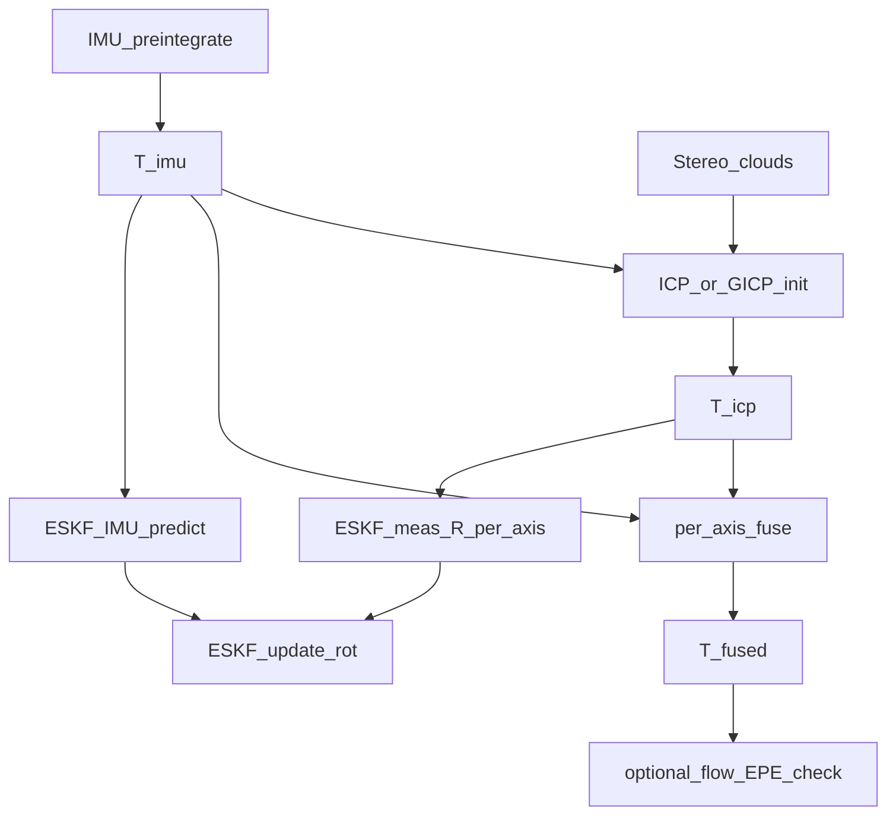
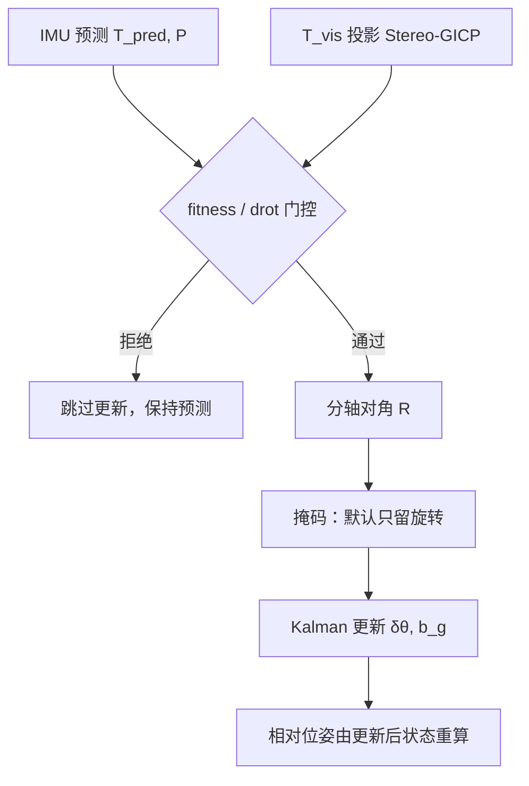
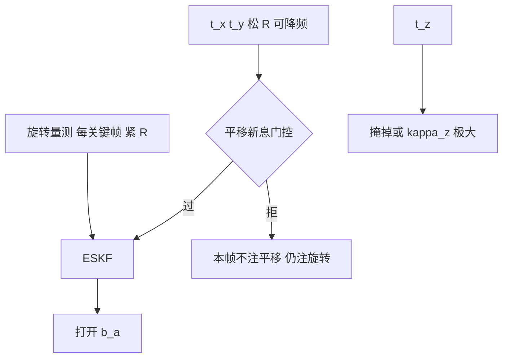

# ICP 各轴角度 / 位移精度（由光流灵敏度反推）

本文在 [`flow_pose_error_sensitivity.md`](flow_pose_error_sensitivity.md) 的各轴光流灵敏度之上，进一步说明：**点对点 / 广义 ICP 在相机系六个自由度上，哪些轴算得准、哪些轴本质上弱**；并与立体点噪声 $\Sigma$（[`gicp_stereo_covariance.md`](gicp_stereo_covariance.md)）、现网 `--fuse-mode axis`、以及 **分轴 ESKF 量测** 对齐。

坐标系：左目相机系 C（$X$ 右、$Y$ 下、$Z$ 前）。**roll / pitch / yaw = 绕相机 $X/Y/Z$**，不是机体航空角。

---

## 0. 符号与参数含义

与 [`flow_pose_error_sensitivity.md`](flow_pose_error_sensitivity.md) §1.2 共用同一套相机系约定；下表覆盖**本文出现的全部符号**。

### 0.1 相机内参与场景几何

| 符号 | 单位 | 含义 |
|------|------|------|
| $f_x,f_y$ | px | 焦距（像素）；ZED HD720 约 $f_x\approx 528$ |
| $f$ | px | 量级分析时取 $f\approx f_x\approx f_y$ |
| $c_x,c_y$ | px | 主点（光轴与像面交点） |
| $B$ | m | 双目基线；约 $0.12\,\mathrm{m}$ |
| $X,Y,Z$ | m | 左目相机系下 3D 点坐标（右、下、前）；$Z$ 亦作场景**特征深度**（如深度中位数） |
| $x,y$ | m | 与 $X,Y$ 同义（点横向 / 竖向坐标） |
| $\rho_{xy}=\sqrt{x^2+y^2}$ | m | 点到光轴的径向距离（离轴距）；决定绕 $Z$ 旋转的杠杆臂 |
| $x_n=x/Z,\ y_n=y/Z$ | 无量纲 | 归一化像平面坐标；光心为 $0$，画面边缘增大 |
| $\alpha$ | rad | 半视场角量级（边缘处 $|x_n|$ 或 $|y_n|$）；用于 $\omega_z$、$t_z$ 的边缘激励 |

### 0.2 相对位姿与六自由度（DoF）

| 符号 | 单位 | 含义 |
|------|------|------|
| $T=(R,\mathbf{t})$ | — | 相对位姿；$p_{\mathrm{tgt}}=R\,p_{\mathrm{src}}+\mathbf{t}$（即 `T_target_source`） |
| $R$ | — | $3\times 3$ 相对旋转 |
| $\mathbf{t}=(t_x,t_y,t_z)^\top$ | m | 相对平移（相机系） |
| $t_x,t_y,t_z$ | m | 沿相机右 / 下 / 前 的平移分量；ICP 或 IMU 的估计值 |
| $t_\perp$ | m | 横向平移量级代表（$t_x$ 或 $t_y$） |
| DoF | — | 自由度：三个旋转 + 三个平移，共 6 个 |

### 0.3 位姿误差 / 扰动（用于灵敏度与精度）

| 符号 | 单位 | 含义 |
|------|------|------|
| $\boldsymbol{\omega}=(\omega_x,\omega_y,\omega_z)^\top$ | rad | 相对旋转的小误差（绕相机 $X/Y/Z$） |
| $\omega_x$ | rad | 绕 $+X$ 的旋转误差；代码名 **roll** |
| $\omega_y$ | rad | 绕 $+Y$ 的旋转误差；代码名 **pitch** |
| $\omega_z$ | rad | 绕 $+Z$（光轴）的旋转误差；代码名 **yaw** |
| $\theta$ / $\theta_{\mathrm{rad}}$ | rad | 某一轴旋转误差的标量大小 |
| $\theta_{\mathrm{deg}}$ | ° | $\theta$ 的角度制：$180\theta/\pi$ |
| $\delta\mathbf{t}=(\delta t_x,\delta t_y,\delta t_z)^\top$ | m | 相对平移的小误差 |
| $\delta t_x,\delta t_y,\delta t_z$ | m | 沿右 / 下 / 前 的平移误差 |
| $\delta t_\perp$ | m | 横向平移误差量级（$\delta t_x$ 或 $\delta t_y$） |
| $\delta\mathbf{p}$ | m | 位姿误差引起的 3D 点一阶位移：$\delta\mathbf{p}\approx\boldsymbol{\omega}\times\mathbf{p}+\delta\mathbf{t}$ |
| $\xi_i$ | 随轴 | 六个 DoF 中的第 $i$ 个（某 $\omega$ 或某 $t$ 分量） |
| $\sigma(\xi_i)$ | 随轴 | 该 DoF 估计的标准差（精度量级）；越小越准 |
| $\sigma(\omega)$、$\sigma(\omega_{x/y})$ | rad 或 ° | 绕 $X/Y$ 旋转估计的不确定度 |
| $\sigma(t_\perp)$、$\sigma(t_z)$ | m | 横向 / 前向平移估计的不确定度 |
| $\mathrm{drot}$ | ° | IMU 与 ICP 相对旋转夹角（诊断用） |

### 0.4 光流与误差预算

| 符号 | 单位 | 含义 |
|------|------|------|
| EPE | px | 端点误差 $\sqrt{(\delta u)^2+(\delta v)^2}$；位姿误差映射到像素流的幅度 |
| $\mathrm{EPE}_{\mathrm{tol}}$ | px | 可接受的光流误差预算（近光心）；由此反推各轴位姿误差上限 |
| $\sim f\,\omega$ | px | 绕 $X/Y$ 旋转 $\omega$（rad）在近光心产生的特征 EPE |
| $\sim f\,\delta t_\perp/Z$ | px | 横向平移误差产生的特征 EPE |

### 0.5 立体点噪声与协方差

| 符号 | 单位 | 含义 |
|------|------|------|
| $\sigma_u,\sigma_v$ | px | 像素坐标噪声标准差；本文取 $0.5\,\mathrm{px}$ |
| $\sigma_d$ | px | 视差噪声标准差；本文取 $0.3\,\mathrm{px}$ |
| $\sigma_X,\sigma_Y$ | m | 三角化后横向位置标准差；光心附近 $\sigma_X\approx(Z/f)\sigma_u$ |
| $\sigma_Z$ | m | 深度标准差；光心附近 $\sigma_Z\approx Z^2\sigma_d/(fB)$，随深度**平方**变差 |
| $\Sigma$ | $\mathrm{m}^2$ | 点的 $3\times 3$ 位置协方差（可含 $\mathrm{Cov}(X,Z)$ 等交叉项） |
| $\mathrm{Cov}(X,Z)$ | $\mathrm{m}^2$ | $X$ 与 $Z$ 的协方差；离轴时非零 |
| P2P | — | Point-to-Point ICP：各向同性欧氏残差，不区分 $\sigma_Z\gg\sigma_X$ |
| GICP | — | Generalized ICP：用马氏距离按 $\Sigma$ 加权残差 |

### 0.6 ICP 残差与统计量

| 符号 | 单位 | 含义 |
|------|------|------|
| $p_i$ | m | source 点云中的点 |
| $q_j$ | m | target 中与之对应的点（立体云推荐投影关联，见 [gicp_stereo_covariance.md](gicp_stereo_covariance.md) §3.2） |
| $e=Tp_i-q_j$ | m | 点对点残差向量 |
| $\Vert\partial e/\partial\xi_i\Vert$ | 随轴 | 残差对第 $i$ 个 DoF 的灵敏度（雅可比列范数 / 杠杆臂）：平移约 $1$，绕 $X/Y$ 约 $Z$，绕 $Z$ 约 $\rho_{xy}$ |
| $\sigma_{\mathrm{res},i}$ | m | 约束该 DoF 时起主导作用的点噪声（如横向用 $\sigma_X$，前向用 $\sigma_Z$） |
| $N_{\mathrm{eff}}$ | — | **有效独立约束点数**（体素下采样 + inlier 后的量级，远小于原始点数） |
| CRLB | — | Cramér–Rao 下界：仅由点噪声推出的精度下界；实际误差通常更大 |
| fitness | — | Open3D 配准 inlier 比例；**不区分轴向**信息量 |
| rmse | m | 对应点残差均方根 |

### 0.7 融合权重（现网 `fuse_mode=axis`）

| 符号 | 单位 | 含义 |
|------|------|------|
| $\mathrm{conf}$ | — | 配准置信度，映射到 $[0,1]$（`icp_confidence`）。P2P 用 fitness + RMSE；投影 Stereo-GICP 只用 fitness，见 [`gicp_stereo_covariance.md`](gicp_stereo_covariance.md) §5.2 |
| $w_{\mathrm{roll}},w_{\mathrm{pitch}},w_{\mathrm{yaw}}$ | — | 旋转融合时 ICP 权重；按灵敏度/可观性，$w_{\mathrm{pitch}}\approx w_{\mathrm{roll}}$（均高于 yaw 的边缘依赖） |
| $15\%\times\mathrm{conf}$ | — | $t_z$ 上 ICP 的弱融合比例（其余信 IMU） |
| $\Vert R_{\mathrm{imu}}\Vert$ | ° | IMU 相对旋转角模长；$>3^\circ$ 时加大 ICP 旋转权重 |
| $R_{\mathrm{imu}}$ | — | IMU 预积分得到的相对旋转（非上面的旋转矩阵符号混用时，语境为“IMU 旋转量”） |

### 0.8 代码名对照

| 代码名 | 相机轴 | 本文符号 |
|--------|--------|---------|
| roll | 绕 $+X$ | $\omega_x$ |
| pitch | 绕 $+Y$ | $\omega_y$ |
| yaw | 绕 $+Z$ | $\omega_z$ |
| tx, ty, tz | 沿 $X,Y,Z$ | $t_x,t_y,t_z$ |

### 0.9 ESKF（误差状态滤波）

| 符号 | 单位 | 含义 |
|------|------|------|
| $\delta\mathbf{x}$ | 混 | 15 维误差状态 $[\delta\mathbf{p},\delta\mathbf{v},\delta\boldsymbol{\theta},\delta\mathbf{b}_a,\delta\mathbf{b}_g]$（世界系 $W$） |
| $P$ | — | $15\times 15$ 误差协方差；预测用 IMU 过程噪声传播 |
| $T_{\mathrm{vis}}$ | — | 视觉相对位姿量测（P2P ICP 或投影 Stereo-GICP 的 `T_target_source`） |
| $T_{\mathrm{pred}}$ | — | IMU 预测得到的同区间相机相对位姿 |
| $\mathbf{z}=\mathrm{Log}(T_{\mathrm{pred}}^{-1}T_{\mathrm{vis}})$ | m, rad | 6D 切空间残差，顺序 $[t_x,t_y,t_z,\omega_x,\omega_y,\omega_z]$ |
| $H$ | — | $\partial\mathbf{z}/\partial\delta\mathbf{x}$（现网默认数值雅可比） |
| $R$ | — | $6\times 6$ 量测噪声；**必须分轴**，对角即可（工程） |
| $K$ | — | Kalman 增益；$R_{ii}$ 大 → 该轴几乎不改状态 |
| $\sigma_{\omega0}$ | ° | 旋转量测基准标准差（工程值，远大于 §2 CRLB） |
| $\sigma_{t0}$ | m | 平移量测基准标准差 |
| $\kappa_z$ | — | $\sigma_{t_z}/\sigma_{t_x}$；建议 $\ge 4$ |
| $\kappa_{\mathrm{yaw}}$ | — | $\sigma_{\omega_z}/\sigma_{\omega_x}$；有离轴结构时 $\approx 1$，挤在光心时 $1.2\sim 1.5$ |
| gate | — | 量测准入：fitness 下限 + 与预测的 $\mathrm{drot}$ 上限 |
| $J_c$ | — | 色彩残差对 $\delta\xi$ 的雅可比；**不进** 15 维状态，见 [§5.10](#510-色彩项投影关联上的雅可比不进-eskf-状态) |

实现：[`eskf_imu.py`](../eskf_imu.py)（预测 / 更新）、[`eskf_icp_obs.py`](../eskf_icp_obs.py)（$R$ 与门控）、[`eskf_icp_run.py`](../eskf_icp_run.py)（离线序列）。

---

## 1. 从光流灵敏度到 ICP 可观测量

光流文档给出的近光心一阶映射（特征深度 $Z$，焦距 $f\approx f_x\approx f_y$）：

| DoF | 光流特征 EPE | 深度依赖 |
|-----|--------------|----------|
| $\omega_y$（pitch） | $\sim f\,\omega_y$ | 几乎无关 |
| $\omega_x$（roll） | $\sim f\,\omega_x$ | 几乎无关 |
| $\delta t_x,\delta t_y$ | $\sim f\,\delta t_\perp/Z$ | $\propto 1/Z$ |
| $\omega_z$（yaw） | 中心 $\sim 0$；半视场 $\alpha$ 处 $\sim f\alpha\,\omega_z$ | 靠边缘 |
| $\delta t_z$ | 中心 $\sim 0$；边缘 $\sim f\alpha\,\delta t_z/Z$ | 最弱 |

灵敏度排序（同“看起来不大”的物理单位下）：

$$
\omega_y,\ \omega_x \gg \delta t_x,\ \delta t_y \gg \omega_z,\ \delta t_z.
$$

ICP 不直接最小化像素光流，而是最小化 **3D 点残差** $e=Tp_i-q_j$。但刚体扰动在 3D 上的位移场与光流推导同源：

$$
\delta\mathbf{p}\approx \boldsymbol{\omega}\times\mathbf{p}+\delta\mathbf{t}.
$$

| DoF | 典型 3D 位移幅度（点深度 $Z$） | 含义 |
|-----|--------------------------------|------|
| $\delta t_x,\delta t_y$ | $\sim\Vert\delta t_\perp\Vert$ | 全体点同向平移 |
| $\delta t_z$ | $\sim\Vert\delta t_z\Vert$ | 全体点沿光轴平移 |
| $\omega_y,\omega_x$ | $\sim Z\Vert\omega\Vert$（横向） | **杠杆臂 = 深度** |
| $\omega_z$ | $\sim \rho_{xy}\Vert\omega_z\Vert$，$\rho_{xy}=\sqrt{x^2+y^2}$ | 杠杆臂 = 离轴距 |

因此：

- **光流里“敏感”的轴**（$\omega_x,\omega_y$）在 ICP 里对应 **大的横向 3D 位移 / 强约束**（前提：横向点噪声可控）。
- **光流里“钝”的轴**（$\omega_z,\delta t_z$）在 ICP 里同样 **几何激励弱**；再叠立体 $\sigma_Z$ 大，$t_z$ 最差。

等价关系（光流文档）在 ICP 里表现为 **平面场景下的旋转–平移耦合**：

$$
1^\circ \Leftrightarrow \delta t_\perp\approx 0.0175\,Z
\quad\Rightarrow\quad
\omega_y\ \text{and}\ \delta t_x\ \text{nearly degenerate on a single-depth plane}.
$$

需要 **深度层次 / 多平面** 才能拆开 $\omega$ 与 $\delta t_\perp$。

---

## 2. 点噪声如何限制各轴精度（细化计算）

思路分三步：**(A) 立体测量 → 单点 3D 噪声** → **(B) 单点残差对位姿的杠杆臂** → **(C) $N_{\mathrm{eff}}$ 个独立约束合并成位姿标准差**。下列默认数值与仓库可视化一致（光心附近近似）。

| 默认参数 | 取值 | 含义 |
|----------|------|------|
| $\sigma_u=\sigma_v$ | $0.5\,\mathrm{px}$ | 像素坐标噪声标准差 |
| $\sigma_d$ | $0.3\,\mathrm{px}$ | 视差噪声标准差 |
| $f\approx f_x$ | $528\,\mathrm{px}$ | 焦距（像素） |
| $B$ | $0.12\,\mathrm{m}$ | 双目基线 |
| $N_{\mathrm{eff}}$ | 示例取 $100$ | 体素 + inlier 后的有效独立点数（乐观量级） |

### 2.1 三角化：深度与横向位置

$$
Z=\frac{f_x B}{d}
$$

| 符号 | 单位 | 含义 |
|------|------|------|
| $Z$ | m | 左目系深度（光轴正向） |
| $f_x$ | px | 水平焦距 |
| $B$ | m | 基线 |
| $d$ | px | 视差（左–右像素差） |

$$
X=\frac{(u-c_x)Z}{f_x},\qquad
Y=\frac{(v-c_y)Z}{f_y}
$$

| 符号 | 单位 | 含义 |
|------|------|------|
| $X,Y$ | m | 相机系横向 / 竖向坐标 |
| $(u,v)$ | px | 左图像素 |
| $c_x,c_y$ | px | 主点 |

### 2.2 视差 → 深度噪声

对 $Z=f_x B/d$ 求导：

$$
\frac{\partial Z}{\partial d}=-\frac{Z^2}{f_x B}
$$

| 符号 | 单位 | 含义 |
|------|------|------|
| $\partial Z/\partial d$ | m/px | 视差变化 1 px 引起的深度变化；负号表示视差越大深度越小 |
| $Z^2/(f_x B)$ | m/px | 灵敏度幅度；**随深度平方增大** |

一阶标准差（光心，$X=Y=0$，深度只受视差噪声）：

$$
\sigma_Z\approx\left\lvert\frac{\partial Z}{\partial d}\right\rvert\sigma_d=\frac{Z^2}{f_x B}\,\sigma_d
$$

| 符号 | 单位 | 含义 |
|------|------|------|
| $\sigma_Z$ | m | 深度标准差（1σ） |
| $\sigma_d$ | px | 视差噪声标准差 |

代入默认值（$f_x=528$，$B=0.12$，$\sigma_d=0.3$）：

$$
\sigma_Z\approx\frac{Z^2}{528\times 0.12}\times 0.3
=\frac{Z^2}{211.2}\times 0.3
\approx 1.42\times 10^{-3}\,Z^2
\quad\text{(m, with }Z\text{ in m)}.
$$

| $Z$ | 计算 | $\sigma_Z$ |
|-----|------|------------|
| 3 m | $1.42\times 10^{-3}\times 9$ | $\approx 13\,\mathrm{mm}$ |
| 5 m | $1.42\times 10^{-3}\times 25$ | $\approx 35\,\mathrm{mm}$ |
| 10 m | $1.42\times 10^{-3}\times 100$ | $\approx 142\,\mathrm{mm}$ |
| 12 m | $1.42\times 10^{-3}\times 144$ | $\approx 204\,\mathrm{mm}$ |

### 2.3 像素 → 横向位置噪声（光心主项）

光心附近，$X\approx 0$，视差耦合到 $X$ 的项可忽略，只留像素噪声：

$$
\sigma_X\approx\frac{Z}{f_x}\,\sigma_u
$$

| 符号 | 单位 | 含义 |
|------|------|------|
| $\sigma_X$ | m | 横向（右）位置标准差 |
| $Z/f_x$ | m/px | 单像素对应的横向米制尺度（小孔成像） |
| $\sigma_u$ | px | $u$ 方向像素噪声 |

同理：

$$
\sigma_Y\approx\frac{Z}{f_y}\,\sigma_v
$$

| 符号 | 单位 | 含义 |
|------|------|------|
| $\sigma_Y$ | m | 竖向（下）位置标准差 |
| $\sigma_v$ | px | $v$ 方向像素噪声 |

代入 $f_x=528$，$\sigma_u=0.5$：

$$
\sigma_X\approx\frac{Z}{528}\times 0.5\approx 9.47\times 10^{-4}\,Z
\quad\text{(m)}.
$$

| $Z$ | $\sigma_X\approx\sigma_Y$ | 与 $\sigma_Z$ 之比 |
|-----|---------------------------|---------------------|
| 3 m | $\approx 2.8\,\mathrm{mm}$ | $\sigma_Z/\sigma_X\approx 4.5$ |
| 5 m | $\approx 4.7\,\mathrm{mm}$ | $\approx 7.5$ |
| 10 m | $\approx 9.5\,\mathrm{mm}$ | $\approx 15$ |
| 12 m | $\approx 11\,\mathrm{mm}$ | $\approx 18$ |

**结论**：同一深度上 $\sigma_Z\gg\sigma_X$；越远比值越大。离轴时还有 $\mathrm{Cov}(X,Z)$ 等交叉项（见 [`gicp_stereo_covariance.md`](gicp_stereo_covariance.md)），量级判断仍以对角为主。

### 2.4 ICP 残差与杠杆臂

对应点残差（target 系）：

$$
e = R\,p_i + \mathbf{t} - q_j
$$

| 符号 | 单位 | 含义 |
|------|------|------|
| $e$ | m | 3D 残差向量 |
| $p_i$ | m | source 点 |
| $q_j$ | m | target 对应点。立体云推荐投影关联（将源点变换后投到目标深度图再反投影），不要默认欧氏最近点；见 [gicp_stereo_covariance.md](gicp_stereo_covariance.md) §3.2 |
| $R,\mathbf{t}$ | — / m | 待估相对位姿 |

小扰动下点位移：

$$
\delta\mathbf{p}\approx\boldsymbol{\omega}\times\mathbf{p}+\delta\mathbf{t}
$$

| 符号 | 单位 | 含义 |
|------|------|------|
| $\delta\mathbf{p}$ | m | 位姿误差引起的点 3D 位移 |
| $\boldsymbol{\omega}$ | rad | 小旋转误差 |
| $\delta\mathbf{t}$ | m | 小平移误差 |

对位于光心附近、深度约 $Z$ 的点，各 DoF 的**杠杆臂**（残差幅度 / 单位参数）：

$$
\left\Vert\frac{\partial e}{\partial t_x}\right\Vert\approx 1,\quad
\left\Vert\frac{\partial e}{\partial t_y}\right\Vert\approx 1,\quad
\left\Vert\frac{\partial e}{\partial t_z}\right\Vert\approx 1
$$

| 符号 | 单位 | 含义 |
|------|------|------|
| $\Vert\partial e/\partial t_x\Vert$ 等 | m/m = 1 | 平移 1 m → 全体点残差约 1 m；无几何放大 |

$$
\left\Vert\frac{\partial e}{\partial\omega_y}\right\Vert\sim Z,\qquad
\left\Vert\frac{\partial e}{\partial\omega_x}\right\Vert\sim Z
$$

| 符号 | 单位 | 含义 |
|------|------|------|
| $\Vert\partial e/\partial\omega_y\Vert$ | m/rad | 绕 $Y$ 转 $1\,\mathrm{rad}$ 时，深度 $Z$ 处点横向移动约 $Z$ 米 |
| $Z$ | m | 该点深度 = 旋转杠杆臂 |

$$
\left\Vert\frac{\partial e}{\partial\omega_z}\right\Vert\sim\rho_{xy}=\sqrt{x^2+y^2}
$$

| 符号 | 单位 | 含义 |
|------|------|------|
| $\Vert\partial e/\partial\omega_z\Vert$ | m/rad | 绕光轴旋转的杠杆臂 = 离轴距 |
| $\rho_{xy}$ | m | 点到光轴距离；光心 $\approx 0$（几乎无约束） |

### 2.5 多点合并：CRLB 型精度公式

假设 $N_{\mathrm{eff}}$ 个有效独立对应、噪声不相关、且该 DoF 主要由某一残差方向约束，则位姿分量标准差量级：

$$
\sigma(\xi_i)\sim\frac{\sigma_{\mathrm{res},i}}{\Vert\partial e/\partial\xi_i\Vert\,\sqrt{N_{\mathrm{eff}}}}
$$

| 符号 | 单位 | 含义 |
|------|------|------|
| $\xi_i$ | 随轴 | 第 $i$ 个 DoF（某 $t$ 或某 $\omega$） |
| $\sigma(\xi_i)$ | 随轴 | 该 DoF 估计的 1σ 下界（越小越准） |
| $\sigma_{\mathrm{res},i}$ | m | 约束该轴时的主导点噪声（见下表） |
| $\Vert\partial e/\partial\xi_i\Vert$ | 随轴 | §2.4 的杠杆臂 |
| $N_{\mathrm{eff}}$ | — | 有效独立点数；$\sqrt{N_{\mathrm{eff}}}$ 来自独立同分布平均 |
| $\sim$ | — | 量级关系；忽略轴间耦合、错误对应、鲁棒核等 |

各轴取：

| $\xi_i$ | $\sigma_{\mathrm{res},i}$ | $\Vert\partial e/\partial\xi_i\Vert$ |
|---------|---------------------------|--------------------------------------|
| $t_x,t_y$ | $\sigma_X$ 或 $\sigma_Y$ | $\approx 1$ |
| $t_z$ | $\sigma_Z$ | $\approx 1$ |
| $\omega_x,\omega_y$ | $\sigma_X$（横向残差） | $\sim Z$ |
| $\omega_z$ | $\sigma_X$ | $\sim\rho_{xy}$ |

### 2.6 平移精度

**横向平移**

$$
\sigma(t_x)\sim\frac{\sigma_X}{\sqrt{N_{\mathrm{eff}}}}
=\frac{Z\,\sigma_u}{f_x\,\sqrt{N_{\mathrm{eff}}}}
$$

| 符号 | 单位 | 含义 |
|------|------|------|
| $\sigma(t_x)$ | m | $t_x$ 估计的 1σ 下界 |
| 第一式 | — | 杠杆臂为 1，噪声取 $\sigma_X$ |
| 第二式 | — | 代入 $\sigma_X=(Z/f_x)\sigma_u$；精度随 $Z$ **线性变差** |

同理 $\sigma(t_y)\sim\sigma_Y/\sqrt{N_{\mathrm{eff}}}$。

**前向平移**

$$
\sigma(t_z)\sim\frac{\sigma_Z}{\sqrt{N_{\mathrm{eff}}}}
=\frac{Z^2\,\sigma_d}{f_x B\,\sqrt{N_{\mathrm{eff}}}}
$$

| 符号 | 单位 | 含义 |
|------|------|------|
| $\sigma(t_z)$ | m | $t_z$ 估计的 1σ 下界 |
| $Z^2\sigma_d/(f_x B)$ | m | 单点深度噪声；合并后除以 $\sqrt{N_{\mathrm{eff}}}$ |
| 随 $Z$ | — | **平方变差**，同深度下远差于 $\sigma(t_x)$ |

**数值例**（$N_{\mathrm{eff}}=100$，$\sqrt{N_{\mathrm{eff}}}=10$）：

| $Z$ | $\sigma(t_x)$ 下界 | $\sigma(t_z)$ 下界 | $\sigma(t_z)/\sigma(t_x)$ |
|-----|--------------------|--------------------|---------------------------|
| 3 m | $\approx 0.28\,\mathrm{mm}$ | $\approx 1.3\,\mathrm{mm}$ | $\approx 5$ |
| 5 m | $\approx 0.47\,\mathrm{mm}$ | $\approx 3.5\,\mathrm{mm}$ | $\approx 7$ |
| 10 m | $\approx 0.95\,\mathrm{mm}$ | $\approx 14\,\mathrm{mm}$ | $\approx 15$ |
| 12 m | $\approx 1.1\,\mathrm{mm}$ | $\approx 20\,\mathrm{mm}$ | $\approx 18$ |

说明：上表是**仅点噪声、理想对应**的 CRLB；实际错误对应 / 平面简并 / 动态点常使 $\sigma(t_z)$ 到 **分米级**，故 fuse 对 $t_z$ 弱信 ICP。

各向同性 P2P 不区分 $\sigma_Z\gg\sigma_X$，优化时仍用深度方向大噪声去拉 $t_z$（「Z 向易滑」）。GICP + $\Sigma$ **降权深度方向**可抑偏置，但公式里 $\sigma(t_z)$ 的信息量仍由 $\sigma_Z$ 决定——**不创造 $t_z$ 可观性**。

### 2.7 旋转精度（绕 $X/Y$）

$$
\sigma(\omega_y)\sim\frac{\sigma_X}{Z\,\sqrt{N_{\mathrm{eff}}}}
=\frac{(Z/f_x)\,\sigma_u}{Z\,\sqrt{N_{\mathrm{eff}}}}
=\frac{\sigma_u}{f_x\,\sqrt{N_{\mathrm{eff}}}}
$$

| 符号 | 单位 | 含义 |
|------|------|------|
| $\sigma(\omega_y)$ | rad | 绕 $Y$（pitch）估计的 1σ 下界 |
| $\sigma_X/(Z\sqrt{N_{\mathrm{eff}}})$ | rad | 横向噪声 /（杠杆臂 $Z$ × $\sqrt{N}$） |
| 化简后 | — | $Z$ 约掉 → **与深度近似无关** |
| $\sigma_u/f_x$ | rad | 单点、无平均时的角精度量级（小孔：像素噪声 / 焦距） |

$\sigma(\omega_x)$ 同形（用 $\sigma_v,f_y$）。

代入 $\sigma_u=0.5$，$f_x=528$：

$$
\sigma(\omega_{x/y})\sim\frac{0.5}{528\,\sqrt{N_{\mathrm{eff}}}}
\approx\frac{9.47\times 10^{-4}}{\sqrt{N_{\mathrm{eff}}}}\ \mathrm{rad}
\approx\frac{0.054^\circ}{\sqrt{N_{\mathrm{eff}}}}.
$$

| 符号 | 单位 | 含义 |
|------|------|------|
| $0.5/528$ | rad | 单点角噪声 $\sigma_u/f_x$ |
| $/\sqrt{N_{\mathrm{eff}}}$ | — | $N$ 个独立点平均 |
| $0.054^\circ$ | ° | $N_{\mathrm{eff}}=1$ 时的角度下界；再除以 $\sqrt{N_{\mathrm{eff}}}$ |

| $N_{\mathrm{eff}}$ | $\sigma(\omega_{x/y})$ 下界 |
|--------------------|------------------------------|
| 1 | $\approx 0.054^\circ$ |
| 25 | $\approx 0.011^\circ$ |
| 100 | $\approx 0.0054^\circ$ |
| 400 | $\approx 0.0027^\circ$ |

与光流一致：近光心 EPE $\sim f\,\omega$，故角误差 $\omega\sim\mathrm{EPE}/f$，与上式同一结构。

**实际**：错误对应、简并、初值偏差常使误差比 CRLB 大 **1～2 个量级**；本数据集 IMU–ICP $\mathrm{drot}<1^\circ$ 与此相容（远高于 $0.005^\circ$ 下界）。

### 2.8 旋转精度（绕 $Z$）

$$
\sigma(\omega_z)\sim\frac{\sigma_X}{\rho_{xy}\,\sqrt{N_{\mathrm{eff}}}}
$$

| 符号 | 单位 | 含义 |
|------|------|------|
| $\sigma(\omega_z)$ | rad | 绕光轴（yaw）估计的 1σ 下界 |
| $\rho_{xy}$ | m | 离轴距；光心附近 $\to 0$ → $\sigma(\omega_z)\to\infty$（不可观） |
| 实用 | — | 需边缘 / 大 $\rho_{xy}$ 的点；可用场景平均 $\bar\rho_{xy}$ 或半视场 $\alpha Z$（$\alpha\sim|x_n|$）代入 |

边缘近似 $\rho_{xy}\approx\alpha Z$：

$$
\sigma(\omega_z)\sim\frac{\sigma_X}{\alpha Z\,\sqrt{N_{\mathrm{eff}}}}
=\frac{\sigma_u}{f_x\,\alpha\,\sqrt{N_{\mathrm{eff}}}}
$$

| 符号 | 单位 | 含义 |
|------|------|------|
| $\alpha$ | rad | 半视场角量级（如 $0.3\sim 0.5$） |
| 相对 $\sigma(\omega_y)$ | — | 大约多因子 $1/\alpha$，故 yaw 通常弱于 pitch/roll |

### 2.9 小结：噪声如何“卡住”各轴

| DoF | 精度公式（下界） | 随 $Z$ | 随 $N_{\mathrm{eff}}$ |
|-----|------------------|--------|------------------------|
| $t_x,t_y$ | $\sigma_u Z/(f\sqrt{N_{\mathrm{eff}}})$ | 线性变差 | $\propto 1/\sqrt{N}$ |
| $t_z$ | $\sigma_d Z^2/(fB\sqrt{N_{\mathrm{eff}}})$ | **平方变差** | $\propto 1/\sqrt{N}$ |
| $\omega_x,\omega_y$ | $\sigma_u/(f\sqrt{N_{\mathrm{eff}}})$ | **几乎无关** | $\propto 1/\sqrt{N}$ |
| $\omega_z$ | $\sigma_u/(f\alpha\sqrt{N_{\mathrm{eff}}})$ | 几乎无关（$\alpha$ 固定时） | $\propto 1/\sqrt{N}$；无离轴点则失效 |

---

## 3. 各轴精度总表（工程判读）

综合 **光流可观测性** + **立体噪声** + **ICP 残差几何**：

| 分量 | 代码名 | 光流激励 | ICP 3D 激励 | 点噪声 | 综合精度 | 建议信任 |
|------|--------|----------|-------------|--------|----------|----------|
| 绕 $Y$ | pitch | 最强（水平流） | 强（杠杆 $Z$） | 横向较好 | **高**（灵敏度最高 → 最可观） | **更信 ICP/GICP**（与 roll 同级或略高） |
| 绕 $X$ | roll | 强（竖直流） | 强 | 横向较好 | **高** | 较信 ICP |
| 绕 $Z$ | yaw | 中心弱 | 离轴才有 | 横向 | **中**（依赖 FOV / 边缘结构） | 可信 ICP（有结构时）；可略低于 roll/pitch |
| $t_x$ | — | 中（$\propto 1/Z$） | 中 | $\sigma_X$ | **中，近处更好** | 近处可参考；本库 fuse 仍偏 IMU |
| $t_y$ | — | 中 | 中 | $\sigma_Y$ | **中** | 同上 |
| $t_z$ | — | 最弱 | 有位移但沿最噪轴 | $\sigma_Z\propto Z^2$ | **最低** | **弱融合 / 信 IMU** |

排序（**计算精度 / 可信度**，由高到低）：

$$
\omega_x\ \gtrsim\ \omega_y\ \gtrsim\ \omega_z
\quad\gg\quad
t_x,\ t_y
\quad\gg\quad
t_z.
$$

说明：[`flow_pose_error_sensitivity.md`](flow_pose_error_sensitivity.md) 中灵敏度 $\omega_y,\omega_x\gg\cdots$ 表示 **同等物理误差产生更大光流 / 更强视觉信息**，即 pitch/roll **更可观**，融合时应 **更信点云**，而不是降权。  
旧实现曾用 $w_{\mathrm{pitch}}=0.45$、$w_{\mathrm{roll}}=0.80$，把「估错时 EPE 大」误当成「少信视觉」——与灵敏度含义相反；正确做法是 $w_{\mathrm{pitch}}\approx w_{\mathrm{roll}}$（均高），yaw 因中心激励弱可略低或同级（有边缘结构时）。

---

## 4. 基于以上分析：如何融合 IMU 与点云观测

原则：**分轴、按信息量加权，而不是对整个 $SE(3)$ 做同一套权重。**  
IMU 与 ICP 的误差结构不同——短时 IMU 平移相对稳、旋转易随时间漂；ICP 旋转（尤其绕 $X/Y$）受横向点约束较好，$t_z$ 被 $\sigma_Z\propto Z^2$ 卡死。

### 4.1 推荐角色分工



| 阶段 | IMU | 点云（ICP / 建议 GICP） |
|------|-----|-------------------------|
| 初值 | **必须**：给 ICP 的 $T_{\mathrm{init}}$ | 勿用单位阵；投影关联比欧氏 NN 更依赖初值 |
| 对应 | — | 立体云推荐投影关联，见 [gicp_stereo_covariance.md](gicp_stereo_covariance.md) §3.2 |
| 旋转 $\omega_x,\omega_y$ | 短时可用；大转角易漂 | **主观测**（光流灵敏度高 → 强可观；pitch 与 roll 同级信任） |
| 旋转 $\omega_z$ | 同上 | **主观测**（需离轴结构；中心弱） |
| 平移 $t_x,t_y$ | **主观测**（近处双积分） | 辅助；与旋转简并，勿单独全信 |
| 平移 $t_z$ | **主观测** | **弱观测**（最多小权重） |
| 滤波层 | 预测 / 过程噪声；默认不靠视觉改平移 | 量测默认只注旋转；$R$ 分轴，pitch 与 roll 同紧 |

### 4.2 开环按轴融合（现网默认，可直接用）

实现：[`fuse_imu_icp_transform.py`](../fuse_imu_icp_transform.py) → `fuse_axis_selective`，`--fuse-mode axis`。

**1）ICP 置信度**（由配准质量映射到 $[0,1]$）：

$$
\mathrm{conf}=f(\mathrm{fitness},\mathrm{rmse})
$$

| 符号 | 含义 |
|------|------|
| $\mathrm{fitness}$ | inlier 比例；低则全面降 ICP 权重 |
| $\mathrm{rmse}$ | 残差均方根；大则降权 |
| $\mathrm{conf}$ | 总闸门：后面所有 ICP 权重都乘它 |

**2）平移**

$$
t_x^{\mathrm{fused}}=t_x^{\mathrm{imu}},\qquad
t_y^{\mathrm{fused}}=t_y^{\mathrm{imu}}
$$

$$
t_z^{\mathrm{fused}}
=(1-\alpha_z)\,t_z^{\mathrm{imu}}+\alpha_z\,t_z^{\mathrm{icp}},\qquad
\alpha_z=\mathrm{conf}\times 0.15
$$

| 符号 | 含义 |
|------|------|
| $\alpha_z$ | $t_z$ 上 ICP 的融合比例；默认上限约 $15\%$ |
| 为何 $t_x,t_y$ 全信 IMU | 近处 IMU 平移可用；ICP 横向与 $\omega$ 简并（$1^\circ\Leftrightarrow 0.0175Z$ m） |
| 为何 $t_z$ 弱融合 | $\sigma(t_z)\sim Z^2\sigma_d/(fB\sqrt{N})$ 最差；全信 ICP 易「Z 向滑」 |

**3）旋转（欧拉按轴混合，相机系 XYZ）**

$$
\mathrm{rot\_scale}=\mathrm{clip}\!\left(\frac{\Vert R_{\mathrm{imu}}\Vert_{\mathrm{deg}}}{3^\circ},\,1,\,2\right)
$$

$$
\begin{aligned}
w_{\mathrm{roll}}&=\mathrm{conf}\times 0.80\times\mathrm{rot\_scale},\\
w_{\mathrm{pitch}}&=\mathrm{conf}\times 0.80\times\mathrm{rot\_scale},\\
w_{\mathrm{yaw}}&=\mathrm{conf}\times 0.80\times\mathrm{rot\_scale}.
\end{aligned}
$$

$$
\phi_i^{\mathrm{fused}}
=(1-w_i)\,\phi_i^{\mathrm{imu}}+w_i\,\phi_i^{\mathrm{icp}}
\quad(i\in\{\mathrm{roll},\mathrm{pitch},\mathrm{yaw}\})
$$

| 符号 | 含义 |
|------|------|
| $w_{\mathrm{roll}},w_{\mathrm{pitch}}$ | 更信 ICP：$\omega_x,\omega_y$ 光流/3D 灵敏度最高 → 视觉信息最强（[`flow_pose_error_sensitivity.md`](flow_pose_error_sensitivity.md)） |
| $w_{\mathrm{yaw}}$ | 默认同级；若点集挤在光心、离轴结构弱，可单独降低 |
| $\mathrm{rot\_scale}$ | IMU 相对转角大时加大 ICP 旋转权（预积分更易漂） |
| $\phi_i$ | 该轴欧拉角（°） |

> 历史备注：旧代码曾设 $w_{\mathrm{pitch}}=0.45\times\mathrm{conf}$（低于 roll）。那是把「pitch 估错时 EPE 大」误读成「少信 ICP」；灵敏度分析要求相反——EPE 对 pitch 敏感 ⇒ 更应采信能约束 pitch 的视觉观测。

**4）输出** $T_{\mathrm{fused}}=(R(\phi^{\mathrm{fused}}),\,t^{\mathrm{fused}})$，再可选跑几何光流 vs RAFT 的 EPE 做验收。

### 4.3 信息量视角（理想加权，与上式同构）

若有各轴方差估计，最优标量融合为：

$$
\hat\xi
=\frac{\sigma_{\mathrm{icp}}^{-2}\,\xi_{\mathrm{icp}}+\sigma_{\mathrm{imu}}^{-2}\,\xi_{\mathrm{imu}}}
{\sigma_{\mathrm{icp}}^{-2}+\sigma_{\mathrm{imu}}^{-2}}
$$

| 符号 | 含义 |
|------|------|
| $\xi$ | 某一轴（如 $t_z$ 或 $\omega_x$） |
| $\sigma_{\mathrm{icp}},\sigma_{\mathrm{imu}}$ | 该轴上 ICP / IMU 的标准差 |
| $\sigma^{-2}$ | 信息量（越大越信） |

与 §2 对齐后的**定性**取值：

| 轴 | $\sigma_{\mathrm{icp}}$（相对） | $\sigma_{\mathrm{imu}}$（短时相对） | 融合倾向 |
|----|-------------------------------|-----------------------------------|----------|
| $\omega_x,\omega_y$ | 小（灵敏度高、可观性强） | 中 | **偏 ICP**（pitch 与 roll 同级） |
| $\omega_z$ | 中（靠离轴） | 中 | 偏 ICP（有边缘结构时） |
| $t_x,t_y$ | 中～大（远景、简并） | 较小 | 偏 IMU |
| $t_z$ | **很大**（$\propto Z^2$） | 较小 | **强偏 IMU** |

现网系数（$w_{\mathrm{roll}}=w_{\mathrm{pitch}}=w_{\mathrm{yaw}}=0.80\times\mathrm{conf}\times\mathrm{rot\_scale}$，$\alpha_z=0.15\times\mathrm{conf}$）是上述信息量加权的**对角工程近似**。真正的最优是两份 $6\times 6$ 在 $\mathrm{SE}(3)$ 上的 MAP（[§4.8](#48-六维协方差融合相对分轴)），不是按欧拉角各轴独立混合。

### 4.4 配准侧建议（喂给融合的点云观测要干净）

1. **初值**：始终用 $T_{\mathrm{imu}}$。  
2. **点云**：nosky / 深度裁剪；远点 $Z>10\!\sim\!12\,\mathrm{m}$ 剔除或降权。  
3. **算法**：优先 Stereo-GICP（[`gicp_stereo_covariance.md`](gicp_stereo_covariance.md)）——马氏加权少信深度，减少 $t_z$ 被远点拉偏；**仍不替代**对 $t_z$ 的弱融合。色彩若用，走同一 $(u,v)$ 门控 / $J_c=-\nabla I\,\Pi\,J_g$，不要另开 Colored ICP。  
4. **勿**因 fitness 高就提高 $t_z$ 权重——fitness 不区分轴向信息量。

### 4.5 进入 ESKF / 滤波时（摘要）

开环 $T_{\mathrm{fused}}$ 给前端位姿；ESKF 给 **IMU 偏置 + 状态**。二者同构：都是分轴按信息量加权，不要把视觉 6D 当各向同性高精度。完整策略见 **[§5](#5-分轴-eskf-策略)**。

| 项 | 短时（现网） | 长期位置 |
|----|--------------|----------|
| 预测 | IMU 传播（[`eskf_imu.py`](../eskf_imu.py)） | 同 |
| 量测 | **只注旋转**（`update_translation: false`） | 旋转照注；**再注视觉平移**（[§5.9](#59-长期位置与视觉平移量测)） |
| $R$ | $\sigma_{\omega_x}\approx\sigma_{\omega_y}$ | 同上，且 $\sigma_{t_z}\gg\sigma_{t_x}\approx\sigma_{t_y}$（松） |
| $b_a$ | 不更新 | 随平移打开 `update_bias_acc` |
| 量测源 | raw $T_{\mathrm{vis}}$，不要喂 $T_{\mathrm{fused}}$ | 同 |

### 4.6 验收与回退

| 检查 | 合格迹象 | 不合格时 |
|------|----------|----------|
| $\mathrm{drot}(R_{\mathrm{imu}},R_{\mathrm{icp}})$ | 通常 $<1^\circ$（本数据集） | 降 `conf` / 更信 IMU 旋转 |
| $\|t_z^{\mathrm{icp}}-t_z^{\mathrm{imu}}\|$ | 分米内可接受；过大勿抬 $\alpha_z$ | 保持弱 $\alpha_z$ 或 $\alpha_z=0$ |
| 融合后光流 EPE vs RAFT | 相对纯 IMU 改善或持平 | 先查旋转（尤其 $\omega_x,\omega_y$）/ 时间同步，勿盲目加平移权 |
| fitness $<0.15$ | — | ICP 全面降权，接近纯 IMU |

### 4.7 一句话策略

**IMU 出初值并主导短时平移（尤其 $t_z$）；点云主导旋转（pitch 与 roll 同级）；用 `conf` 做总闸门。** 短时 ESKF：只注旋转、不估 $b_a$。**要世界系位置长期不二次发散，必须把视觉平移送进 KF**（松 $R$、慎 $t_z$、同时打开 $b_a$，§5.9），而不是把 GICP 6D 当高精度 GPS。协方差校准之后，用 [§4.8](#48-六维协方差融合相对分轴) 的 $6\times 6$ MAP 替换分轴权重。

现网命令：

```bash
conda run -n foundation_stereo python fuse_imu_icp_transform.py data \
  --source-frame <src> --target-frame <tgt> \
  --estimate-gravity-mag --fuse-mode axis --run-flow-diff
```

### 4.8 六维协方差融合（相对分轴）

分轴 `fuse_axis` 把「旋转信视觉、平移信 IMU」写进固定权重。更干净的做法是：**同一相对位姿的两份高斯，用完整 $6\times 6$ 信息相加**，不再按轴设 $w_i$。这在协方差**校准过**时比分轴更合理；拿未缩放的 $H^{-1}$ 去融，会比分轴更差。

**1）目标式（开环一次 MAP）**

预积分给出 $T_{\mathrm{imu}}$、$P_{\mathrm{imu}}$（[`relative_pose_covariance_predict`](../eskf_imu.py)）。Stereo-GICP 给出 $T_{\mathrm{gicp}}$ 与视觉信息 $H_{\mathrm{g}}$（[`projective_pose_covariance`](../gicp_stereo_register.py)，顺序 $[\omega,t]$，用前需置换到与 $P_{\mathrm{imu}}$ 相同的 $[t,\omega]$）。

$$
T^{\star}
=\arg\min_T
\Bigl\lVert
\mathrm{Log}(T_{\mathrm{imu}}^{-1}T)
\Bigr\rVert_{P_{\mathrm{imu}}^{-1}}^{2}
+
\Bigl\lVert
\mathrm{Log}(T_{\mathrm{gicp}}^{-1}T)
\Bigr\rVert_{\Lambda_{\mathrm{g}}}^{2}
$$

$\Lambda_{\mathrm{g}}$ 是校准后的视觉信息，不是生的 $H_{\mathrm{g}}$。一阶解（切空间、以 IMU 为线性化点）：

$$
P_{\mathrm{fused}}^{-1}=P_{\mathrm{imu}}^{-1}+\Lambda_{\mathrm{g}},\qquad
\delta\xi^{\star}=P_{\mathrm{fused}}\,\Lambda_{\mathrm{g}}\,\mathrm{Log}(T_{\mathrm{imu}}^{-1}T_{\mathrm{gicp}}),
$$

$$
T_{\mathrm{fused}}=\exp(\delta\xi^{\star})\,T_{\mathrm{imu}}.
$$

这就是「按协方差融合、不分轴」：哪一轴信谁，由两份信息矩阵的特征值与**交叉项**自动决定。

**2）为什么比分轴更合理（协方差诚实的时候）**

| 分轴 `fuse_axis` | $6\times 6$ MAP |
|-----------------|-----------------|
| 欧拉按轴独立混合，不是 $\mathrm{SE}(3)$ 均值 | 切空间高斯，姿态与平移一起更 |
| 丢掉 $\mathrm{corr}(\omega_y,t_x)\approx -0.9$ | 简并模态是 $H_{\mathrm{g}}$ 的弱特征值，IMU 的 $t$ 会钉住该模态，视觉仍约束互补的旋转组合 |
| $t_x,t_y$ 权直接打成 0，平面上可能把视觉的 $\omega_y$ 与 IMU 的 $t_x$ 拼成几何不一致的位姿 | 联合后验自动取「视觉准的子空间 + IMU 准的子空间」 |
| $\alpha_z=0.15$ 与 $w_{\mathrm{rot}}=0.80$ 是场景无关的数 | 近处 / 多平面时视觉 $t$ 权自动升；远平面时自动把前向交给 IMU |

单平面上视觉强约束的是 $\omega_y + t_x/Z$ 这类组合，弱约束是差组合。IMU 短时平移紧，正好补差组合。分轴把 $t_x$ 扔掉再单独信视觉 $\omega_y$，等于拆开了那条强约束。

**3）为什么现在还不能直接换**

实测投影 Hessian 的对角 $\sigma$ 是 CRLB：旋转 $\sim 0.001^\circ$，平移 $0.1\sim 0.3\,\mathrm{mm}$（[`data/icp_vs_stereo_gicp_pose_covariance.csv`](../data/icp_vs_stereo_gicp_pose_covariance.csv)）。相对 IMU 残差是 $0.1^\circ\sim 1^\circ$、$2\sim 15\,\mathrm{cm}$。生 $H^{-1}$ 当 $P_{\mathrm{gicp}}$ 时 $\Lambda_{\mathrm{g}}$ 比 $P_{\mathrm{imu}}^{-1}$ 大 $10^{4}\sim 10^{6}$，融合结果 $\approx T_{\mathrm{gicp}}$，等于没融。

更糟的是只看 $H^{-1}$ **对角**：简并把边缘 $\sigma_{t_x}$ 抬大，于是 $\sigma_{t_z}<\sigma_{t_x}$。对角融合会更信视觉 $t_z$——与物理相反。完整 $6\times 6$ 不会犯这个错（弱的是混合模态，不是「$Z$ 轴本身更准」）；只抽对角会。

另外 $T_{\mathrm{gicp}}$ 以 $T_{\mathrm{imu}}$ 为初值，两路不是独立量测。开环把它们当独立高斯会双计 IMU 初值。更紧的写法是视觉似然 $H_{\mathrm{g}}$ 加在 IMU 先验上（上式已经如此），而不是「两份位姿各算各的再平均」。

**4）$\Lambda_{\mathrm{g}}$ 怎么校准**

不要 $\Lambda_{\mathrm{g}}=H_{\mathrm{g}}$。

$$
\Lambda_{\mathrm{g}}=\frac{1}{s}\,H_{\mathrm{g}},\qquad s\gg 1.
$$

$s$ 使 $\mathrm{Log}(T_{\mathrm{imu}}^{-1}T_{\mathrm{gicp}})$ 在 $P_{\mathrm{imu}}+\Lambda_{\mathrm{g}}^{-1}$ 下的马氏距离（NEES）约 $6$。本数据上 $s\sim 10^{2}\sim 10^{3}$ 量级（与「不要把 raw $H^{-1}$ 当 ESKF $R$」同一原因）。保留全部交叉项。fitness 低时再乘总闸门，或直接拒绝对（与现在 `conf` 相同角色）。

IMU 侧用预积分相对位姿协方差，不要用各向同性「陀螺 $0.1^\circ$、加速度随便」的对角。短时 $P_{\mathrm{imu}}$ 的平移通常紧、旋转随 $\Delta t$ 与 $\sigma_g$ 变；这已经编码「短时平移信 IMU」。

**5）和 ESKF 的关系**

开环 $6\times 6$ MAP 是单对帧的 Kalman 更新。多帧纠 $b_g$（长期再纠 $b_a$）仍用 ESKF：预测信 IMU，量测 $R=\Lambda_{\mathrm{g}}^{-1}$（同一份校准 Hessian）。那时**不必再分轴掩码**——弱模态的 $R$ 已经大。现网 `update_translation: false` 是在 $R$ 还不诚实之前，用掩码硬模拟「视觉平移信息量 $\approx 0$」。

量测必须是 raw $T_{\mathrm{gicp}}$，不能是已经融过 IMU 的 $T_{\mathrm{fused}}$。

**更紧的一层**：不要先收敛 GICP 再融，把先验直接写进 LM：

$$
E(T)=\sum e^{\top}C^{-1}e+\mathrm{Log}(T_{\mathrm{imu}}^{-1}T)^{\top}P_{\mathrm{imu}}^{-1}\mathrm{Log}(T_{\mathrm{imu}}^{-1}T).
$$

对应仍用 IMU 初值做投影关联。这是「Stereo-GICP 直接按协方差吃预积分」，比先出 $T_{\mathrm{gicp}}$ 再 MAP 少一次 Laplace 近似。

**6）建议**

| 阶段 | 做法 |
|------|------|
| 现网 | 继续 `fuse_axis`：在 $H^{-1}$ 未校准前，它是「不要信视觉 $t$」的安全默认 |
| 下一目标 | 校准 $s$ 后，开环用 §4.8 的 $6\times 6$ MAP 替换 `fuse_axis`；ESKF 用同一 $\Lambda_{\mathrm{g}}$ 做满 6D 更新（不再靠分轴掩码） |
| 勿做 | 生 $H^{-1}$ 与 $P_{\mathrm{imu}}$ 直接加；只用对角 $\sigma$；把 MAP 输出再喂回 ESKF |

一句话：分轴是在协方差不准时**人为写死**信息量排序；协方差融合是把同一排序交给 $P_{\mathrm{imu}}$ 与校准后的 $H_{\mathrm{g}}$。合理的是后者，前提是 $s$ 和交叉项都在。

**7）落地步骤（前端一对帧）**

输入：Stereo-GICP 的 $T_{\mathrm{gicp}}$、未阻尼 $H_{\mathrm{g}}$（[`projective_pose_covariance`](../gicp_stereo_register.py)）；IMU 该区间预积分的 $T_{\mathrm{imu}}$、$P_{\mathrm{imu}}$。

切空间顺序必须对齐：`se3_log` 与 $P_{\mathrm{imu}}$ 是 $[t,\omega]$；$H_{\mathrm{g}}$ 是 $[\omega,t]$。置换

$$
H_{[t,\omega]}
=
\Pi\,H_{\mathrm{g}}\,\Pi^{\top},\qquad
\Pi=\begin{pmatrix}0&I_3\\I_3&0\end{pmatrix}.
$$

$P_{\mathrm{imu}}$ 用**这一对帧区间**的预积分协方差映到相机相对位姿（[`integrate_interval_with_covariance`](../imu_frame_preintegrate.py) + [`jacobian_rel_pose_wrt_preint_error`](../analyze_imu_icp_covariance.py)），不要用从静止段累到现在的 15 维 $P$ 再投影——那是世界系绝对不确定度，会把共享历史算进去，相对位姿先验会过松或乱耦合。

```text
1. 门控：fitness ≥ 0.2 且 drot(T_gicp, T_imu) ≤ 3°
   不过 → 输出 T_imu，不融
2. H_tω = Π H_g Πᵀ          # 保留交叉项，不要抽对角
3. Λ_g = H_tω / s            # s ~ 1e2–1e3，见下
   可选再乘 conf=clip(fitness,0,1)
4. z = se3_log(T_imu⁻¹ T_gicp)     # [t, ω]
5. P_f⁻¹ = P_imu⁻¹ + Λ_g
   δξ* = P_f Λ_g z
   T_fused = exp(δξ*) T_imu
```

$s$：在一段序列上调，使创新马氏距离

$$
\mathrm{NEES}=z^{\top}(P_{\mathrm{imu}}+\Lambda_{\mathrm{g}}^{-1})^{-1}z
$$

均值接近 $6$（6 维）。本数据生 $H^{-1}$ 相对 IMU 残差乐观约 $10^{2}\sim 10^{3}$，所以 $s$ 先从 $300$ 起，按 NEES 加减。fitness 低只降 $\Lambda_{\mathrm{g}}$ 或跳过，不要靠减小 $s$ 去硬融。

前端要相对位姿：用 $T_{\mathrm{fused}}$。ESKF 要纠偏置：量测仍是 raw $T_{\mathrm{gicp}}$，量测噪声 $R=\Lambda_{\mathrm{g}}^{-1}$（同一份、同一置换），不要喂 $T_{\mathrm{fused}}$。

---

## 5. 分轴 ESKF 策略

开环 fuse（§4.2）是**一次性混合两个相对位姿**；ESKF 是**用视觉残差去修正 IMU 误差状态**（姿态、陀螺偏置，可选位置）。信息量排序不变：

$$
\omega_x\ \gtrsim\ \omega_y\ \gtrsim\ \omega_z
\quad\gg\quad
t_x,\ t_y
\quad\gg\quad
t_z.
$$

因此滤波器里「信哪一轴」= 那一轴 $R_{ii}$ 小、并且该轴在量测掩码里为真。$R$ 各向同性、或 fitness 高就把 $t_z$ 收紧，都会把 §2 的结论作废。

短时（现网）：只注旋转，$p$ 会随 $b_a$ 二次漂，帧间相对位姿仍可用。  
长期世界系位置：必须按 [§5.9](#59-长期位置与视觉平移量测) 把视觉 $t_x,t_y$ 松地注进 KF。



### 5.1 和开环 fuse 怎么分工

| 项 | 开环 `fuse_axis` | ESKF |
|----|-------------------|------|
| 输出 | 前端 $T_{\mathrm{fused}}$ | 世界系状态 + 偏置；相对位姿是派生量 |
| 视觉输入 | $T_{\mathrm{vis}}$ | **同一份 raw** $T_{\mathrm{vis}}$ |
| 平移 | $t_x,t_y$ 全信 IMU；$t_z$ 最多 $15\%\times\mathrm{conf}$ | 短时不注；**长期位置见 §5.9** |
| 旋转 | $w\approx 0.80\times\mathrm{conf}$ 信视觉 | $R$ 中 $\sigma_{\omega}$ 紧，增益大 |
| 时间 | 单对帧 | 多帧递推；短时估 $b_g$，长期才估 $b_a$ |

**不要双计**：ESKF 的量测必须是配准输出，不能是 $T_{\mathrm{fused}}$。融合已经把 IMU 混进去了，再当「独立视觉」会让旋转过自信、平移（若开启）被同一份 IMU 信息用两次。

前端要位姿：用 $T_{\mathrm{fused}}$。要纠偏置 / 多帧平滑：跑 ESKF。两条线并行，视觉源相同。

### 5.2 状态、残差与掩码

误差状态（[`eskf_imu.py`](../eskf_imu.py)）15 维，世界系：

$$
\delta\mathbf{x}
=
[\delta\mathbf{p}^\top,\ \delta\mathbf{v}^\top,\ \delta\boldsymbol{\theta}^\top,\ \delta\mathbf{b}_a^\top,\ \delta\mathbf{b}_g^\top]^\top
$$

量测是**相机系**相对位姿残差（预测左乘）：

$$
\mathbf{z}
=\mathrm{Log}\bigl(T_{\mathrm{pred}}^{-1}\,T_{\mathrm{vis}}\bigr)
=
[t_x,\,t_y,\,t_z,\,\omega_x,\,\omega_y,\,\omega_z]^\top
$$

$H=\partial\mathbf{z}/\partial\delta\mathbf{x}$（现网数值差分）。Joseph 更新：

$$
K=PH^{\top}(HPH^{\top}+R)^{-1},\qquad
\delta\hat{\mathbf{x}}=K\mathbf{z}
$$

$R_{ii}$ 大 $\Rightarrow$ 该轴 $K$ 小 $\Rightarrow$ 保持 IMU 预测。这就是滤波版的「弱融合」。

**掩码**（`build_measurement_mask`）：

| `update_translation` | 实际注入的 $\mathbf{z}$ 分量 | 建议 |
|----------------------|------------------------------|------|
| `false`（现网 / 短时） | $\omega_x,\omega_y,\omega_z$ | 帧间相对位姿；不约束 $p,v,b_a$ |
| `true` 且 $R$ 各向同性 | 全 6D | **不要**：立体 $t_z$ 和平面简并会灌进 $p$ 与 $b_a$ |
| 长期（§5.9） | 旋转 + $t_x,t_y$；**$t_z$ 关掉或极松** | 为了钉住世界系 $p$ 并让 $b_a$ 可观 |

现网掩码是「平移三轴一起开/关」。长期模式需要 **按轴掩码**（实现上把 `update_translation` 拆成 `update_tx/ty/tz`），推荐默认 `[tx, ty, tz, rx, ry, rz] = [1, 1, 0, 1, 1, 1]`。

加速度偏置：旋转量测几乎看不清 $b_a$。短时 `update_bias_acc: false`，把 $H$ 的 $b_a$ 列置零。**只有在注入平移之后**才打开 $b_a$ 更新（§5.9）。陀螺偏置 $b_g$ 始终由旋转残差更新。

### 5.3 各轴：注不注、紧不紧

与 §3 总表同一套信任，只是改写成 $R$ 与掩码。

| 分量 | 代码 | 注入？ | $R$ 松紧 | 依据 |
|------|------|--------|----------|------|
| $\omega_x$ | roll | **注** | **紧**；与 pitch **同级** | 光流 / 3D 杠杆 $Z$；横向 $\sigma_X$ |
| $\omega_y$ | pitch | **注** | **紧**；$\sigma_{\omega_y}=\sigma_{\omega_x}$ | 灵敏度更高或同级，**不要**比 roll 更松 |
| $\omega_z$ | yaw | **注** | 同级，或 $\kappa_{\mathrm{yaw}}=1.2\sim 1.5$ | 中心不可观，靠离轴 $\rho_{xy}$ |
| $t_x,t_y$ | tx, ty | 短时不注；**长期注** | **偏松** | 与 $\omega$ 平面简并；用来钉 $p$ / 估 $b_a$，不取代短时 IMU |
| $t_z$ | tz | 短时不注；长期尽量不注 | 若注：$\kappa_z\ge 8$ | $\sigma_Z\propto Z^2$；前向不能当里程计 |

**pitch 与 roll 必须同级。** 旧启发式曾设 $\sigma_{\mathrm{pitch}}>\sigma_{\mathrm{roll}}$（yaml 里 $0.8^\circ$ vs $0.5^\circ$，代码再乘 $1.2$），把「pitch 估错时 EPE 大」误读成「少信视觉」。§1–§3 要求相反：EPE 对 pitch 敏感 ⇒ $R$ 更应收紧。现网开环 fuse 已改成 $w_{\mathrm{pitch}}=w_{\mathrm{roll}}$；ESKF 的 $R$ 应对齐。

Stereo-GICP **不改变上表**。马氏代价让旋转残差更干净，于是 $\sigma_{\omega0}$ 可以略小于 P2P；$\sigma(t_z)$ 的信息量下界仍由 $\sigma_Z$ 决定，不能因为 fitness 高就注 $t_z$。

### 5.4 启发式 $R$（推荐主路径）

对角即可。实现：[`icp_measurement_noise`](../eskf_icp_obs.py)。

$$
R=\mathrm{diag}
\bigl(
\sigma_{t_x}^2,\sigma_{t_y}^2,\sigma_{t_z}^2,
\sigma_{\omega_x}^2,\sigma_{\omega_y}^2,\sigma_{\omega_z}^2
\bigr)
$$

闸门（与开环 `conf` 同构；投影 Stereo-GICP **只用 fitness**，不用欧氏 RMSE）：

$$
s=\frac{1}{\sqrt{\max(\mathrm{fitness},\,\varepsilon)}},\qquad \varepsilon=0.05
$$

**旋转**（写入 $R$ 前把角度换成 rad）：

$$
\sigma_{\omega_x}=\sigma_{\omega_y}=\sigma_{\omega0}\,s,\qquad
\sigma_{\omega_z}=\kappa_{\mathrm{yaw}}\,\sigma_{\omega_x}
$$

| 参数 | 推荐 | 含义 |
|------|------|------|
| $\sigma_{\omega0}$ | $0.5^\circ$ | 工程标准差。§2 CRLB 在 $N_{\mathrm{eff}}=100$ 时约 $0.005^\circ$，实际错误对应 / 简并大 1～2 个量级；本数据 IMU–视觉 $\mathrm{drot}$ 常 $<1^\circ$，与 $0.5^\circ\cdot s$ 同量级 |
| $\kappa_{\mathrm{yaw}}$ | $1.0$（有边缘结构）或 $1.5$（点挤在光心） | 不要默认把 yaw 设得比 roll **更紧** |

**平移**（短时掩掉；长期注入时用下面的松 $R$，见 §5.9）：

$$
\sigma_{t_x}=\sigma_{t_y}=(\sigma_{t0}+\alpha\cdot\mathrm{rmse})\,s,\qquad
\sigma_{t_z}=\kappa_z\,\sigma_{t_x}
$$

| 参数 | 短时（不注入） | 长期注入 | 含义 |
|------|----------------|----------|------|
| $\sigma_{t0}$ | $30\,\mathrm{mm}$（占位） | $80\sim 150\,\mathrm{mm}$ | 横向要松过简并尺度；5 m 上 $0.5^\circ\Leftrightarrow 4.4\,\mathrm{cm}$，再乘安全系数 |
| $\alpha$ | P2P：$0.5$；投影 GICP：$0$ | 同 | 投影路径不用欧氏 RMSE |
| $\kappa_z$ | $\ge 4$ | **$\ge 8$，或掩掉 $t_z$** | 前向不创造可观性；宁可不注 |

### 5.5 Information 矩阵 $R$（P2P 退路）

[`covariance_mode=information`](../eskf_icp_obs.py) 用 Open3D `get_information_matrix_from_point_clouds`，切空间置换到 $[t,\omega]$ 后 $R=\Lambda^{-1}$。

这是 **欧氏点对点** 的信息，物理含义是「沿面法向薄」。立体点的不确定度沿**视线**长。地面法向是 $Y$、视线是 $Z$，两者不是一回事——information 会**低估** $t_z$ 的真实不确定度。

若走这条退路：

| 项 | 建议 |
|----|------|
| `info_inflation` | $\ge 1$；经验不足时先 $1\sim 3$ |
| `info_tz_scale` | **$\ge 4$**（现网 `eskf_noise_info.yaml` 默认 $1.0$，应改大） |
| 与 Stereo-GICP | **不要**用 P2P information 去描述马氏 GICP 的 $T_{\mathrm{vis}}$ |

Stereo-GICP 的正路：用配准 LM 的 Hessian $H=\sum J^{\top}WJ$（$W=C^{-1}$，见 [`gicp_stereo_covariance.md`](gicp_stereo_covariance.md) §3.4）取 $\Lambda_{\mathrm{g}}=H/s$，再 $R=\Lambda_{\mathrm{g}}^{-1}$ 置换到 ESKF 顺序。$s\sim 10^{2}\sim 10^{3}$ 见 [§4.8](#48-六维协方差融合相对分轴)；生 $H^{-1}$ 当 $R$ 会把视觉当成亚毫米 GPS。校准后弱特征值已经对应简并模态，$t_z$ 会自动变松，不必再靠分轴掩码。在接上之前，用 §5.4 启发式 + 只注旋转。

### 5.6 门控、预测与验收

更新前（[`icp_gate`](../eskf_icp_obs.py)）：

$$
\mathrm{fitness}\ge f_{\min}
\quad\text{且}\quad
\mathrm{drot}(T_{\mathrm{vis}},T_{\mathrm{pred}})\le \theta_{\mathrm{gate}}
$$

| 参数 | 推荐 | 不合格时 |
|------|------|----------|
| $f_{\min}$ | $0.2$ | 跳过本帧更新，保持 IMU 预测 |
| $\theta_{\mathrm{gate}}$ | $3^\circ$ | 同上；先查时间同步 / 动态点，不要放宽门控去硬注 |
| 投影 GICP | 只用 fitness | 不要用欧氏 RMSE 再卡一刀 |
| 色彩 | 配准侧同一 $(u,v)$ 门控（[`gicp_stereo_covariance.md`](gicp_stereo_covariance.md) §3.6） | 不要为颜色放宽 $\theta_{\mathrm{gate}}$ 或收紧 $\sigma_{t_z}$ |

预测：中点 IMU 积分 + `propagate_error_covariance`。过程噪声用静止段残差估 $\sigma_a,\sigma_g$；偏置随机游走现网 `acc_bias_rw_std=0.001`、`gyro_bias_rw_std=1\mathrm{e}{-4}$。

| 检查 | 合格迹象 | 不合格 |
|------|----------|--------|
| 更新后 $\mathrm{drot}(T_{\mathrm{eskf}},T_{\mathrm{vis}})$ | 旋转被拉向视觉，但小于把门控当恒等 | $R$ 过紧或门控过松 |
| $\mathrm{drot}(T_{\mathrm{eskf}},T_{\mathrm{imu}})$ | 短时不大；长时允许纠陀螺漂 | 短时模式下每帧大改平移 → 误开了平移量测 |
| $b_g$ | 缓变、轴稳定 | 乱跳：查 yaw 过紧 / 动态点 |
| $b_a$ / $p$（长期） | 见 [§5.9](#59-长期位置与视觉平移量测) | 只注旋转时 $p$ 二次漂是预期行为 |

### 5.7 现网配置对照

文件：[`eskf_noise.yaml`](../eskf_noise.yaml)（启发式）、[`eskf_noise_info.yaml`](../eskf_noise_info.yaml)（information）。

| 项 | 现网（短时） | 长期位置（§5.9） |
|----|----------------|------------------|
| `update_translation` | `false` | 按轴：`tx,ty` 开，`tz` 关 |
| `update_bias_acc` | `false` | **`true`（必须与平移一起）** |
| $\sigma_{\mathrm{roll}}=\sigma_{\mathrm{pitch}}$ | yaml 尚未对齐 | $0.5^\circ$，禁止 pitch 更松 |
| $\sigma_{\mathrm{yaw}}$ | $0.5^\circ$ | 同（弱结构 $0.75^\circ$） |
| $\sigma_{t0}$ / $\kappa_z$ | $30\,\mathrm{mm}$ / $4$（未注入） | $80\sim 150\,\mathrm{mm}$ / $\ge 8$ 或掩掉 $t_z$ |
| `info_tz_scale` | `1.0` | 若走 information：$\ge 8$ |
| 量测来源 | P2P `T_icp_*.txt` | 优先投影 Stereo-GICP |

跑序列：

```bash
conda run -n foundation_stereo python eskf_icp_run.py data \
  --frames 57 58 59 60 --estimate-gravity-mag \
  --noise-yaml eskf_noise.yaml
```

information 退路把 yaml 换成 `eskf_noise_info.yaml`，并先把 `info_tz_scale` 提到 $\ge 4$。

### 5.8 勿做

- 各向同性小 $R$，把视觉当满 6D 高精度 GPS
- 因 fitness 高就收紧 $t_z$（长期也一样）
- 把 $T_{\mathrm{fused}}$ 当 ESKF 量测（双计 IMU）
- 投影 Stereo-GICP 仍用欧氏 RMSE 缩放 $R$
- $\sigma_{\mathrm{pitch}}>\sigma_{\mathrm{roll}}$（与灵敏度相反）
- 用 P2P information 描述 Stereo-GICP，且 `info_tz_scale=1`
- **只注旋转却打开 `update_bias_acc`**（$b_a$ 不可观，会乱漂）
- 门控失败仍强制更新平移
- 把色彩当成第二路 6D 量测，或按 RGB 欧氏距离搜对应（离开投影光线）
- 用未缩放的 $H^{-1}$ 与 $P_{\mathrm{imu}}$ 直接做 6D 融合（视觉会吞掉 IMU；见 [§4.8](#48-六维协方差融合相对分轴)）

短时一句话：预测信 IMU；只注旋转；pitch 与 roll 同紧；$b_a$ 钉在静止段。  
长期一句话：旋转照注；**松地注 $t_x,t_y$ 来钉 $p$ 并估 $b_a$；$t_z$ 关掉或极松**（§5.9）。

### 5.9 长期位置与视觉平移量测

短时相对位姿不需要视觉 $t$：$0.4\,\mathrm{s}$ 上 $1\,\mathrm{mg}$ 的 $b_a$ 只造成亚毫米 $\delta p$。  
世界系位置要跨分钟不二次发散，过程模型必须被**位置类量测**拉住，否则

$$
\delta\mathbf{p}\sim\tfrac12\delta\mathbf{b}_a\,t^2
$$

无界。GICP 的平移可以当这个量测，但必须按轴、故意松，目的是 **bound 漂移 / 让 $b_a$ 可观**，不是用视觉 $t$ 取代 IMU 短时积分。



**1）量测仍然是 raw 相对 $T_{\mathrm{vis}}$**

$$
\mathbf{z}_t=[t_x,t_y,t_z]^\top
=\mathrm{Log}\bigl(T_{\mathrm{pred}}^{-1}T_{\mathrm{vis}}\bigr)_{0:3}
$$

不要喂 $T_{\mathrm{fused}}$。相对 $t$ 沿关键帧链起来，就是在约束世界系 $\Delta\mathbf{p}$，从而约束 $p,v,b_a$。$g$ 仍固定在静止初始化，不进 15 维状态；$b_a$ 吸收缓慢的常值加速度误差。

**2）按轴注入（不要 3 个平移一齐紧）**

| 分量 | 注入 | $R$ | 作用 |
|------|------|-----|------|
| $\omega$ | 每关键帧 | 紧，$\sigma_{\omega_x}=\sigma_{\omega_y}$ | 姿态 + $b_g$（与短时相同） |
| $t_x,t_y$ | **注入** | **松**：$\sigma_{t0}=80\sim 150\,\mathrm{mm}$，再乘 $s$ | 横向/竖向钉 $p$；本仓库相机 $Y$ 与重力同向，$t_y$ 有助于竖向 $b_a$ |
| $t_z$ | **默认掩掉** | 若必须注：$\kappa_z\ge 8$，并随中位深 $Z^2$ 再放大 | 视线方向信息量下界是 $\sigma_Z$，不能当沿光轴里程计 |
| $b_a$ | 随 $t_x,t_y$ 打开 | — | 没有平移行，$H$ 到 $b_a$ 应保持为 0 |

现网 `update_translation` 是三轴开关。长期模式应改成 6 维掩码，推荐

$$
\mathrm{mask}=[1,1,0,1,1,1]
\quad(t_x,t_y,t_z,\omega_x,\omega_y,\omega_z)
$$

并设 `update_bias_acc: true`。在改代码之前，若只能整包打开平移，必须把 $\sigma_{t_z}$ 放到分米～米级，相当于人工掩掉。

**3）$R$ 为什么要松**

平面上 $0.5^\circ$ 旋转 $\Leftrightarrow$ $0.0175Z\cdot 0.5$ 的横向平移（5 m 约 $4.4\,\mathrm{cm}$）。若 $\sigma_{t_x}$ 取 5 mm，滤波器会把旋转误差吞成 $t_x$，再通过 $H$ 写进 $p$ 和 $b_a$。松 $R$ 的意思是：只纠正「积分漂了分米」这类慢误差，不和旋转抢同一帧的几何。

深度分层好（多平面、近处结构）时可以把 $\sigma_{t0}$ 收到 $\sim 50\,\mathrm{mm}$；inlier 深度方差小（单面墙）时再放大 $2\sim 3$ 倍，或本帧不注 $t_x,t_y$。

投影 Stereo-GICP：缩放只用 fitness（$s=1/\sqrt{\mathrm{fitness}}$），$\alpha=0$。欧氏 RMSE 不是置信度。

**4）门控：旋转与平移分开**

旋转门控仍是 fitness + $\mathrm{drot}\le 3^\circ$。平移另外卡新息，失败时**丢掉本帧 $t$，仍更新 $\omega$**：

$$
\lvert t_x^{\mathrm{vis}}-t_x^{\mathrm{pred}}\rvert < \gamma\,\sigma_{t_x},\quad
\lvert t_y^{\mathrm{vis}}-t_y^{\mathrm{pred}}\rvert < \gamma\,\sigma_{t_y}
$$

$\gamma=3\sim 5$。$t_z$ 即使未掩掉，超门限只拒 $t_z$，不要因为前向差就把横向也扔掉，更不要因此拒旋转。

平移可以比旋转降频（每 $N$ 个关键帧注一次 $t_x,t_y$）。漂移是慢的，降频能减轻 $\omega\leftrightarrow t_\perp$ 耦合。

**5）$b_a$ 可观性**

打开平移后，$z_t$ 通过 $\int(R(a_{\mathrm{meas}}-b_a)+g)\,dt$ 看到 $b_a$。仍要：

- 有线加速度 / 转弯，否则体轴 $b_a$ 与姿态误差分不开
- **静止优先 ZUPT**（速度近 0 再估 $b_a$），比开着走用 GICP 的 $t$ 更干净
- $g$ 保持常值；不要同时估 $\delta g$ 和 $b_a$

**6）沿光轴（车头方向往往是 $t_z$）**

立体视觉钉不住沿视线的长期里程。前向要用轮速、车体 $X$ 速度、或别的位移计，写成速度量测，**不要指望 GICP 的 $t_z$。** 横向 $t_x$、竖向 $t_y$ 才是双目能贡献的长期锚。

**7）验收**

| 检查 | 合格 | 不合格 |
|------|------|--------|
| $\|p_{\mathrm{eskf}}-p_{\mathrm{imu}}\|$ 随时间 | 慢漂被拉回，不跟 GICP $t_z$ 抖 | $p$ 跟着前向滑移 → $t_z$ 过紧 |
| $b_a$ | 缓变；$\\|b_a\\|$ 与静止段同量级 | 每帧跳、跟平面墙走 → $\sigma_{t_x}$ 过紧或单平面未放大 $R$ |
| 姿态 $\mathrm{drot}$ | 与只注旋转时接近 | 注入 $t$ 后旋转明显变差 → 简并，加松 $R$ 或降频 |
| 静止段 | $v\to 0$，$b_a$ 回到初值附近 | 没有 ZUPT 且一直注很松的 $t$，静止 $b_a$ 仍可能慢爬 |

**8）和开环 fuse 的关系**

前端短时 $T_{\mathrm{fused}}$：**照旧** IMU 平移 + 视觉旋转（§4.2）。  
ESKF 长期 $p$：额外、更松的视觉 $t_x,t_y$。两条线目的不同，不要把开环的 $\alpha_z=0.15$ 搬进 KF 当「已经注过平移」。

实现缺口：[`build_measurement_mask`](../eskf_imu.py) 需支持按轴；$R$ 用 §5.4 长期列；平移新息门控与旋转门控拆开。在此之前不要只把 yaml 里 `update_translation` 拨成 `true`。

### 5.10 色彩项（投影关联上的雅可比，不进 ESKF 状态）

色彩**不是**第 7 个误差状态，也不是第二路 6D 量测。它只改 $T_{\mathrm{vis}}$ 的对应与（可选）配准 Hessian。完整链式求导见 [`gicp_stereo_covariance.md`](gicp_stereo_covariance.md) §3.6。

同一连续 $(u,v)=\pi(Rp_i+t)$ 上：

$$
r_c=Y_i-I_j(u,v),\qquad
J_c=-\nabla I\,\Pi\,J_g,
$$

$J_g=[-[p']_{\times}\mid I]$ 是几何左扰动雅可比，$\Pi=\partial\pi/\partial p'$ 是针孔投影雅可比。信息在位姿空间相加：$H=H_g+H_c$，其中 $H_g$ 仍用立体 $C^{-1}$。

| ESKF 侧 | 建议 |
|---------|------|
| 量测 | 仍是 raw $T_{\mathrm{vis}}$ |
| 门控 | 色彩一致的 inlier 让 fitness 更干净；$\theta_{\mathrm{gate}}$ 不必为颜色放宽 |
| $R$ | 纹理丰富且色彩 inlier 高时，可略收 $\sigma_{\omega}$；**不要**收 $\sigma_{t_z}$ |
| 禁止 | Colored-ICP 再注一次；无纹理墙却把 $\sigma_c$ 收紧 |

近光心 $J_\pi$ 与光流灵敏度同构：$\omega_x,\omega_y$ 强，$t_x,t_y$ 中等，$t_z$ 弱。单色平面拆不开 $\omega_y\leftrightarrow t_x$。

---

## 6. 简并与失效模式（各轴特有）

| 模式 | 主要污染轴 | 机制 |
|------|------------|------|
| 近乎单平面 / 弱纹理深度层 | $\omega_y\leftrightarrow t_x$，$\omega_x\leftrightarrow t_y$ | $1^\circ\Leftrightarrow 0.0175Z$ 米横向平移 |
| 远点为主 | $t_z$、连带 $t_x,t_y$ | $\sigma_Z\propto Z^2$，P2P 各向同性 |
| 点集挤在光心附近 | $\omega_z$、$t_z$ | 杠杆臂 $\rho_{xy}$、$x_n$ 都小 |
| 动态物体 / 天空未滤净 | 全轴，尤其旋转 | 错误对应 = 虚假大残差 |
| 仅用 fitness 高就信 $t_z$ / 把 $t_z$ 紧着注进 KF | $t_z$、$p$、$b_a$ | fitness 不区分轴向；前向噪声写成位置和偏置 |

---

## 7. 用光流反推「可接受的 ICP 误差预算」

若希望某轴位姿误差在特征深度 $Z$ 上只贡献约 $\mathrm{EPE}_{\mathrm{tol}}$ 像素（近光心）：

| DoF | 预算 |
|-----|------|
| $\omega_x,\omega_y$ | $\theta_{\mathrm{rad}}\lesssim\mathrm{EPE}_{\mathrm{tol}}/f$；$\theta_{\mathrm{deg}}\lesssim\mathrm{EPE}_{\mathrm{tol}}\cdot 180/(f\pi)$ |
| $\delta t_\perp$ | $\delta t_\perp\lesssim\mathrm{EPE}_{\mathrm{tol}}\cdot Z/f$ |
| $\omega_z$ | 需按边缘 $\alpha$：$\omega_z\lesssim\mathrm{EPE}_{\mathrm{tol}}/(f\alpha)$ |
| $\delta t_z$ | $\delta t_z\lesssim\mathrm{EPE}_{\mathrm{tol}}\cdot Z/(f\alpha)$（更松，也更不可靠） |

ZED HD720 量级 $f\approx 528$：

| $\mathrm{EPE}_{\mathrm{tol}}$ | $\omega_{x/y}$ 预算 | $Z=5\,\mathrm{m}$ 时 $t_\perp$ 预算 |
|-------------------------------|----------------------|----------------------------------------|
| 0.5 px | $\sim 0.05^\circ$ | $\sim 4.7\,\mathrm{mm}$ |
| 1 px | $\sim 0.11^\circ$ | $\sim 9.5\,\mathrm{mm}$ |
| 2 px | $\sim 0.22^\circ$ | $\sim 19\,\mathrm{mm}$ |

解读：ICP 旋转若相对真值差 $0.5^\circ$，近光心已可产生 $\sim f\cdot 0.5\cdot\pi/180\approx 4.6\,\mathrm{px}$ 量级流误差——**远大于** 厘米级 $t_x$ 在 $Z=5\,\mathrm{m}$ 上的贡献。故评价 ICP「准不准」时，应 **分轴看**，且用光流差分诊断时优先盯旋转轴。

---

## 8. 一句话结论

**光流灵敏度排序 ≈ ICP 几何可观测性排序；再乘立体 $\sigma_Z\gg\sigma_X$，得到精度：绕 $X/Y$（及有结构时的绕 $Z$）相对最好，横向平移中等且近处更好，前向 $t_z$ 最差。**

融合上（§4–§5）：**短时** IMU 主导平移、点云主导旋转。**长期世界系 $p$** 必须把视觉 $t_x,t_y$ 松地注进 ESKF 并打开 $b_a$；$t_z$ 仍不紧信（§5.9）。GICP+$\Sigma$ 改善旋转观测，不把前向变成 GPS。

---

## 9. 相关文档

| 文档 | 关系 |
|------|------|
| [`flow_pose_error_sensitivity.md`](flow_pose_error_sensitivity.md) | 各轴 → 光流 EPE 的解析基础 |
| [`gicp_stereo_covariance.md`](gicp_stereo_covariance.md) | 点 $\Sigma$ 与 GICP 如何改各轴有效权重；§3.4 / §3.6 几何与色彩雅可比 |
| [`coordinate_frames.md`](coordinate_frames.md) §9.2 | 现网 fuse 策略 |
| 本文 §4 / §5 | 开环 axis 融合；§4.8 六维协方差 MAP（校准 $H$ 后替换分轴）；短时只注旋转；§5.9 长期视觉平移进 KF；§5.10 色彩不进状态 |
| [`rot_ferr_flow_pipeline.md`](rot_ferr_flow_pipeline.md) | 用旋转轴灵敏度做光流降权（IMU 侧） |
