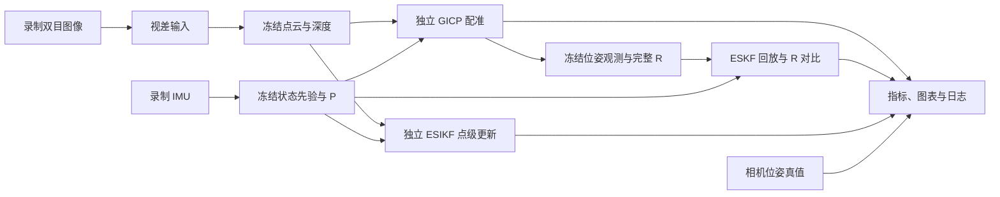

# 前端卡尔曼融合测试工作区

测试对象分为普通帧 **GICP 位姿观测 + ESKF 松耦合**，以及关键帧 **点云观测 + ESIKF 紧耦合**。静态场景保留全部有效场景点；测试目标不创建 RAFT、动态滤除线程或 3DGS 后端，也不接受后端状态反馈。相机运动和 IMU 预测仍参与测试。

2026-10-29 已修正初始 P 的轴索引与 ESKF 混合量纲阻尼问题，93 项单测通过。新增固定观测/同一 P、重传播 P、P/R 敏感性三组共 960 条对照。精度并未因此全部改善；诊断结论见 [实验记录.md 第 4 节](../../实验记录.md#4-2026-10-29-初始-p-与-eskf-求解修复)。

配准模块采用 [robotic-front main 提交 `744ac2d`](https://github.com/Ben-cpy/robotic-front/commit/744ac2d993ae629b0cc44a3b1d995e04ab4fad48)，默认欧氏 GICP；投影 Stereo-GICP 作为独立对照。算法源码和适配说明见 [registration/README.md](../../modules/registration/README.md)。版本信息随实验配置保存，升级前的结果保留原样。



## 快速开始

在项目根目录运行；脚本会为 C++ 子进程加载 `env.sh`：

```bash
python3 scripts/fusion_lab.py build
python3 scripts/fusion_lab.py test
bash scripts/build_models.sh disp
python3 scripts/fusion_lab.py run --sequence up --mode all
```

滤波构建目标为 `build/local/fusion/sio_fusion_lab`，保留 GDB 调试符号，设置 `SIO_BUILD_RUNTIME=OFF`、`SIO_BUILD_FUSION_LAB=ON`。滤波和单测本身不需要 `.plan` 或 ZED SDK。默认实验配置为 [model.yaml](configs/model.yaml)，首次运行单独调用 GPU 视差导出工具生成缓存；后续滤波进程只读取缓存。Python 报告依赖 PyYAML、OpenCV、NumPy、Matplotlib；本机已具备。

使用旧的 SGBM 调试基线时显式指定：

```bash
python3 scripts/fusion_lab.py run --config experiments/fusion/configs/baseline.yaml --sequence up --mode all
```

运行结束会打印 `report.html` 的实际路径。用本机浏览器打开该文件，可以按模块、案例、配准方法和失败状态筛选表格；PNG、SVG 和 CSV 可单独导出。全部实验的本机入口为 `artifacts/fusion/index.html`。

| 入口 | 命令 | 用途 |
|---|---|---|
| 数学和模块单测 | `python3 scripts/fusion_lab.py test --suite eskf` | 检查 R 对增益的影响、分轴不确定性、Joseph 协方差等 |
| GICP 及观测 R | `python3 scripts/fusion_lab.py run --sequence up --mode gicp` | 同一先验分别测投影 Stereo-GICP 和欧氏 small_gicp |
| ESKF 单独回放 | `python3 scripts/fusion_lab.py replay` | 读取最近已完成的 GICP 观测，改变 R，不重新配准 |
| ESIKF 独立测试 | `python3 scripts/fusion_lab.py run --sequence up --mode esikf` | 直接从相同点云和先验开始，不调用 GICP，不继承 ESKF 后验 |
| 全部独立实验 | `python3 scripts/fusion_lab.py run --sequence up --mode all` | 一次生成 GICP、ESKF、ESIKF 三组结果 |

`test --suite` 还支持 `imu`、`gicp`、`esikf`、`all`。切换数据可用 `up`、`forward`、`right`、`yaw_left`、`pitch_up`、`roll_right`；`--sequence all` 逐条测试六条序列。本机运行选择独立于 `project_config.local.yaml`，不会切换完整前端当前选用的数据。

## 目录与输入冻结

```text
experiments/fusion/
├── configs/baseline.yaml        可编辑的实验设置和固定帧对
├── configs/model.yaml           默认入口，继承基线设置并使用模型视差
├── src/                        薄实验驱动，调用项目现有算法
└── local/debug.yaml            本机调试入口，Git 忽略
scripts/fusion_lab.py            构建、运行、回放、生成调试配置
scripts/fusion_report.py         只在此处读取真值并评估
data/datasets/fr5_highspeed/      已接入的六条序列与标定
data/cache/fusion/<序列>/<哈希>/  冻结点云、深度、先验状态、完整 P
data/cache/model_disparity/      按引擎、预处理和输入哈希保存的模型视差
artifacts/fusion/<时间_序列_模式>/
├── resolved.yaml               配置快照、代码/输入/程序哈希、已完成阶段
├── params.yaml                 本次相机及算法参数快照
├── observations.yml.gz         GICP 位姿、原始协方差、对齐后的完整 R
├── eskf.yml.gz                 各组 ESKF 的完整状态、P、创新、S、K、修正量
├── esikf.yml.gz                ESIKF 状态、P、逐轮 H/R/K/残差/修正量
├── metrics.csv                 所有案例的误差、收敛和协方差指标
├── covariances.csv             位姿部分的 R、P_prior、P_result、K
├── gicp_iterations.csv          上游 Stereo 求解每轮代价、步长与 Hessian 谱
├── esikf_iterations.csv         ESIKF 每轮指标及矩阵
├── summary.json                分组 RMSE，保留有效数量与总数量
├── errors.png / errors.svg      图像对条件误差 RMSE
├── report.html                 可筛选的本地报告
└── *.log                       数据准备与各模块运行日志
```

只运行某个模块时，仅生成相应结果。原工作区的数据缓存、实验产物、本机参数均在 Git 忽略范围内。独立 GitHub 发布快照将历史结果和选定输入放入可跟踪的 `results/`，新运行仍写入 `artifacts/`；详见 [发布步骤](../../docs/PUBLISH_NEW_REPOSITORY.md)。

图像对编号使用原录制的 `source_frame_id`，不会因跳过前 60 帧或初始化而重编号。默认五组是初始静止段 `110→111`、同步摆动 `185→186`、主运动 `340→341`、较长间隔 `340→346`、结束静止段 `640→641`。可编辑 [baseline.yaml](configs/baseline.yaml)，或用 `--case main_motion` 只跑一组；多个 `--case` 可组合。

每条录制从最初保留的静止 IMU 中收集至少 200 个样本初始化，然后由实际 `ImuPreintegrationCov` 连续前推，保存所选图像时刻的状态和完整 P。每个案例独立读取同一份冻结先验；不同算法的后验不会传到下一个案例。输入缓存包含图像、IMU、配置和源码哈希，缓存文件本身也校验 SHA256，避免意外改写后继续复用。

## 怎样比较普通帧 ESKF

先检查独立配准，再检查滤波。默认不会在两种配准方法之间自动回退：Stereo-GICP 和 small_gicp 各自产生一条观测，便于看出方法差异。

1. 在 GICP 报告里检查位姿误差、对应点数、迭代次数、收敛标志及 `solver_status`、协方差是否来自 Hessian，以及 R 的特征值和旋转/平移方差。上游默认 Stereo 在 `max_iter` / `stopped_at_minimum` 时也可能置 `converged=true`，需结合逐轮日志判断；欧氏 GICP 未提供独立点距 RMSE，该字段保留为 NaN。
2. 保留完整的旋转–平移交叉项。两种配准输出的扰动约定不同，统一调用与前端共享的转换函数，将 R 对齐到 ESKF 的 `[δθ_body, δp_world]` 坐标。
3. 回放冻结的同一位姿观测、先验均值和 P，比较 `0.1R`、`R`、`10R`，以及固定对角 R。固定组默认旋转标准差 0.5°、位置标准差 0.02 m。
4. 比较实际 K、创新、正则化 S、NIS、后验 P 和对真值的误差。R 很小而 P 很大时，若干组结果接近是可能的；应一起看 P、R 和 K。

指定一次实验的观测文件可保证比较来源清楚：

```bash
python3 scripts/fusion_lab.py replay artifacts/fusion/<原实验>/observations.yml.gz \
  --scales 0.1 1 10 1000
```

控制先验不确定性的实验：

```bash
python3 scripts/fusion_lab.py replay artifacts/fusion/<原实验>/observations.yml.gz \
  --scales 0.1 1 10 --prior-scale 0.0001
```

`--prior-scale` 只缩放本次输入 P，不改变冻结均值、观测或缓存。它用于观察滤波行为，不等同于标定 IMU 过程噪声；生产积分器内的 Q 设置仍需单独检查。基线保留原始纯惯性 P。每次回放都会创建新的结果目录，并记录原观测文件哈希与当前程序/源码哈希。

对融合输入的检查包括至少 20 个对应点、有限位姿、正定 R，以及确实来自 Hessian 的协方差。失败观测保留在报告中，其 ESKF 更新标记为跳过。`require_convergence` 默认关闭，与当前前端的输入检查一致；收敛状态单独记录，也可在配置中开启严格要求。报告中的 `valid` 表示满足输入检查并产生有效数值更新，不能据此判断精度是否提升。

Stereo 参数见 `gicp.stereo_options`；点面、视差法向和源体素代表点默认关闭，与上游一致。`gicp.stereo_solver` 通过生产接口设置停止阈值与协方差地板。small_gicp 右扰动和 Stereo 左扰动的 R 分别转换到 ESKF 的混合坐标，保留完整交叉项；这一滤波适配与上游前端的统一分块旋转方式有区别，详见模块说明及有限差分单测。ESIKF 保留原独立观测工具，不调用新的 GICP 求解器。

## 怎样单独检查关键帧 ESIKF

ESIKF 使用相同图像对和 IMU 先验，从点云重新关联并建立点级观测，不使用 GICP 位姿、GICP 的 R 或 ESKF 后验。目标点云的体素、法向、颜色梯度与立体点协方差通过生产模块计算。

默认比较几何权重 `1.0`（纯几何）与 `0.5`（几何 + 光度），在配置的 `esikf.geometry_weights` 中调整。`esikf.prior_covariance_scale` 可用于独立控制 P，默认为 1。配置里写 `esikf.variants` 时改为逐个变体运行，可打开迭代先验项、锚点先验（`prior_covariance: anchor_conditioned` 或 `anchor_relative`）、观测放大、亮度与残差模型等选项；各选项、配置文件和运行顺序见 [实验记录.md 第 6 节](../../实验记录.md#6-2026-10-29-关键帧-esikf-改进-e0e7已运行) 与 [第 7 节](../../实验记录.md#7-2026-10-30-第二轮-f0f5待运行)。

重点查看 `esikf_iterations.csv`：对应点是否充足、H 是否退化、虚拟观测 R 和 K 是否合理、每轮修正是否收敛、最终 P 是否对称且半正定，以及相同先验下误差是否减少。未发生有效更新的案例保留为 `no_valid_update`。

## 视差来源

默认使用用户提供的 `models/disp.onnx`，先在本机转换为 `models/tensorrt/disp_896x448_fp16.plan`，由独立 GPU 工具导出所选帧的视差缓存。配置入口为 [model.yaml](configs/model.yaml)，固定帧对及滤波参数继承 [baseline.yaml](configs/baseline.yaml)。模型输入是与生产加载器一致的裁剪、光照处理及缩放结果，RGB、FP32、NCHW、0..255，归一化在模型图内完成。输出是 896×448 浮点像素视差；实验使用原始网络输出，不应用完整前端的局部邻域视差后处理。

视差缓存记录引擎 SHA256、图像及预处理代码哈希；更新模型或预处理会创建新缓存。只为选定帧导出，不启动 RAFT、动态滤除或后端。ESKF 回放不调用 GPU，ESIKF 继续独立读取点云。输入像素步长默认 2，记录在实验配置中。

CPU SGBM 保留为显式调试基线，用上述 `--config .../baseline.yaml` 选择。**旧 SGBM 报告和模型报告应分别查看；SGBM 的精度结论不能直接用于模型视差。**

模型视差可独立生成后缓存，无需把推理模型接到滤波测试进程：

```yaml
depth:
  provider: disparity_cache
  disparity_dir: /绝对路径/模型视差目录
  # 其余字段保留 baseline.yaml 中的设置
```

文件名为原图像时间戳毫秒，例如 `1792034776598.yml.gz` 或 `.yml`；OpenCV FileStorage 中的矩阵键为 `disparity`，浮点像素单位、大小 896×448。必须与当前裁减/缩放和内参一致；从其他分辨率重采样时，视差数值也应乘横向缩放比例。可用以下方式保存单张输出：

```python
storage = cv2.FileStorage("<timestamp_ms>.yml.gz", cv2.FILE_STORAGE_WRITE)
storage.write("disparity", disparity.astype(np.float32))
storage.release()
```

当前 Stereo-GICP 中的像素/视差噪声设置见 [registration/stereo_gicp.h](../../modules/registration/include/registration/stereo_gicp.h)，关键帧点协方差见 [feature_processor.cpp](../../src/feature_processor.cpp)。这些模型假设需要结合真实视差误差验证。

## 真值与指标的含义

原始真值是左目相机位姿。报告先取真值相对运动，再用 `T_imu_cam` 转到机体系，与估计的同一锚点相对运动比较；真值只出现在报告脚本中。时间标签保留已接入数据集的约定，详见 [FR5_DATASET.md](../../docs/FR5_DATASET.md)。

当前评估范围是**固定帧对的模块行为和条件误差**。先验来自纯惯性前推，未经连续视觉校正；关键帧对也由配置固定。完整前端的关键帧调度、逐帧后验反馈和全序列闭环轨迹属于另一层验证。图中的分组 RMSE 不表示整条轨迹 ATE。

`conditional_pose_mahalanobis` 使用同一估计锚点和相对真值作诊断；它没有计入锚点与真值的不确定性。NIS 使用实际 ESKF 正则化 S。少量、可能相关的图像对和近似的 Hessian 逆，只能帮助发现不一致，不能单独证明协方差统计校准正确。

## IDE 中使用

在 VS Code / Cursor 的“运行任务”里选择 `Fusion:` 开头的任务，可构建、跑单测、选择序列、生成 GICP 观测、回放 ESKF 或独立测试 ESIKF。默认 CMake 构建目录已指向 `build/local/fusion/`；实验构建更新 `compile_commands.json`，供 clangd 索引。

调试下拉框提供三个入口：

- `Fusion: GICP and observation covariance`
- `Fusion: ESKF frozen observations`
- `Fusion: ESIKF direct point observations`

先完成一次 GICP 或全部实验，再按 F5。启动前任务会选择最近已完成的观测集，创建新的调试结果目录，并写入本机 `local/debug.yaml`。也可手工选择来源：

```bash
python3 scripts/fusion_lab.py debug --mode eskf \
  --observations artifacts/fusion/<原实验>/observations.yml.gz
```

显式选择会保存在被 Git 忽略的 `local/selection.yaml` 中，后续 F5 继续使用这个观测来源。执行 `python3 scripts/fusion_lab.py debug --latest` 可恢复跟随最近完成的 GICP 实验。

建议断点：`StateEstimator::ESKF`、`StateEstimator::ESIKF`、`ColorICP::EstimatePoseStereoGICP`、`ColorICP::EstimatePoseGICP`。调试观察 `P_pred`、`R_obs`、`K`、`z_innov`、`delta_x`，以及 ESIKF 的 `H_obs`、`r_v`。直接进入核心算法前，缓存已准备好，便于反复单步。

默认优化构建中，部分临时变量可能被优化掉；`debug_out` 保留了实际计算的诊断矩阵。需要更完整的逐句调试时，可在加载 `env.sh` 后执行 `cmake -S . -B build/local/fusion -DCMAKE_BUILD_TYPE=Debug`，再构建；恢复速度优先的构建则改回 `RelWithDebInfo`。

完整 GPU 前端仍保留在 `build/local/gpu/`，可用 `bash scripts/build.sh gpu` 构建；`run_frontend (Debug)` 配置仍保留。滤波测试不会启动它。

## 本机验证记录（2026-10-28，升级前基线）

- 77 项单元测试通过，包括 R 缩放、分轴不确定性、Stereo-GICP 协方差坐标转换、独立 ESIKF 更新和标准 YAML 配置读取回归。
- 六条序列各五组固定帧对已完成 GICP、ESKF、ESIKF 实验，共 360 条对比记录；包括未收敛标志和精度未改善的结果。报告入口为 `artifacts/fusion/index.html`。
- 已验证固定观测回放保持同一缓存及观测哈希，同时可独立调整 P/R；图像、IMU 与真值原文件保持完整。
- 已用浮点像素视差缓存回读 SGBM 生成的两帧样本，确认点云结果一致；此项覆盖缓存接口，尚未验证模型推理。
- 原 GPU `run_frontend` 已重新编译通过；新的融合实验目标不链接 TensorRT、LibTorch 或后端光栅化库。
- GDB 已实际命中 ESKF 和 ESIKF 源码断点，并继续运行至正常结束；日志在 `build/fusion-lab-gdb.log`、`build/fusion-lab-gdb-esikf.log`。

## robotic-front main 接入验证（2026-10-28）

- 固定版本 `744ac2d993ae629b0cc44a3b1d995e04ab4fad48`。原始文件 SHA256 已核对；Stereo 核心与上游相比仅调整 include 路径并增加协方差来源诊断，求解数学及上游测试保持一致。
- 90 项单元测试全部通过，包含上游 13 项测试、配置读取、左右扰动协方差有限差分和独立滤波测试。日志：`build/robotic-front-import-test.log`。
- 六条序列各五组固定帧对重新生成观测，共 360 条记录（60 GICP、240 ESKF、60 ESIKF）；全部通过数值输入/更新检查。观测文件及代码 SHA256 一致，GICP 的 R 正定，滤波后 P 未发现负特征值越过数值容差。日志：`build/robotic-front-six-sequences.log`。
- 30 组欧氏 GICP 均报告收敛；30 组 Stereo 均为 `solver_status=max_iter`（20 轮），同时保留上游返回的 `converged=true`，没有改写求解结果。后者应按迭代耗尽检查。
- 30 组图像对汇总的条件平移 RMSE：IMU 先验 25.75 mm、欧氏 GICP 15.56 mm、Stereo 23.87 mm；条件旋转 RMSE 则从先验 0.0596° 增至 0.2445° / 0.1141°。这些结果使用 SGBM，不能视为模型视差下的精度结论，也不能因更新数值有效就认定滤波效果合格。
- 新版观测的固定回放已验证：保持同一缓存、观测 SHA256 和上游版本，`P×0.0001` 与三档 R 加固定 R 共 40 次更新有效。IDE 的本机选择已指向新版 `up` 观测，原始录制文件不改写。
- 完整 GPU 构建中的 `run_frontend`、`run_demo`、`pipeline_smoke_test` 均编译及链接通过（`build/robotic-front-runtime-build.log`）。尚缺模型，未执行依赖模型的完整前端运行测试。

新版首条实验：[up/report.html](../../results/fusion/20261028_164351_798995_up_all/report.html)；全部入口：[artifacts/fusion/index.html](../../results/fusion/index.html)。升级前的实验目录仍保留，索引以 `pre-import` 区分。

## 用户模型接入验证（2026-10-29）

- 用户原始文件为 `models/disp.onnx` 和 `models/raft_large_896x448_iter6.onnx`，哈希核对后均未改写。视差原图中的 312 次 ScatterND 写入使 TensorRT 临时空间过大；默认构建使用经过验证的 Pad/Concat 派生图。104 个视差平面的原始与派生子图在固定随机 FP16 特征输入上最大绝对误差为 0，保持原始相关计算、完整左特征平面及 FP32→FP16 边界。证据在 `models/onnx/disp_cost_volume.verified.json`，脚本见 [prepare_disp_onnx.py](../../scripts/prepare_disp_onnx.py)。
- 本机生成约 728 MiB 视差引擎和约 21 MiB RAFT 引擎，TensorRT 10.14.1、FP32 I/O、FP16 内部计算，workspace 上限 3 GiB、优化级别 0。再次运行构建命令命中相同 ONNX/构建指纹，不重新编译。`bash scripts/check_env.sh gpu` 已识别两个 `.plan`，日志为 `build/model-final-env-check.log`。
- 六条序列共导出 54 帧模型视差，896×448、像素单位，所选帧全部为有限正值。推理耗时中位数约 607 ms/帧（此调试引擎、默认 CUDA stream），使用缓存避免滤波调参时重复推理；此结果不代表实时性能。
- 模型视差下完成 360 条记录：60 GICP、240 ESKF、60 ESIKF，全部通过数值输入/更新检查；R 正定，后验 P 未超出负特征值容差，源码、图像、IMU、缓存视差和观测哈希均核对一致。30 组欧氏 GICP 报告收敛，30 组 Stereo 仍达到 20 次迭代上限。日志为 `build/model-six-sequences.log`。
- 30 组图像对汇总的条件平移 RMSE：IMU 先验 25.75 mm、欧氏 GICP 18.89 mm、Stereo 22.02 mm；条件旋转 RMSE：先验 0.0596°、欧氏 GICP 0.4757°、Stereo 0.1473°。模型视差并未带来所有指标改善，更新数值有效仍不等于精度合格；应继续检查配准与观测协方差。
- 原模型观测固定回放的 40 组后验位姿与完整 P 均可重复（绝对容差 `1e-12`），保持相同缓存/观测/引擎哈希。IDE 固定选择已更新为本次 `up` 观测；GICP、ESKF 和 ESIKF 断点测试继续从冻结数据开始。
- RAFT 六轮输出形状为 `1×2×448×896`，已验证实际读取最后一轮 `2206` 且输出有限。无纹理黑图自匹配的最大流约 33.34 px，此项仅检查推理接口，不作为光流精度验收；当前融合实验不启用 RAFT 或动态滤除。日志为 `build/raft-model-smoke.log`。完整 SLAM 与后端仍未在本次执行。

模型实验入口：[up/report.html](../../results/fusion/20261029_103507_280291_up_all/report.html)，其余五条及旧 SGBM 报告均在 [报告索引](../../results/fusion/index.html) 中。模型报告显示 `TensorRT model cache`，并记录原始 ONNX、派生图验证及引擎 SHA256。默认执行：

```bash
python3 scripts/fusion_lab.py run --sequence up --mode all
```
