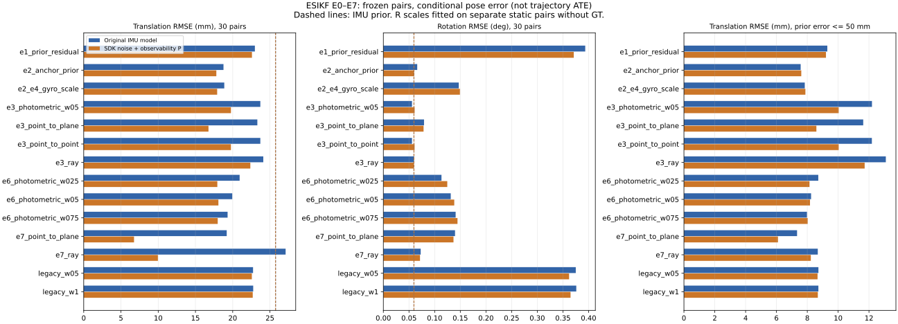

# ESIKF E0–E7 实验结果（2026-10-29）

实测代码：`b9804c77a503dc1f4891b1ddc263870f04efb8b5`。只修复两处 GTest 宏对 Eigen 模板逗号的解析，未改滤波算法。111 项单测通过。环境为 RTX 4060 Laptop 8 GB、CUDA 12.9、TensorRT 10.14.1、ROS Humble；完整版本记录见 [环境日志](logs/esikf-environment.log)。

先读本页和 [实验记录](../../../实验记录.md)，无需运行程序即可审阅。来源、完整配置、输入文件/模型/程序哈希在各次 `resolved.yaml` 和 [MANIFEST.json](MANIFEST.json)。

- 静止标定：6 序列 × 11 帧对 × 6 变体 = 396 条。原始帧 96–150；不含评估帧对。每模型的 66 次纯观测结果按预设均值法标定，无 GT 调参。
- 主对照：6 序列 × 5 帧对 × 14 变体 = 420 条。
- 先验模型对照：相同 30 帧对、14 变体 = 420 条；只换 SDK 噪声和可观性初始 P，先验误差与主对照完全相同。
- 共 1236 条有效更新；“有效”包括达到迭代上限及对应点丢失后的部分更新，不等于收敛。三阶段收敛数分别为 178/396、298/420、286/420。
- 每个帧对独立运行，后验不传递给下一组；报告的是以锚点为条件的相对误差，不是轨迹 ATE。场景静止，但主评估包含相机运动。没有运行新的普通帧 ESKF/GICP 对照、动态滤波、RAFT 或后端。

## 主对照（全部预设变体）

IMU 先验：25.754 mm / 0.0596117°。每格均为相同 30 帧对的条件 RMSE。

| 变体 | 原先验平移 mm | 原先验旋转 ° | 新先验模型平移 mm | 新先验模型旋转 ° |
|---|---:|---:|---:|---:|
| `legacy_w1` | 22.751 | 0.37600 | 22.688 | 0.36481 |
| `legacy_w05` | 22.731 | 0.37502 | 22.569 | 0.36201 |
| `e1_prior_residual` | 22.977 | 0.39346 | 22.584 | 0.37113 |
| `e2_anchor_prior` | 18.762 | 0.06604 | 17.802 | 0.05997 |
| `e2_e4_gyro_scale` | 18.868 | 0.14702 | 17.914 | 0.14925 |
| `e6_photometric_w075` | 19.313 | 0.14090 | 17.989 | 0.14454 |
| `e6_photometric_w05` | 19.940 | 0.13137 | 18.080 | 0.13821 |
| `e6_photometric_w025` | 20.930 | 0.11332 | 17.937 | 0.12461 |
| `e7_ray` | 27.103 | 0.07282 | 9.958 | 0.07145 |
| `e7_point_to_plane` | 19.196 | 0.13972 | 6.753 | 0.13673 |
| `e3_point_to_point` | 23.708 | 0.05585 | 19.764 | 0.06093 |
| `e3_photometric_w05` | 23.709 | 0.05585 | 19.766 | 0.06102 |
| `e3_ray` | 24.105 | 0.05983 | 22.366 | 0.05957 |
| `e3_point_to_plane` | 23.308 | 0.07931 | 16.749 | 0.07838 |

- 原先验 `e3_point_to_point`：23.708 mm / 0.0558466°，比 IMU 分别低约 7.94% / 6.32%。`e3_photometric_w05` 几乎相同，不能据此认定光度带来改进。
- 新先验模型 `e7_point_to_plane` 平移最低（6.753 mm），旋转为 0.136725°，约为 IMU 的 2.29 倍。它不是同时改善两项的配置。
- 原先验 `e2_anchor_prior` 为 18.762 mm / 0.0660369°；加入预设 1.5% 陀螺刻度项后旋转变为 0.147020°。本数据不支持直接采用该刻度值作为更优默认值。
- 新先验模型 `e3_ray` 为 22.366 mm / 0.0595714°，旋转只比 IMU 低约 0.00004°；其纯观测版本发散，不能把这点微小差别解释为 ray 观测可靠。

## 观测协方差标定与静止段

| 纯观测模型 | 旋转 R 倍数 | 平移 R 倍数 | 样本数 |
|---|---:|---:|---:|
| `obs_photometric_w05` | 27.37 | 29.64 | 66 |
| `obs_point_to_plane` | 49.27 | 30.15 | 66 |
| `obs_point_to_point` | 54.75 | 59.16 | 66 |
| `obs_ray` | 88.53 | 87.35 | 66 |

| 静止段变体 | 平移 RMSE mm | 旋转 RMSE ° | 停止状态 |
|---|---:|---:|---|
| `e2_e4_gyro_scale` | 2.291 | 0.03048 | converged:60 max_iterations:6 |
| `legacy_w1` | 6.406 | 0.15182 | converged:65 max_iterations:1 |
| `obs_photometric_w05` | 7.270 | 0.17878 | converged:22 max_iterations:44 |
| `obs_point_to_plane` | 11.241 | 0.38937 | converged:10 max_iterations:56 |
| `obs_point_to_point` | 7.266 | 0.17928 | converged:21 max_iterations:45 |
| `obs_ray` | 1361.971 | 123.24002 | correspondences_lost:66 |

`obs_ray` 的 66 次记录全部是 `correspondences_lost`，它们在已有一次更新后丢失对应点，因此仍被程序标为 valid=1，并按原脚本进入均值标定。该标定项必须作为失败观测模型的诊断对照，不应直接用于部署；本轮没有事后删掉这些样本或改选中位数。

点对点和光度纯观测也分别有 45/66、44/66 次达到 8 轮上限；标定样本并非全部收敛。均值与中位数估计均保存在已提交的 `esikf_calibrated.yaml` 中。

## 协方差与离群样本

- `legacy_w1/w05` 对旧归档的 60 次更新逐矩阵核对：1080 组 anchor/prior/result 矩阵最大绝对差 1.18e-14，见 [基线核对](logs/esikf-legacy-validation.json)。
- 原先验 `e3_point_to_point` 后验白化均值（旋转/平移）约 24.47/225.50；新先验模型约 25.84/25.65。平移一致性改善，但仍远离 1，不能宣布 P/R 已标定正确。静止观测 R 标定不能代替运动场景、先验 P 和时间相关性的验证。
- 主评估只有 `roll_right/static_end` 的先验平移误差超过预设 50 mm 门限。原先验 `e3_point_to_point` 在其余 29 对上的平移 RMSE 为 12.187 mm；新先验模型 `e7_point_to_plane` 为 6.097 mm。完整/去标记/中位数及逐帧结果均保留，没有删除该异常对。
- 原先验主对照中有 55 条完整 21×21 后验的最小特征值略小于零，最小约 -6.24e-10（均为锚点条件先验变体）；先验模型对照最小值约 2.44e-11。应继续检查 Schur 条件化与数值正定性；本轮未改算法来掩盖该现象。

## 文件怎么读

| 文件 | 内容 |
|---|---|
| [summary.csv](summary.csv) | 34 组汇总；全量/去标记 RMSE、中位数、改善计数、白化误差和收敛统计 |
| [metrics.csv.gz](metrics.csv.gz) | 1236 条逐帧指标，包含阶段、序列和执行目录 |
| [validation.json](validation.json) | 数量、状态、离群标记、数值协方差检查 |
| runs/*/metrics.csv、resolved.yaml、params.yaml | 每次执行原始指标和完整参数、版本与哈希 |
| runs/*/covariances.csv | 每次更新的完整 6×6 R、先验和后验位姿 P |
| runs/*/last_iteration.csv | 每个变体最后有效迭代的 H、R、K_pose 及收敛量 |
| runs/*/iteration_trace.csv | 每一轮对应点数、改正量、离先验偏移和最小信息特征值 |
| runs/*/report.html、errors.png/svg | 分序列可视化 |
| runs/*/cache_provenance/ | 冻结输入和实际视差输出的逐文件哈希 |
| logs/ | 三阶段执行、标定、构建和测试日志，含测试宏编译失败及修正补丁 |
| [SHA256SUMS](SHA256SUMS) | 本次审阅包的独立校验；不会覆盖首次发布快照 |

分序列 HTML 的迭代入口已改为本包中的逐轮轨迹与末轮 H/R/K_pose；原始数值 CSV 保持不变。

本审阅包保留所有指标、最终位姿矩阵与逐轮标量记录；原始 21 维状态转储及每轮完整矩阵仍在本机 `artifacts/fusion/`，其位置、大小及 SHA256 已写入 MANIFEST。原始点云、132 帧新增静止视差和模型权重未重复上传。需要完整矩阵归档时，可用 `scripts/archive_esikf_results.py --full-matrices` 生成另一份目录，旧结果保持不变。

可从本目录校验：`sha256sum -c SHA256SUMS`。按 [MANIFEST.json](MANIFEST.json) 定位各个原始执行；绝对路径是执行来源记录，CSV 的 `run` 列和归档路径可跨机器定位。
