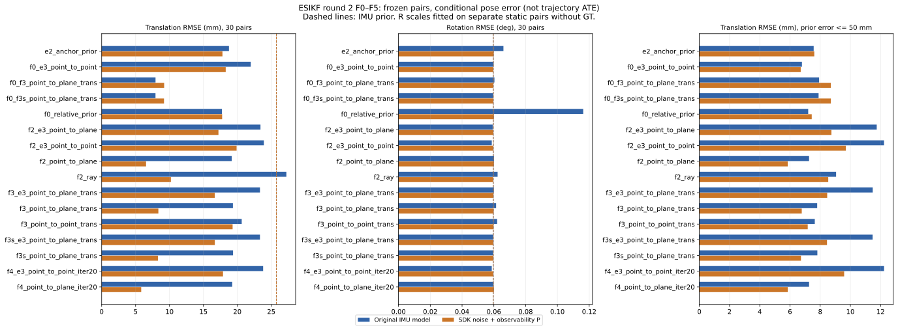

# ESIKF 第二轮 F0–F5（2026-10-30）

实测滤波代码：`1b88c05e0496f8e8790f79a26f857c7c5e54bf35`，未作本地算法改动；115 项单测通过。环境为 RTX 4060 Laptop 8 GB、驱动 595.99.02、CUDA 12.9、TensorRT 10.14.1、ROS Humble，见 [环境日志](logs/round2-environment.log)。本次提交另外增加报告派生、矩阵审计及归档支持，滤波源码保持实测版本。

6 条 FR5 高速录制，静态场景、相机运动。数据与时间/坐标约定见 [实验记录](../../../实验记录.md) 和 [数据说明](../../../docs/FR5_DATASET.md)。视差来自用户 ONNX/TensorRT 模型。每组固定帧对独立运行，后验不传递，报告为估计锚点参照下的相对误差，不能当作轨迹 ATE。没有新增普通帧 GICP/ESKF、RAFT、动态滤波或后端实验。

| 阶段 | 设计 | 有效更新 | 收敛 | 达到上限 |
|---|---|---:|---:|---:|
| 静止标定 | 6 序列 × 11 帧对 × 2 纯观测模型，20 轮 | 132/132 | 90 | 42 |
| 原先验主对照 | 6 序列 × 5 帧对 × 16 变体 | 480/480 | 341 | 139 |
| SDK 先验对照 | 同样的 30 帧对与 16 变体，只换噪声和初始 P | 480/480 | 323 | 157 |

共 **18 次运行、1092 条记录**。有效更新包括达到迭代上限，不能理解成全部收敛。静止标定帧对与评估帧对不同，但来自相同 6 条录制，不是跨序列独立验证；同一录制内帧对和 F5 窗口高度相关。

## 全部预设变体

IMU 先验：25.754 mm / 0.0596117°；每格为相同 30 对的 RMSE，未事后删除异常帧对。

| 变体 | 原先验平移 mm | 原先验旋转 ° | SDK 先验平移 mm | SDK 先验旋转 ° |
|---|---:|---:|---:|---:|
| `e2_anchor_prior` | 18.762 | 0.066037 | 17.802 | 0.059966 |
| `f0_relative_prior` | 17.725 | 0.116232 | 17.757 | 0.060064 |
| `f2_point_to_plane` | 19.170 | 0.060115 | 6.543 | 0.060087 |
| `f2_ray` | 27.221 | 0.062362 | 10.204 | 0.059444 |
| `f3_point_to_point_trans` | 20.641 | 0.062084 | 19.300 | 0.059821 |
| `f3_point_to_plane_trans` | 19.345 | 0.061423 | 8.359 | 0.059881 |
| `f0_f3_point_to_plane_trans` | 7.940 | 0.060373 | 9.211 | 0.059613 |
| `f3s_point_to_plane_trans` | 19.365 | 0.059612 | 8.293 | 0.059612 |
| `f0_f3s_point_to_plane_trans` | 7.935 | 0.059612 | 9.189 | 0.059612 |
| `f4_point_to_plane_iter20` | 19.241 | 0.059837 | 5.831 | 0.060078 |
| `f2_e3_point_to_point` | 23.904 | 0.058702 | 19.889 | 0.059566 |
| `f0_e3_point_to_point` | 21.974 | 0.059863 | 18.285 | 0.059613 |
| `f2_e3_point_to_plane` | 23.406 | 0.059255 | 17.214 | 0.059706 |
| `f3_e3_point_to_plane_trans` | 23.331 | 0.060041 | 16.672 | 0.059736 |
| `f3s_e3_point_to_plane_trans` | 23.329 | 0.059612 | 16.677 | 0.059612 |
| `f4_e3_point_to_point_iter20` | 23.800 | 0.058692 | 17.884 | 0.059549 |

## 结果说明

1. **F0 修正了评价参照对应的先验量级，但不能自动修正观测。** 原先验的旋转/平移先验白化均值从 E2 的 168.32/201.55 降为 4.02/3.66；单独 F0 仍为 17.725 mm / 0.116232°，旋转比 IMU 差。SDK 模型 F0 的平移白化为 0.379、旋转仍为 152.05，说明更换噪声与评价参照没有覆盖运动相关的旋转误差，不能宣布 P 已校准。
2. **F3s 保持旋转，F3 仍有间接旋转更新。** 原先验 F0+F3 为 7.940 mm / 0.060373°，F0+F3s 为 7.935 mm / 0.059612°。SDK 模型的 F3s 点到面为 8.293 mm / 0.059612°，加 F0 后为 9.189 mm / 0.059612°，并非每次加 F0 都会提高精度。冻结旋转后的旋转结果等于先验是设计约束，不是视觉改进了旋转。
3. **去掉 E4 后，点到面旋转明显改善；最低平移仍有旋转代价。** SDK 点到面 8 轮为 6.543 mm / 0.060087°，第一轮含 E4 时为 6.753 mm / 0.136725°。20 轮为本轮预设变体中的最低平移 5.831 mm，旋转为 0.060078°，比 IMU 高约 0.78%；不能按最低平移直接选为系统默认配置。SDK 点对点标定 20 轮为 17.884 mm / 0.059549°，两项均低于先验，但后验白化仍不一致。
4. **更多迭代带来更多收敛，不保证精度更好。** 静止纯观测点对点收敛 21→52/66、点到面 10→38/66；零运动 RMSE 却分别从 7.266 mm / 0.17924° 变为 8.615 mm / 0.25240°，从 11.241 mm / 0.38939° 变为 12.210 mm / 0.42296°。原先验点到面 20 轮收敛 29/30（8 轮 26/30），平移 19.241 mm 略差于 19.170 mm；SDK 则从 6.543 降至 5.831 mm。停止条件只判定步长，不证明配准准确。
5. **NIS 接近 1 不等于 P、R 各自正确。** SDK 的 F0+F3s NIS/自由度约 1.15，但先验旋转白化仍为 152；原先验 F0+F3s 的 NIS 为 11.74、后验旋转/平移白化为 4.02/31.37。SDK 的最低平移变体后验白化为 258.80/16.03。P/R 的量级、偏差和相关性仍需分开诊断。
6. **离群与数值问题保留在结果中。** 唯一预设标记仍是 roll_right/static_end（IMU 先验约 120 mm）。原先验 F0+F3s 在其余 29 对上为 7.895 mm，E2 为 7.570 mm，说明总 RMSE 的改善不能解释为每一对均改善。原先验的条件化变体仍有 60 条完整后验最小特征值为负，最小 −6.24e−10；第二轮变体数不同，不能直接用 60 对第一轮 55 判断稳定性变化。240 条 F0 记录无负特征值，最小约 1.34e−11；SDK 全部变体无负特征值。

## 静止 R 标定

| 纯观测模型 | all / usable 样本 | 收敛样本 | all=usable 均值 旋转/平移 | all=usable 中位数 | 收敛样本均值 | 收敛样本中位数 |
|---|---:|---:|---:|---:|---:|---:|
| 点对点 | 66 / 66 | 52 | 111.2 / 83.18 | 32.99 / 37.31 | 34.37 / 54.88 | 23.86 / 23.11 |
| 点到面 | 66 / 66 | 38 | 58.43 / 35.92 | 40.26 / 21.46 | 48.06 / 29.13 | 29.14 / 16.61 |

本轮无失败状态被排除，all 与 usable 相同；usable 按预定规则保留 max_iterations。点对点最大的 6 个旋转白化误差占总和约 61.9%。采用预设 usable 均值法，不根据评估真值改成中位数或仅用收敛样本。倍数是协方差的倍数，不是标准差的倍数；精确来源、三组统计及所有 16 个变体保存在 [生成配置](../../../experiments/fusion/configs/esikf_round2_calibrated.yaml)。

## 协方差与检查

逐变体先验/后验白化、NIS、超出 95% 分位比例见 [协方差诊断表](COVARIANCE_DIAGNOSTICS.md)，完整均值/中位数、去标记 29 对结果和状态见 [summary.csv](summary.csv)。NIS 不用真值，先验/后验白化用真值；不可观方向按报告阈值从 NIS 自由度中移除，不能把所有记录都按 6 自由度解释。

- 115 项单测通过；先前的 20 条运行检查只作预检，不计入 1092 条正式记录。
- 与第一轮比较，60 条 E2 的结果位姿最大绝对差 1.33e−15，先验 P 差 0，后验 P 最大差 1.33e−17。两种噪声模型、所有变体的先验位姿均值与第一轮相同，IMU 基准仍为 25.754 mm / 0.0596117°。
- 240 条 F0 的完整 21×21 先验按估计位姿构造 J 并重建，最大绝对差 0；180 条 F3s 的旋转矩阵及旋转协方差块变化均为 0。
- 各次源码、输入、冻结点云和视差的文件哈希经归档脚本校验。第一轮原始审阅包校验全部通过，新增 NIS 写在独立派生目录，没有改写旧记录。

## 第一轮 NIS 与 F5

[第一轮派生汇总](round1_nis/summary.csv) 包含原有 1236 条记录的新 NIS/先验白化，详见 [派生来源](round1_nis/PROVENANCE.json)，位姿误差最大变化为 0。原始 C++ 仍为 b9804c7，报告处理使用 1b88c05；它们不计作第二轮新运行。原先验 E2 的 NIS/自由度为 14.00，第一轮 E3 点对点约 0.430，先验白化仍远大于 1。

[F5 汇总](imu_rotation/summary.json) 与复核记录一致：坐标系旋转 0.4810°，尺度特征值偏差 −1.574%/−1.005%/−0.179%；1 帧窗口 3812 个、6 帧窗口 3782 个。6 帧窗口 RMS 原始 0.0435°，拟合 0.0248°，时间对半验证 0.0270°；残余偏移 +1 ms 只有很小改善。该拟合使用真值，只作系统误差诊断，没有将 A 用于先验，也不能区分 IMU 外参与真值手眼标定的误差。跨时间验证不等于独立标定数据验证。

## 审阅入口

| 文件 | 内容 |
|---|---|
| [MANIFEST.json](MANIFEST.json) | 实测提交、18 次运行、模型/缓存身份、报告源码哈希、未上传的大矩阵文件位置与哈希 |
| [summary.csv](summary.csv)、[metrics.csv.gz](metrics.csv.gz) | 34 组汇总与全部 1092 条指标 |
| runs/*/report.html、errors.png/svg | 每条序列的逐对筛选与可视化 |
| runs/*/resolved.yaml、params.yaml | 实际完整配置和输入/二进制/源码哈希 |
| runs/*/covariances.csv | 每条最终 6×6 R、先验 P、后验 P |
| runs/*/last_iteration.csv、iteration_trace.csv | 最后一轮 H/R/K_pose 与所有迭代标量轨迹 |
| [矩阵审计](audit/validation.json)、[逐条审计](audit/matrix_checks.csv) | 完整 21 维特征值、F0 重建、F3s 冻结与第一轮 E2 基准检查 |
| [静止 8→20 轮逐对比较](audit/calibration_comparison.csv) | 132 条成对停止状态和零运动误差/白化 |
| round1_nis/ | 第一轮新诊断的 1236 条指标、汇总及来源哈希 |
| imu_rotation/ | F5 汇总、7594 条窗口指标压缩 CSV 及来源 |
| logs/ | 115 项单测、标定、全部正式运行、诊断与环境日志 |
| [SHA256SUMS](SHA256SUMS) | 仅针对本次结果包，按文件字节校验 |

归档保留最终 P/R/K 和所有迭代轨迹，原始 21 维转储和每轮完整矩阵保留本机并记录 SHA256；原始图像、点云和模型权重没有重复上传。运行命令见 [实验记录第 7 节](../../../实验记录.md#7-2026-10-30-第二轮-f0f5已运行)。

新增分析入口：`scripts/derive_esikf_metrics.py` 独立派生旧指标，`scripts/audit_esikf_round2.py` 审计已完成的矩阵，`scripts/archive_esikf_results.py --config ...` 生成本轮审阅包。它们不调参或修改滤波结果。从本目录执行 `sha256sum -c SHA256SUMS` 可校验发布包。
