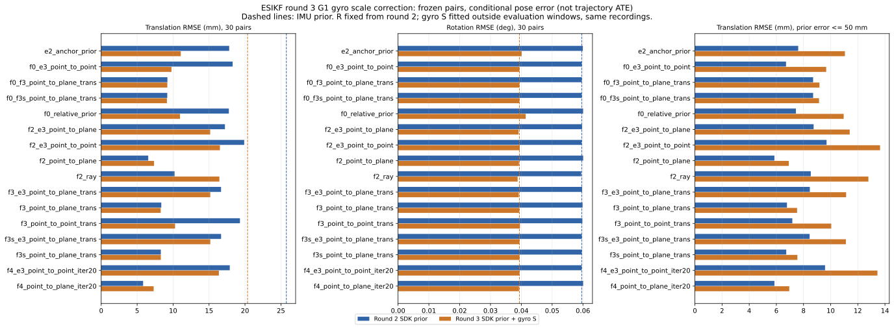

# 第三轮 G1 陀螺刻度校正与末轮 NIS（2026-10-30）

实测代码 **`8f2355077f1d583b4c2699a62d8dabd017e57899`**，未作本地滤波算法修改；116 项单测通过。6 条 FR5 高速录制、30 个固定帧对、沿用第二轮全部 16 个变体和静止 R 标定，共 **6 次运行、480 条记录**。环境见 [日志](logs/round3-environment.log)，实验定义见 [实验记录](../../../实验记录.md)。

本轮的唯一实验因素是在 IMU 预处理后、积分前应用固定的 `ω′=Sω`。S 是离线拟合 A=XS 的对称部分；原始双目观测不变。第二轮对照的 C++ 是 `1b88c05`，本包用 `8f23550` 报告脚本补算其末轮 NIS，未重跑 C++ 或改写旧归档。

## 先验与全部变体

| IMU 先验 | 全 30 对平移 mm | 全 30 对旋转 ° | 同一未标记 29 对平移 mm |
|---|---:|---:|---:|
| 第二轮 SDK | 25.754 | 0.059612 | 13.738 |
| 第三轮 SDK + S | 20.354 | 0.039396 | 16.860 |

| 变体 | 第二轮 SDK 平移 mm | 第二轮旋转 ° | G1 平移 mm | G1 旋转 ° |
|---|---:|---:|---:|---:|
| `e2_anchor_prior` | 17.802 | 0.059966 | 11.070 | 0.040126 |
| `f0_relative_prior` | 17.757 | 0.060064 | 10.960 | 0.041421 |
| `f2_point_to_plane` | 6.543 | 0.060087 | 7.348 | 0.039235 |
| `f2_ray` | 10.204 | 0.059444 | 16.437 | 0.038809 |
| `f3_point_to_point_trans` | 19.300 | 0.059821 | 10.274 | 0.039573 |
| `f3_point_to_plane_trans` | 8.359 | 0.059881 | 8.277 | 0.039329 |
| `f0_f3_point_to_plane_trans` | 9.211 | 0.059613 | 9.197 | 0.039382 |
| `f3s_point_to_plane_trans` | 8.293 | 0.059612 | 8.295 | 0.039396 |
| `f0_f3s_point_to_plane_trans` | 9.189 | 0.059612 | 9.143 | 0.039396 |
| `f4_point_to_plane_iter20` | 5.831 | 0.060078 | 7.298 | 0.039244 |
| `f2_e3_point_to_point` | 19.889 | 0.059566 | 16.513 | 0.039495 |
| `f0_e3_point_to_point` | 18.285 | 0.059613 | 9.772 | 0.039380 |
| `f2_e3_point_to_plane` | 17.214 | 0.059706 | 15.161 | 0.039114 |
| `f3_e3_point_to_plane_trans` | 16.672 | 0.059736 | 15.173 | 0.039179 |
| `f3s_e3_point_to_plane_trans` | 16.677 | 0.059612 | 15.178 | 0.039396 |
| `f4_e3_point_to_point_iter20` | 17.884 | 0.059549 | 16.370 | 0.039397 |

## 如何解释

1. **G1 的主要收益来自先验旋转，而非视觉旋转更新。** IMU 先验旋转 RMSE 从 0.0596117° 降至 0.0393956°（−33.9%）；main_motion 从 0.037271° 降至 0.027311°，main_motion_long 从 0.126403° 降至 0.081776°。G1 点到面 8 轮为 0.039235°，只比校正后的先验低约 0.4%；F3s 的 0.039396° 等于校正后的先验，是冻结旋转的设计结果。
2. **先验平移并非全面改善。** 全 30 对从 25.754 降至 20.354 mm，主要来自 roll_right/static_end 的 120.105→64.689 mm；同一其余 29 对反而从 13.738 升至 16.860 mm。main_motion_long 先验平移从 25.199 升至 27.445 mm；G1 改变姿态传播及其对位置的影响，不能只从旋转改善推断平移也会改善。
3. **点到面在旋转上改善、平移上退化。** 8 轮从第二轮 6.543 mm / 0.060087° 变为 7.348 mm / 0.039235°；20 轮从 5.831 mm / 0.060078° 变为 7.298 mm / 0.039244°。在相同未标记 29 对上，20 轮平移也从 5.857 升至 6.950 mm，退化不只来自那一异常对。pitch_up/static_end 的平移 16.134→23.335 mm；20 轮的 roll_right/static_end 为 5.030→14.041 mm。现有数据没有支持“G1 加上点到面后两项都优于第二轮”的结论。
4. **不同变体的收益不同，完整保留对照。** E2 点对点从 17.802 mm / 0.059966° 变为 11.070 mm / 0.040126°；F0+标定点对点从 18.285 mm / 0.059613° 变为 9.772 mm / 0.039380°；F3s 点到面平移几乎不变（8.293→8.295 mm）。ray 旋转 0.038809° 是本轮预设变体中最低，但平移 10.204→16.437 mm，且历史纯观测 ray 失效，不能按微小旋转优势选默认配置。
5. **剩余 P/R 不一致仍很大。** E2 先验旋转白化 216.20→105.55，F0 为 152.05→75.82，仍远大于 1。G1 点到面 20 轮后验旋转/平移白化为 126.77/26.60，末轮 NIS/自由度为 11.46；80% 的记录超过对应自由度的 95% χ² 分位。F0+F3s 末轮 NIS 为 1.40，先验旋转白化仍为 75.82，不能用 NIS 接近 1 推断 P/R 各自正确。
6. **末轮 NIS 的变化依赖变体。** 在第二轮 SDK 旧矩阵上，标定点对点为 0.255→0.596（首轮→末轮），F3 点对点平移观测为 6.05→28.88；但 E2 为 12.88→10.45，点到面为 10.83→10.73，F0 点对点为 11.68→7.67。因此末轮 NIS 并非总更大，更不能统一按“偏小一个数量级”修正。首末轮使用不同关联、R 和可能不同的可观方向，末轮又在使用过同批观测后计算，χ² 比例仍只作诊断。

## 标定与验证

G1 已在 Linux 复算，S 的 9 个系数及拟合元数据与已提交配置完全一致。2167 个 6 帧窗口距每个评估帧对至少 1 s；S 特征值偏差 −1.5382% / −1.2725% / −0.2649%；未施加的 X 为 0.4390°。评估附近留出的 1615 个 6 帧窗口，零偏模型残差 0.0489°→应用 S 后 0.0371°；1495 个 1 帧窗口为 0.0228°→0.0220°。这些是窗口拟合诊断，与长时间惯性先验的 30 对结果分开报告。见 [拟合结果](gyro_fit/summary.json)、[提交配置](gyro_fit/committed_config.yaml)、[本机重算配置](gyro_fit/recomputed_config.yaml) 和 [来源](gyro_fit/PROVENANCE.json)。两份配置的 extends 路径不同，因为核对文件生成于 /tmp，矩阵及拟合元数据相同；实际运行使用仓库内原配置。

- 116 项单测通过；6 次正式运行，30 帧对 × 16 变体 = 480 条，全部 valid=1，其中 319 次收敛、161 次达到迭代上限；没有对应点丢失或数值失败。
- 54 个相同输入帧的视差、深度、XYZRGB 点云与第二轮逐元素完全一致；帧对、16 个变体、SDK 噪声及 R 标定保持相同，配置只增加固定的 gyro_correction。
- 120 条 F0 先验用估计位姿重建核对；90 条 F3s 的旋转矩阵和旋转协方差块均保持先验。完整 21×21 后验无负特征值，最小约 2.44e−11。
- 首轮/末轮 NIS 及旋转、平移分块使用独立 Cholesky 白化核对：2338 项有限诊断通过，最大缩放绝对差 2.56e−7；不可观分块按自由度为 0 记录，不作有限值检验。
- 第二轮 1092 条旧记录新增末轮 NIS，原位姿误差与首轮 NIS 最大变化均为 0；它们是派生报告，不是第三轮重跑。第一、第二轮原归档保持完整。

## 审阅入口

| 文件 | 内容 |
|---|---|
| [MANIFEST.json](MANIFEST.json) | 实测提交、6 次原执行、源码/模型/缓存/二进制身份和省略的大矩阵哈希 |
| [summary.csv](summary.csv)、[metrics.csv.gz](metrics.csv.gz) | 第三轮 16 组汇总与 480 条逐对指标 |
| [comparison_summary.csv](comparison_summary.csv)、[全部变体表](ALL_VARIANTS.md) | 两轮 SDK 32 组汇总，第二轮使用新报告派生的末轮 NIS |
| [协方差与 NIS](COVARIANCE_DIAGNOSTICS.md) | 全部变体的先验/后验白化、首末轮 NIS 与 95% 诊断比例 |
| [先验分组](prior_by_case.csv)、[先验完整/去标记](prior_summary.csv)、[融合分组](fusion_by_case.csv) | 5 类案例各 6 对，区分先验变化与融合收益 |
| [共同未标记对照](shared_unflagged_summary.csv)、[逐对比较](audit/paired_comparison.csv) | 两轮相同 29 对与全部 30 对的检查依据 |
| [矩阵审计](audit/validation.json)、[逐条矩阵](audit/matrix_checks.csv)、[视觉输入核对](audit/visual_input_checks.csv) | 全部 21 维后验、F0/F3s 与独立 NIS 检查 |
| runs/*/resolved.yaml、params.yaml、metrics.csv | 每次执行的配置快照、输入与源码哈希、逐对数值 |
| runs/*/covariances.csv、last_iteration.csv、iteration_trace.csv | 最终 6×6 P/R、末轮 H/R/K_pose 和全部迭代标量 |
| runs/*/report.html、errors.png/svg | 分序列报告与图表 |
| round2_final_nis/ | 第二轮 1092 条指标的派生报告、34 组汇总及来源哈希 |
| logs/、[publication_checks.json](publication_checks.json)、[SHA256SUMS](SHA256SUMS) | 测试、正式运行、标定、报告与环境日志，以及发布校验 |

本包保留审阅所需的全部指标、最终 P/R/K 和每轮标量，原始全状态/逐轮矩阵转储保留本机，其位置和 SHA256 见 MANIFEST；没有重复上传原始图像、点云或权重。可从本目录执行 `sha256sum -c SHA256SUMS`。

## 适用范围与下一步

- S 用同一 6 条录制中的真值拟合，虽排除了每个评估帧对前后 1 s 的窗口，但不构成独立录制验证；长时间 IMU 先验还共享这些录制的传播历史，帧对和窗口也不是独立样本。
- 仅应用 S；坐标系旋转 X 和离线拟合的序列残余零偏 c 都未施加。S 可能吸收真值手眼标定、机械臂或时间模型的部分误差，不能单凭本轮确认硬件刻度误差的全部来源。
- SDK 标量噪声参数沿用第二轮，没有另行把 S 的标定不确定度传播进 P，也未单独验证校正后的噪声模型。因此不能把精度改善解释成协方差已校准。
- 评估为固定帧对的估计锚点参照误差；后验不回写，结果不是完整轨迹 ATE。没有运行特征预实验、分格刀切法、动态滤波、RAFT、普通帧 GICP/ESKF 或后端，这些属于后续步骤。

先复核 G1 的旋转收益与平移退化，再按原计划做稀疏特征预实验及随帧变化的 R；本轮未据结果改调标定倍数或切换默认配置。完整流程与后续议题见 [实验记录第 8、9 节](../../../实验记录.md#8-2026-10-30-第三轮-g1-陀螺刻度校正与末轮-nis已运行)。
